# Chatbot Agent Harness: Production Architecture

Nov 3, 2026 · @Aditya Acharya

## Overview: the harness owns everything except thought

The model produces three things only: a plan, a structured tool or delegation request, and user-facing text. Every other concern (executing the request, deciding whether it is allowed, persisting what happened, paying for it, showing it to a person, recovering when it fails) is owned by the harness and is implemented as deterministic, testable, vendor-neutral services. This split is the single design rule from which the 15 sections below follow.

| Concern | Owner | Why it belongs there |
| --- | --- | --- |
| Reasoning, planning, tool selection, phrasing | LLM | Needs judgement; non-deterministic by design |
| Execution of tools, plugins, delegations | Harness | Must be sandboxed, retried, audited |
| Authorization and policy | Harness (policy gateway) | Cannot trust a probabilistic component to self-police |
| State, checkpoints, trajectory log | Harness | Needs durability, replay, rollback |
| Memory tiers and retrieval | Harness | Permission-aware, lifecycle-managed, evaluable |
| Context assembly and budgets | Harness | Token economics and leakage prevention are deterministic problems |
| Cost accounting and limits | Harness | Must be enforced before the spend, not reported after |
| UI streaming and state sync | Harness | Protocol, ordering, and reconnect semantics must be stable across model swaps |
| Observability | Harness | Spans and correlation IDs must survive model and vendor changes |

### Reference architecture

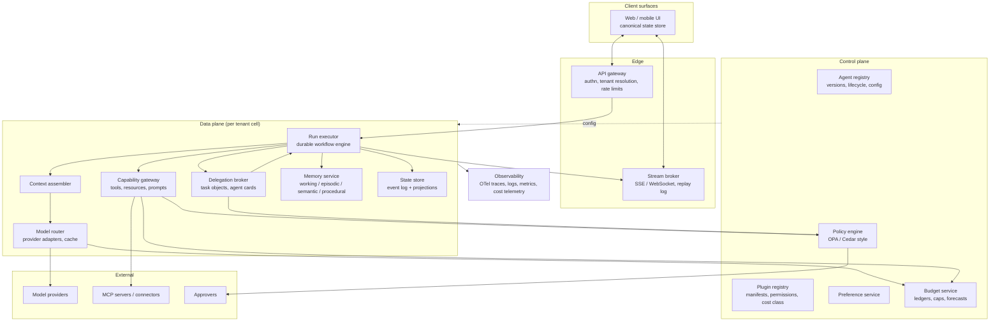

The run executor is a durable workflow (Temporal-style semantics: deterministic replay, activities with retries, signals for human input), not a loop in a web handler. Every box on the data plane is stateless except the state store and memory service, so cells can be scaled per tenant.

### Cross-cutting primitives used in every section

**Identifiers.** All IDs are ULIDs (sortable, 26 chars) with a type prefix. The prefix is a contract: `tenant_`, `user_`, `sess_`, `run_`, `task_`, `del_` (delegation), `call_` (model call), `tool_`, `plug_`, `art_` (artifact), `mem_`, `evt_`, `apr_` (approval), `cp_` (checkpoint).

**Correlation envelope.** Every message crossing a boundary carries the same header block, so a single trace ID joins a UI click to a warehouse query three delegations deep.

```json
{
  "envelope": {
    "tenant_id": "tenant_01J9...",
    "user_id": "user_01J9...",
    "session_id": "sess_01J9...",
    "run_id": "run_01J9...",
    "task_id": "task_01J9...",
    "delegation_chain": ["del_01J9A", "del_01J9B"],
    "trace_id": "4bf92f3577b34da6a3ce929d0e0e4736",
    "span_id": "00f067aa0ba902b7",
    "actor": {"kind": "agent", "id": "agent_sql_data@1.4.2"},
    "token_ref": "tok_01J9...",
    "idempotency_key": "run_01J9.../step/17",
    "issued_at": "2026-11-03T04:25:11Z"
  }
}
```

**Trust boundaries.** There are exactly four: user to harness, harness to model, harness to capability (tool, plugin, MCP server), and agent to agent. Each is fronted by the policy gateway and each hop mints a new scoped token (section 6). Nothing crosses a boundary on a forwarded credential.

**Action classes.** Every capability, delegation, and UI action is labelled `read`, `write`, or `dangerous`. The label drives idempotency requirements, checkpointing, approval, audit sampling, and cost warnings uniformly across sections 1, 2, 6, 7, 10, and 11.

**Artifacts, not blobs.** Any output larger than roughly 2 KB (a query result, a chart spec, a document) is stored once as an artifact with an ID, a content hash, a schema, and provenance. Prompts, events, memories, and delegations reference the artifact; they do not embed it.

**Vendor neutrality.** Model providers sit behind a single `ModelAdapter` interface (chat, tool calling, streaming, prompt caching, token counting). Tools sit behind MCP. The workflow engine, event log, vector store, and policy engine are all swappable behind interfaces; the document names candidate implementations only as examples.

## 1. External tools and data: the capability gateway

**Intent.** Every external effect an agent can have passes through one gateway that knows the tool's contract, its risk class, its health, and its cost, so the model never talks to the outside world directly.

**Problem.** Without a gateway, tool access is scattered across agent code: schemas drift, credentials leak into prompts, retries double-charge, large payloads flood context, and there is no single place to say "this tool is deprecated" or "this call needs approval".

### Components

| Component | Responsibility |
| --- | --- |
| Tool registry | Source of truth for tool descriptors: JSON Schema in/out, action class, version, owner, SLA, cost class, health |
| MCP adapter layer | Connects to MCP servers (stdio, HTTP, streamable) and normalises Tools, Resources, Prompts into registry entries |
| Invocation service | Validates arguments, mints the per-hop token, applies idempotency, timeouts, retries, circuit breaker, rate limits |
| Result shaper | Enforces data minimisation: stores large outputs as artifacts, returns a reference plus a structured summary |
| Provenance stamper | Attaches source, version, timestamp, hash, and permission scope to every result |
| Health prober | Runs synthetic checks, computes availability, drives fallback selection |

### Data contracts

Tool descriptor (registry entry):

```json
{
  "tool_id": "warehouse.run_aggregate_query",
  "version": "2.3.0",
  "kind": "tool",
  "source": {"type": "mcp", "server": "mcp://warehouse", "transport": "streamable-http"},
  "owner": "team-data-platform",
  "action_class": "read",
  "side_effects": "none",
  "idempotent": true,
  "input_schema": {
    "$schema": "https://json-schema.org/draft/2020-12/schema",
    "type": "object",
    "required": ["metric", "date_range"],
    "properties": {
      "metric": {"type": "string", "enum": ["weekly_active_users", "retention_d7"]},
      "date_range": {"type": "string", "pattern": "^last_[0-9]+_(days|weeks)$"},
      "group_by": {"type": "array", "items": {"type": "string"}, "maxItems": 4},
      "minimum_cohort_size": {"type": "integer", "minimum": 50}
    },
    "additionalProperties": false
  },
  "output_schema": {"$ref": "#/schemas/AggregateTable"},
  "output_policy": {"max_inline_bytes": 2048, "artifact_kind": "table", "summary_fields": ["row_count", "summary"]},
  "limits": {"timeout_ms": 30000, "rate": {"per_minute": 60, "burst": 10}, "max_concurrency": 8},
  "retry": {"max_attempts": 3, "backoff": "exponential", "base_ms": 500, "retry_on": ["timeout", "5xx", "rate_limited"]},
  "cost_class": "metered",
  "cost_estimate": {"unit": "usd", "per_call": 0.004},
  "required_scopes": ["read:warehouse_aggregates"],
  "data_categories": ["product_usage"],
  "residency": ["eu-west"],
  "lifecycle": {"status": "active", "deprecated_at": null, "sunset_at": null, "replacement": null},
  "fallbacks": ["warehouse.run_aggregate_query@2.2", "bi.saved_metric_lookup"],
  "health": {"probe": "warehouse.ping", "interval_s": 60}
}
```

MCP primitives map onto the registry as follows:

| MCP primitive | Registry kind | Who initiates | Context treatment |
| --- | --- | --- | --- |
| Tool | `tool` | Model selects, harness executes | Result shaped; large output becomes artifact |
| Resource | `resource` | Harness or model requests by URI | Never inlined by default; injected as `resource_ref` with a summary, fetched on demand |
| Prompt | `prompt` | Harness composes into context | Treated as a versioned template; cached (section 10) |

Tool result envelope (what the model sees):

```json
{
  "tool_call_id": "tool_01J9...",
  "status": "ok",
  "inline": {"row_count": 96, "summary": {"overall_wow_change_pct": -12.4}},
  "artifact_ref": {"artifact_id": "art_wau_001", "kind": "table", "bytes": 18744, "sha256": "9f3c...", "uri": "art://tenant_01J9/art_wau_001"},
  "provenance": {
    "tool_id": "warehouse.run_aggregate_query",
    "tool_version": "2.3.0",
    "server": "mcp://warehouse",
    "executed_at": "2026-11-03T04:25:14Z",
    "duration_ms": 1840,
    "attempt": 1,
    "cache": "miss",
    "data_as_of": "2026-11-02T23:59:59Z",
    "scope_used": ["read:warehouse_aggregates"],
    "policy_decision_id": "pd_01J9...",
    "freshness_ttl_s": 3600
  }
}
```

### Action classification and what it changes

| Class | Examples | Idempotency | Checkpoint before | Approval | Audit sampling |
| --- | --- | --- | --- | --- | --- |
| `read` | query, search, fetch resource | Natural | No | Policy only | Sampled |
| `write` | create ticket, send draft to deck, update CRM | Required key | Yes | Policy, or user threshold | Always |
| `dangerous` | delete, pay, send external email, change permissions | Required key plus dry-run | Yes, plus compensation plan | Always human | Always, retained longer |

### Invocation pipeline

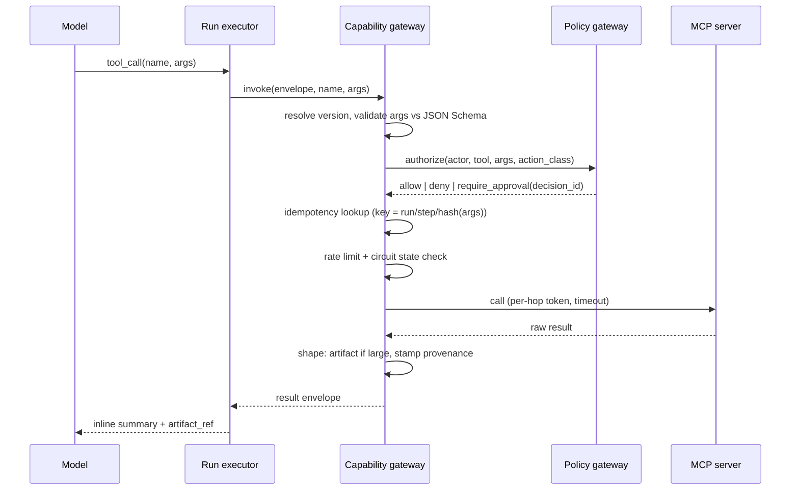

Idempotency key is `sha256(run_id, step_index, tool_id, canonical_json(args))`. The gateway stores the key with the result for the tool's `freshness_ttl_s`; a replay after crash returns the stored result instead of re-executing. For `write` and `dangerous` tools the key is also forwarded to the downstream system as `Idempotency-Key` where supported.

Circuit breaker: per tool version and tenant, open after 5 failures in 60 s or p95 latency over 3 times SLA, half-open after 30 s. While open, the invocation service walks the `fallbacks` list; if none is healthy it returns `status: unavailable` with a structured reason so the model can tell the user instead of hallucinating a result.

### Versioning, deprecation, and fallback

- Semantic versions; the model is bound to a major version via the agent's config, the gateway resolves the newest compatible minor.
- Deprecation is a registry state with `sunset_at`; the gateway emits a `tool.deprecated_used` telemetry event and a UI activity notice when a deprecated tool is called.
- Schema changes within a major version must be additive. A breaking change is a new major version and a new registry entry; both run side by side until sunset.
- Health has three states: `healthy`, `degraded` (serving but slow or partial), `down`. The context assembler (section 9) omits `down` tools from the tool list offered to the model so it never plans around something that cannot run.

### Failure modes and mitigations

| Failure | Mitigation |
| --- | --- |
| Model sends malformed arguments | Schema validation returns a structured error; model gets one repair attempt, then the run surfaces an error event |
| Duplicate side effects after retry or crash | Idempotency key stored before execution; downstream idempotency header |
| Large result blows the context budget | Output policy forces artifact storage above `max_inline_bytes`; model receives summary plus reference |
| Slow or dead backend | Timeout, circuit breaker, fallback list, `unavailable` status surfaced honestly |
| Tool returns stale data | `data_as_of` and `freshness_ttl_s` in provenance; context assembler flags stale results |
| Prompt injection via tool output | Results are wrapped as data with a provenance tag; untrusted-origin results are marked and never treated as instructions (section 6) |
| Silent schema drift on the MCP server | Gateway re-fetches `tools/list` on connect and on a schedule, diffs against the registry, alerts on drift |

### Security, privacy, and governance

- Per-hop scoped token per invocation (section 6); the MCP server never sees the user's credential.
- Arguments are redacted by field path (from `input_schema` annotations such as `x-pii: true`) before they are logged or traced.
- Data categories and residency on the descriptor let the policy gateway refuse a tool for a tenant whose data may not leave a region.
- Resource URIs are resolved through the gateway with the same authorization, so an agent cannot fetch a resource it could not have been granted by a tool.
- Every result carries a `policy_decision_id`, linking it to the audit trail.

### Example flow

The SQL agent asks for `warehouse.run_aggregate_query` with `return_raw_rows: true`. Schema validation passes, but the policy gateway sees the tenant rule "aggregate only" and returns `deny` with reason `raw_rows_forbidden`. The gateway returns a structured error; the model retries with `return_raw_rows: false`; the result is 96 rows, stored as `art_wau_001`, and the model receives a 300-token summary plus the artifact reference. The UI receives the full table through the artifact endpoint, not through the prompt.

## 2. Agent coordination and delegation

**Intent.** Delegation is a durable, budgeted, typed contract between agents, brokered by the harness, never an informal prompt passed from one model to another.

**Problem.** Free-form delegation produces unbounded recursion, untraceable cost, lost work on crashes, and free-text results the parent cannot validate. The parent must be able to ask "what did I get, from whom, at what cost, and can I trust it?".

### Coordination patterns

| Pattern | Use when | Harness responsibility | Failure semantics |
| --- | --- | --- | --- |
| Orchestrator-worker | One agent owns the user conversation and farms out bounded subtasks | Task fan-out, budget split, artifact collection | Worker failure is a task failure; orchestrator decides retry, fallback, or partial answer |
| Sequential pipeline | Each stage consumes the previous stage's artifact (extract, analyse, write) | Enforces `depends_on`, passes artifact refs only | Stage failure halts the pipeline at a checkpoint; resume from the failed stage |
| Concurrent fan-out | Independent subtasks (per-region analysis) | Caps fan-out width, aggregates with a join policy (`all`, `quorum`, `first`) | Partial results accepted under `quorum`; stragglers cancelled at deadline |
| Handoff | Conversation ownership moves to a specialist (billing agent takes over) | Transfers conversation state slice and consent, emits `AGENT_HANDOFF` to the UI | Specialist cannot return to the original mid-turn; failure hands back with a reason |
| Group chat | Several agents critique or negotiate (plan, review, revise) | Turn scheduler, max rounds, moderator agent, shared whiteboard artifact | Round limit reached produces a `no_consensus` artifact with positions, never an endless loop |

### Durable Task object

```json
{
  "task_id": "task_01J9...",
  "run_id": "run_8842",
  "parent_task_id": "task_root",
  "delegation_id": "del_101",
  "agent": {"id": "sql_data_agent", "version": "1.4.2"},
  "purpose": "Retrieve WAU trend and segment breakdowns",
  "status": "running",
  "lifecycle": ["created", "queued", "running", "waiting_input", "waiting_auth", "paused", "completed", "failed", "cancelled", "compensated"],
  "inputs": {"artifact_refs": ["art_task_brief_01"], "params": {"metric": "weekly_active_users", "weeks": 8}},
  "expected_artifacts": [
    {"name": "wau_trend", "schema": "AggregateTable@1"},
    {"name": "platform_breakdown", "schema": "AggregateTable@1"}
  ],
  "artifacts": [],
  "depends_on": [],
  "budget": {"max_model_cost_usd": 0.35, "max_tool_calls": 8, "max_duration_s": 90, "max_depth": 2, "max_fanout": 4},
  "spent": {"model_cost_usd": 0.0, "tool_calls": 0, "elapsed_s": 0},
  "scope": ["read:product_metrics", "read:warehouse_aggregates"],
  "checkpoint_id": null,
  "cancellation": {"requested": false, "reason": null, "deadline": "2026-11-03T04:27:00Z"},
  "attempts": 1,
  "created_at": "2026-11-03T04:25:12Z",
  "updated_at": "2026-11-03T04:25:12Z"
}
```

State machine:

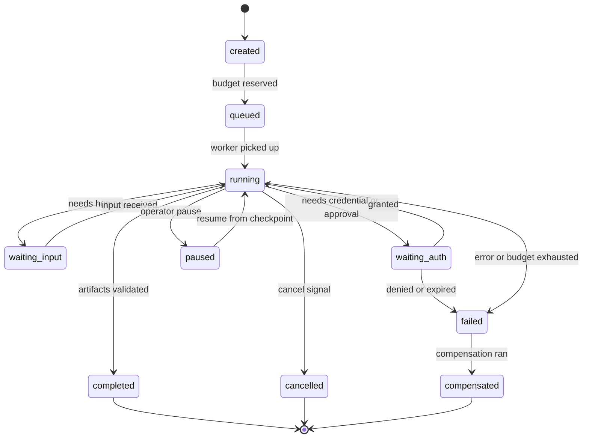

### Agent Card (discovery metadata)

```json
{
  "agent_id": "statistics_agent",
  "version": "2.1.0",
  "display_name": "Statistics Agent",
  "description": "Segment impact, cohort comparison, significance and anomaly tests on aggregate artifacts",
  "skills": [
    {"id": "segment_impact", "input_schema": "AggregateTable@1", "output_schema": "SegmentFindings@1"},
    {"id": "significance_test", "input_schema": "CohortPair@1", "output_schema": "TestResult@1"}
  ],
  "accepts_delegation_from": ["analytics_chat_agent", "research_orchestrator"],
  "may_delegate_to": [],
  "required_scopes": ["read:aggregate_artifacts", "run:statistical_tests"],
  "data_categories": ["aggregates_only"],
  "cost_profile": {"typical_usd": 0.12, "p95_usd": 0.30, "typical_duration_s": 25},
  "model_tier": "standard",
  "supports": {"streaming": true, "cancellation": true, "resume": true, "human_input": false},
  "endpoint": "internal://agents/statistics_agent",
  "lifecycle": "production"
}
```

### Delegation graph and forbidden rules

The control plane holds an explicit directed graph of who may delegate to whom. Anything not in the graph is denied at the policy gateway before a task is created.

```mermaid
flowchart LR
  U[User] --> A[analytics_chat_agent]
  A --> S[sql_data_agent]
  A --> ST[statistics_agent]
  A --> V[visualization_agent]
  S -.x.-> A
  ST -.x.-> S
  V -.x.-> ST
```

Forbidden-delegation rules (evaluated in order):

1. No cycles: a child may not delegate to any agent in its own `delegation_chain`.
2. Depth cap from tenant policy (default 3) and per-task `max_depth`.
3. Scope monotonicity: a child's scope must be a subset of the parent's.
4. Data category containment: an agent labelled `aggregates_only` cannot receive a task whose input artifacts carry `row_level` data.
5. Lifecycle gate: `production` agents may only delegate to `production` or `canary` agents; `draft` agents cannot be delegation targets outside test tenants.

### Structured artifact returns

A child task completes only when every `expected_artifact` exists and validates against its schema. Free text is permitted as a `notes` field on the artifact, not as the artifact.

```json
{
  "artifact_id": "art_stats_002",
  "task_id": "task_01J9...",
  "name": "segment_findings",
  "schema": "SegmentFindings@1",
  "content_ref": "art://tenant_01J9/art_stats_002",
  "sha256": "c1a8...",
  "summary": "iOS/EMEA accounts for 58% of the decline, high significance",
  "confidence": 0.86,
  "provenance": {"producer": "statistics_agent@2.1.0", "inputs": ["art_wau_001"], "tool_calls": ["tool_301", "tool_302"], "model_calls": ["call_77"]},
  "cost": {"model_usd": 0.11, "tool_usd": 0.00, "elapsed_s": 22}
}
```

### Long-running tasks, human input, auth, partial failure, compensation

| Situation | Mechanism |
| --- | --- |
| Long-running (minutes to days) | Task runs as a durable workflow; parent subscribes to task events rather than blocking; UI shows `SUBAGENT_PROGRESS`; heartbeat every 15 s, missed heartbeat x3 marks the worker lost and re-queues from checkpoint |
| Human input needed by a child | Child enters `waiting_input`; the request bubbles up the chain to the agent that owns the conversation, which asks the user; the answer is routed back as a signal, never by the child talking to the user directly |
| Authentication needed | Child enters `waiting_auth`; the harness runs the OAuth or token-exchange flow (section 11) and resumes; credentials never pass through the parent |
| Partial failure in fan-out | Join policy decides; the aggregate artifact carries `coverage` (which children succeeded) so the model can caveat the answer |
| Compensation | Each `write` or `dangerous` step registers a compensating action at checkpoint time; on task failure after a side effect, the harness runs compensations in reverse order (saga) and marks the task `compensated` |
| Cancellation | Cancel signal propagates down the chain; children get a grace period to checkpoint; cost already spent is attributed, not refunded |

### Failure modes and mitigations

| Failure | Mitigation |
| --- | --- |
| Recursive delegation storm | Graph rules, depth and fan-out caps, budget reserved at creation (not at spend) |
| Child returns prose instead of artifact | Schema validation fails the task; parent receives `artifact_invalid` and can retry once with a stricter instruction |
| Parent crashes while children run | Children are independent durable tasks; the parent resumes from its checkpoint and re-attaches by `task_id` |
| Budget exhausted mid-task | Task fails cleanly with partial artifacts flagged `partial: true`; parent decides whether to answer with caveats |
| Credential prompt loops | `waiting_auth` has a TTL; expiry fails the task with a user-visible reason |

### Security, privacy, and governance

Each delegation mints a new token scoped to the task (section 6). Children see only the artifacts listed in `inputs`, not the parent's conversation. The `purpose` string is recorded in the audit log and shown to the user in the UI's subagent card, which makes delegation legible rather than hidden.

### Example flow

The analytics agent creates `del_101` to the SQL agent with a $0.35 budget and three expected artifacts. The SQL agent runs four tool calls, produces `art_wau_001`, and completes. In parallel `del_102` goes to the statistics agent with `art_wau_001` as its only input. The statistics agent's task exceeds its 5-call limit on the fourth test, so the harness fails it with `budget_exhausted`, keeping the three findings already produced as a `partial: true` artifact. The orchestrator receives both, notes the partial coverage, and asks the user whether to spend more or proceed.

## 3. Interface streaming

**Intent.** One ordered, typed, replayable event stream per run is the only channel from harness to UI; the UI is a pure function of the events it has seen.

**Problem.** Ad hoc streaming (text chunks on one socket, tool status on another, state in a REST poll) produces races, duplicated renders after reconnect, and runs that never visibly finish. The UI needs a protocol it can render idempotently and resume from any point.

### Components

| Component | Responsibility |
| --- | --- |
| Event emitter (in run executor) | Assigns `sequence`, stamps `run_id`, writes to the run's event log before fanning out |
| Run event log | Append-only, per-run, retained for the run's retention window; the source for replay |
| Stream broker | Serves SSE and WebSocket, handles `Last-Event-ID` resume, backpressure, throttling of high-frequency event kinds |
| UI event reducer | Applies events to the canonical client store (section 4); idempotent by `(run_id, sequence)` |
| Control channel | UI to harness: cancel, retry, approval decisions, human input, custom actions |

### Event envelope

```json
{
  "id": "evt_01J9...",
  "run_id": "run_8842",
  "sequence": 42,
  "type": "TOOL_CALL_START",
  "ts": "2026-11-03T04:25:14.021Z",
  "thread_id": "sess_01J9...",
  "parent_message_id": "m1",
  "task_id": "task_01J9...",
  "agent_id": "sql_data_agent",
  "payload": {"tool_call_id": "tool_201", "tool_name": "warehouse_run_aggregate_query", "action_class": "read"},
  "visibility": "user",
  "cost_hint": {"bytes": 212}
}
```

`visibility` is `user`, `developer`, or `internal`; the broker filters by the viewer's role and the user's preferences (section 12) before sending.

### Event catalogue

| Family | Types | Notes |
| --- | --- | --- |
| Run lifecycle | `RUN_STARTED`, `RUN_PAUSED`, `RUN_RESUMED`, `RUN_FINISHED`, `RUN_ERROR`, `RUN_CANCELLED` | Exactly one terminal event per run (`FINISHED`, `ERROR`, `CANCELLED`) |
| Step | `STEP_STARTED`, `STEP_FINISHED` | Groups events into model-turn boundaries |
| Message | `TEXT_MESSAGE_START`, `TEXT_MESSAGE_CONTENT` (delta), `TEXT_MESSAGE_END` | One message id per start/end pair; deltas are append-only |
| Tool call | `TOOL_CALL_START`, `TOOL_CALL_ARGS` (delta), `TOOL_CALL_END`, `TOOL_CALL_RESULT` | Result carries inline summary plus artifact ref, never raw bulk |
| Reasoning | `REASONING_START`, `REASONING_CONTENT`, `REASONING_END` | Only emitted if preference and policy allow; may be a summary rather than raw trace |
| Progress | `PROGRESS` | `{percent, label, eta_s}` throttled to 2 per second per task |
| Approval | `APPROVAL_REQUESTED`, `APPROVAL_RESOLVED` | Carries `approval_id`, action, risk, expiry; resolution comes from the control channel |
| Error | `ERROR` (non-terminal) | Recoverable errors shown inline; terminal errors use `RUN_ERROR` |
| Activity | `ACTIVITY` | Short human-readable status lines ("Validating metric definition"), throttled |
| Subagent | `SUBAGENT_STARTED`, `SUBAGENT_PROGRESS`, `SUBAGENT_FINISHED`, `AGENT_HANDOFF` | Renders the delegation tree; payload references `task_id` |
| State | `STATE_SNAPSHOT`, `STATE_DELTA` | Section 4 |
| Custom | `CUSTOM` | `{name, version, value}`; see convention below |
| Meta | `HEARTBEAT`, `RAW` | Heartbeat every 15 s on idle streams; `RAW` wraps provider-native events for debugging, `visibility: developer` |

### Ordering and delivery guarantees

- `sequence` is a per-run monotonic integer assigned by the emitter under a single writer; there is no global order across runs.
- The event is durably appended to the run event log before it is sent on any socket. A client that reconnects with `Last-Event-ID: 41` receives 42 onward from the log, then live events.
- Delivery is at-least-once; the reducer is idempotent: an event with a `sequence` already applied is dropped, a gap triggers a replay request for the missing range.
- Terminal guarantee: every run ends with exactly one terminal event, including when the executor crashes (the workflow engine's failure handler emits `RUN_ERROR` with `reason: executor_lost`). A client that sees no terminal event within the run's `max_duration` plus grace may call `GET /runs/{id}` to reconcile.
- Deltas (`TEXT_MESSAGE_CONTENT`, `TOOL_CALL_ARGS`, `STATE_DELTA`) are only valid between their `START` and `END`; the reducer buffers out-of-window deltas and flags a protocol error after 5 s.

### Transport

| Transport | Use | Resume |
| --- | --- | --- |
| SSE (`GET /runs/{id}/events`) | Default; works through proxies and CDNs | `Last-Event-ID` header = last `sequence` |
| WebSocket (`/ws/sessions/{id}`) | Multiplexes several runs plus the control channel | First frame `{"resume": {"run_8842": 41}}` |
| Control channel (`POST /runs/{id}/control` or WS frame) | cancel, retry, approve, reject, provide\_input, custom\_action | Idempotent by `client_action_id` |

Reconnect policy on the client: exponential backoff 0.5 s to 30 s with jitter; after 3 failed resumes, fetch `STATE_SNAPSHOT` via REST and resubscribe from the snapshot's `sequence`.

```mermaid
sequenceDiagram
  participant UI
  participant B as Stream broker
  participant L as Run event log
  UI->>B: GET /runs/run_8842/events (Last-Event-ID: 41)
  B->>L: read from 42
  L-->>B: 42..57
  B-->>UI: replay 42..57
  B-->>UI: live 58, 59 ...
  Note over UI: connection drops after 63
  UI->>B: reconnect (Last-Event-ID: 63)
  B-->>UI: 64.. (no duplicates rendered; reducer drops <=63)
  B-->>UI: RUN_FINISHED (seq 91, terminal)
```

### Cancellation, retry, approval in the UI

- Cancel: UI sends `cancel` with `client_action_id`; harness emits `RUN_CANCELLED` only after children have checkpointed or been force-stopped; the UI greys out the run immediately on send and reconciles on the event.
- Retry: allowed only from `RUN_ERROR` or a failed task; the harness creates a new run that references `retry_of: run_8842` and reuses checkpoints and cached tool results where idempotency keys match.
- Approval: `APPROVAL_REQUESTED` renders a card with action, plugin, risk, reason, and expiry; the decision goes over the control channel; the harness emits `APPROVAL_RESOLVED` and resumes or compensates.

### Custom UI events without breaking compatibility

`CUSTOM` events carry `name` (namespaced, `vendor.chart`), `version` (integer), and `value` (validated against a JSON Schema registered by the plugin or agent that emits it). Unknown names render as a generic card with a label and a "view details" link to the raw payload; unknown versions of a known name fall back to the latest version the client supports if the schema declares `backward_compatible: true`, otherwise to the generic card. Custom events must not carry run-critical state; anything the client needs to reconstruct the run lives in standard events or `STATE_*`.

### Failure modes and mitigations

| Failure | Mitigation |
| --- | --- |
| Duplicate renders after reconnect | `(run_id, sequence)` idempotency in the reducer |
| Run appears stuck | Heartbeats plus terminal guarantee from the workflow failure handler |
| Firehose of progress or activity events | Broker-side throttling per family; coalescing of `PROGRESS` to latest value |
| Oversized payload | Hard limit 32 KB per event; larger content becomes an artifact reference |
| Reasoning leak to users who should not see it | `visibility` filter in the broker, not in the client |

### Security, privacy, and governance

The stream is authenticated per session and authorised per run (a user sees only runs in sessions they own or that are shared with them). Events are redacted server-side by the same field-path rules as logs. Replay is bounded by the run's retention window; after that only the snapshot and artifacts remain.

### Example flow

The UI opens an SSE stream, renders `RUN_STARTED` (seq 1), streams `m1` text deltas, shows a tool card for `tool_201`, then a chart card from a `CUSTOM` event named `app.chart@2`. The tab is closed for a minute; on reopen the client resumes from seq 63, receives the approval request (seq 70), the user approves, and `RUN_FINISHED` (seq 91) closes the run.

## 4. Interface state synchronization

**Intent.** The client holds one canonical, versioned state document that the harness updates by snapshot plus JSON Patch deltas, so every surface (web, mobile, a second tab) converges on the same view and survives reloads.

**Problem.** Chat UIs that derive state from the message list cannot represent long-running workflows, partially complete analyses, or agent-visible widgets (a filter the user set, a chart they pinned). They also cannot tell the agent what the user is looking at without re-sending the whole UI.

### State ownership

| Partition | Owner | Who may write | Sent to the model | Persistence |
| --- | --- | --- | --- | --- |
| `ui` | Client | Client only | Never, except the `ui.context` allowlist | Local storage plus server backup, per device |
| `shared` | Agent and client | Both, with conflict rules | Yes, as `shared_state` in the context payload | Server, per session |
| `conversation` | Harness | Harness only (derived from the event log) | Yes, via the context assembler | Server, per session |
| `domain` | Application services | Services only; agent requests changes through tools | Only as resource references | Application databases |

A single JSON document per session, with four top-level keys matching the partitions, each carrying its own version:

```json
{
  "session_id": "sess_01J9...",
  "versions": {"ui": 17, "shared": 42, "conversation": 310, "domain": "etag:9f1c"},
  "ui": {"active_panel": "charts", "expanded_tool_cards": ["tool_201"], "draft_input": ""},
  "shared": {
    "analysis": {
      "run_8842": {"status": "analysis_complete", "charts": ["chart_wau_trend", "chart_segment_impact"], "selected_segment": "iOS / EMEA"}
    },
    "pinned_artifacts": ["art_stats_002"]
  },
  "conversation": {"messages": ["m1", "m2"], "open_approvals": ["apr_301"], "active_run": "run_8842"},
  "domain": {"refs": [{"kind": "dashboard", "id": "dash_leadership", "etag": "9f1c"}]}
}
```

### Snapshot plus delta protocol

- `STATE_SNAPSHOT` carries the full `shared` and `conversation` partitions with their versions; emitted at run start, after reconnect fallback, and every N deltas (default 200) as a compaction point.
- `STATE_DELTA` carries an RFC 6902 JSON Patch array scoped to one partition, with `base_version` and `new_version`.

```json
{
  "type": "STATE_DELTA",
  "sequence": 71,
  "payload": {
    "partition": "shared",
    "base_version": 41,
    "new_version": 42,
    "patch": [
      {"op": "add", "path": "/analysis/run_8842/charts", "value": ["chart_wau_trend", "chart_segment_impact"]},
      {"op": "replace", "path": "/analysis/run_8842/status", "value": "analysis_complete"}
    ],
    "author": {"kind": "agent", "id": "analytics_chat_agent"}
  }
}
```

Client-originated changes to `shared` go over the control channel as the same shape with `author.kind: user`; the harness validates the patch against the partition's JSON Schema, applies it under the version lock, and broadcasts the resulting delta to all connected clients (including the author, which reconciles its optimistic apply).

```python
from dataclasses import dataclass, field
import jsonpatch

@dataclass
class PartitionStore:
    name: str
    version: int = 0
    doc: dict = field(default_factory=dict)
    pending: dict[int, dict] = field(default_factory=dict)

    def apply(self, delta: dict) -> bool:
        """Idempotent, gap-tolerant apply. Returns True if applied."""
        if delta["new_version"] <= self.version:
            return False  # already applied
        if delta["base_version"] != self.version:
            self.pending[delta["base_version"]] = delta  # buffer until gap fills
            return False
        self.doc = jsonpatch.apply_patch(self.doc, delta["patch"], in_place=False)
        self.version = delta["new_version"]
        nxt = self.pending.pop(self.version, None)
        return self.apply(nxt) if nxt else True
```

### Versioning and conflict resolution

| Case | Rule |
| --- | --- |
| Agent and user patch the same path concurrently | Last-writer-wins by server receipt order for scalar leaves; arrays declared `set-like` in the schema merge; the losing author receives the winning delta and a `STATE_CONFLICT` custom event with both values |
| Client patch with stale `base_version` | Rejected with `409` and the current version; client rebases its patch (standard JSON Patch rebase on disjoint paths) and resends; overlapping paths require user confirmation |
| Agent writes to `ui` | Rejected at the harness; agents may only emit a `ui_suggestion` custom event the client is free to ignore |
| Schema violation | Rejected; the run receives an `ERROR` event so the model can correct itself |

### Reconnect recovery and snapshot replay

1. Client reconnects with its per-partition versions.
2. Server compares: if the gap is within the event log retention, it replays deltas from the client's version; otherwise it sends a `STATE_SNAPSHOT`.
3. Client applies replayed deltas through the same idempotent reducer; a snapshot replaces the partition wholesale and drops any pending buffer.
4. `ui` partition is restored from local storage first, then merged with the server backup by `updated_at`.

### Persistence across reloads, devices, and long workflows

- `shared` and `conversation` are server-authoritative and keyed by session; any device loads the latest snapshot and subscribes.
- Long-running workflows (days) keep their `shared` subtree alive as long as the session; compaction snapshots keep replay bounded; a workflow that outlives the session is promoted to a `workspace` scope with its own ID.
- Per-device `ui` state is never required for correctness; losing it degrades only layout.

### What UI state may be sent to the agent as run input

Only the `ui.context` allowlist, declared by the application, and only when a run starts or the user explicitly acts. The default allowlist is: current panel, selected item IDs, visible artifact IDs, active filters. Never: draft input text (until submitted), scroll positions, hover state, device identifiers, other users' presence. The harness injects the result as a compact `ui_context` block (section 9) capped at 512 tokens.

### Failure modes and mitigations

| Failure | Mitigation |
| --- | --- |
| Divergence between two tabs | Server-authoritative `shared`; every accepted patch is broadcast; versions are per partition so an unrelated `ui` change never blocks |
| Unbounded delta log | Compaction snapshots every 200 deltas; retention aligned with run retention |
| Agent floods state with large values | Partition schema caps value sizes; anything over 2 KB must be an artifact reference |
| Client replays a snapshot over newer local edits | Snapshot carries version; client prompts only if local uncommitted patches exist, else replaces |

### Security, privacy, and governance

Partitions are authorised independently: a viewer with read-only share gets `conversation` and `shared` deltas but cannot write. State documents are stored in the tenant's cell and inherit its residency. PII in `shared` must be referenced (artifact or domain ref), never inlined, which is enforced by the partition schema.

### Example flow

The visualization agent emits a `shared` delta adding two charts. The PM, on a phone, pins `chart_segment_impact` (a client patch to `/pinned_artifacts`). Both deltas land in order; the PM's laptop tab, reconnecting after a train tunnel, replays from version 40 and converges. The next run receives `ui_context: {selected_segment: "iOS / EMEA", visible_artifacts: [...]}` so the model knows what the user is looking at when they ask "why that one?".

## 5. Agent management: control plane and data plane

**Intent.** Agents are versioned, deployable units with a lifecycle, and runs are first-class resources that can be inspected and controlled, independently of the model behind them.

**Problem.** Without a control plane, "the agent" is whatever prompt is in the repo today; there is no rollback, no canary, no way to pause a runaway run, and tenants share one blast radius.

### Components

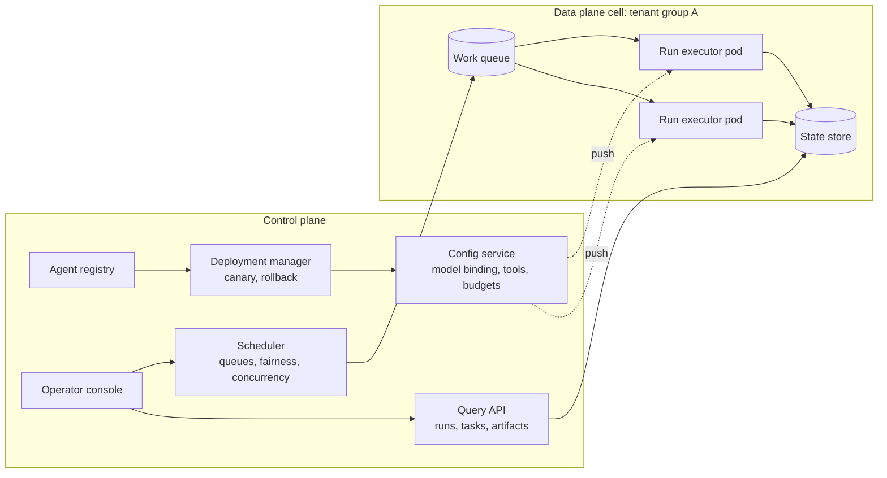

| Component | Responsibility |
| --- | --- |
| Agent registry | Agent definitions (card, system prompt, tool allowlist, model binding, memory and preference policy) with immutable versions |
| Deployment manager | Promotes versions through lifecycle stages, runs canaries by traffic percentage, rolls back on SLO breach |
| Config service | Resolves effective config per (agent version, tenant, environment) and pushes it to executors |
| Scheduler | Admission control, per-tenant queues, weighted fair share, concurrency limits, deadline scheduling |
| Query API | Read model over the event log and state store for runs, tasks, artifacts, approvals |
| Operator console | Inspect, pause, cancel, resume, retry, replay; drain and shutdown |

### Operations API

| Operation | Endpoint | Semantics |
| --- | --- | --- |
| Create run | `POST /sessions/{id}/runs` | Admission check (budget, concurrency, lifecycle); returns `run_id` and stream URL |
| Inspect | `GET /runs/{id}` | Status, current step, task tree, spend, open approvals, last checkpoint |
| Pause | `POST /runs/{id}:pause` | Signal; executor checkpoints at the next safe point and enters `paused` |
| Resume | `POST /runs/{id}:resume` | From last checkpoint; re-validates budgets and token expiry |
| Cancel | `POST /runs/{id}:cancel` | Propagates to tasks; compensations run for completed side effects if `compensate: true` |
| Retry | `POST /runs/{id}:retry` | New run with `retry_of`; reuse of idempotent results |
| Replay | `POST /runs/{id}:replay` | Deterministic re-execution against the event log for debugging; no external side effects (tools stubbed from recorded results) |
| Query runs | `GET /runs?tenant=&agent=&status=&since=&cost_gt=` | Paginated, filterable; backed by projections |
| Query tasks | `GET /tasks?run=&agent=&status=` | Task tree with artifacts and spend |
| Query artifacts | `GET /artifacts?run=&kind=&schema=` | Metadata plus signed download URL |

All mutating operations are idempotent by `Idempotency-Key` and recorded as `operator.*` audit events with the operator's identity.

### Agent definition and versioning

```json
{
  "agent_id": "analytics_chat_agent",
  "version": "3.2.0",
  "lifecycle": "canary",
  "card_ref": "agentcard://analytics_chat_agent@3.2.0",
  "system_prompt_ref": "prompt://analytics_chat/system@14",
  "model_binding": {"planning": "tier:strong", "default": "tier:standard", "summarise": "tier:light"},
  "tools": {"allow": ["warehouse.*", "bi.*", "statistics.*"], "deny": ["*.export_raw"]},
  "delegation": {"may_delegate_to": ["sql_data_agent", "statistics_agent", "visualization_agent"], "max_depth": 2, "max_fanout": 3},
  "budget_defaults": {"max_run_cost_usd": 2.00, "max_duration_s": 600, "max_tool_calls": 40},
  "memory_policy_ref": "mempolicy://analytics@2",
  "context_policy_ref": "ctxpolicy://analytics@5",
  "eval_gate": {"suite": "analytics_golden_v7", "min_pass_rate": 0.92},
  "created_by": "user_01J9...",
  "created_at": "2026-10-28T10:00:00Z",
  "changelog": "Adds statistics delegation; tightens export deny rule"
}
```

Versions are immutable. Config that varies by tenant (budgets, allowed plugins) is an overlay resolved at run creation and frozen into the run record, so a run is reproducible even after the overlay changes.

### Lifecycle

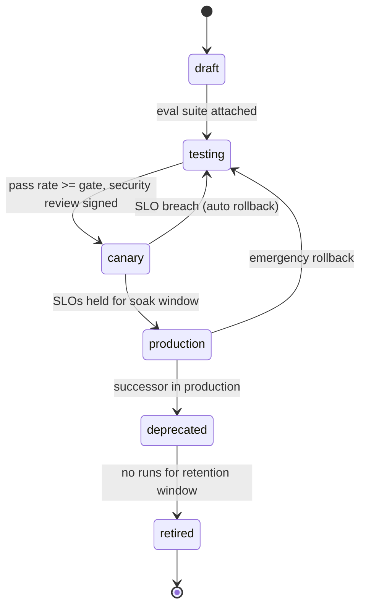

| Stage | Who can run it | Traffic | Delegation target | Notes |
| --- | --- | --- | --- | --- |
| draft | Author, test tenant | 0% | No | Editable |
| testing | Eval harness, QA | 0% | Only from testing agents | Golden and regression suites must pass |
| canary | Opted-in tenants or 1 to 10% of traffic | Partial | Yes, from production | Shadow evaluation runs in parallel (section 14) |
| production | All | 100% minus canaries | Yes | SLO-monitored |
| deprecated | Existing sessions only | Draining | No new | UI shows notice |
| retired | None | 0% | No | Definition kept for audit and replay |

### Budgets, concurrency, queueing, scheduling, shutdown

- Admission: a run is admitted only if the tenant's monthly and daily ledgers (section 10) have headroom for the agent's `max_run_cost_usd`, which is reserved up front and reconciled at completion.
- Concurrency limits at three levels: per tenant (cell capacity share), per agent version (protects a canary), per user (default 3 concurrent runs).
- Queues are per tenant with weighted fair queuing across tenants in a cell; priority classes `interactive` (user is waiting), `background` (scheduled), `batch`. Interactive runs preempt batch at the step boundary.
- Deadline scheduling: each run carries `max_duration_s`; the scheduler rejects admission if the queue wait estimate plus duration exceeds the user's interactive SLO and offers `background` instead.
- Graceful shutdown: executor receives SIGTERM, stops taking new steps, checkpoints every running run at its next safe point (never mid tool call), releases queue leases, and exits within 60 s; the scheduler re-leases runs to other pods, which resume from checkpoint.

### Multi-tenant isolation

| Layer | Isolation |
| --- | --- |
| Compute | Tenants grouped into cells; high-assurance tenants get dedicated cells; executors never process two tenants in one process |
| Data | Tenant ID is a mandatory partition key in state store, event log, memory, artifacts; row-level security on every query |
| Network | Tool and MCP egress through per-tenant egress policy; no cross-tenant service discovery |
| Secrets | Per-tenant KMS keys; plugin credentials encrypted under the tenant key |
| Models | Provider accounts or projects per tenant where the provider supports it; otherwise per-tenant API keys and quotas |
| Observability | Traces and logs tagged with tenant; dashboards scoped; cross-tenant aggregates only in anonymised form |

### Failure modes and mitigations

| Failure | Mitigation |
| --- | --- |
| Bad prompt version shipped | Canary with automatic rollback on eval or SLO breach; immutable versions make rollback a pointer change |
| Runaway run | Hard budget and duration caps enforced by the executor, operator pause and cancel, scheduler kill at 2x `max_duration_s` |
| Noisy tenant starves others | Weighted fair queuing, per-tenant concurrency, cell isolation |
| Executor pod dies | Workflow engine re-leases; checkpoints guarantee no duplicated side effects |
| Config drift between pods | Config pushed with a version; executor refuses to start a run if its config version is older than the registry's minimum |

### Security, privacy, and governance

Registry writes require two-person review for `production` promotion. Every promotion, rollback, and operator action is an immutable audit event. Replay runs in a sandbox with tools stubbed, so debugging never re-executes side effects. Operator access to run contents is itself logged and limited by tenant data-access policy.

### Example flow

`analytics_chat_agent@3.2.0` passes its golden suite at 94% and is promoted to canary at 5% for tenants that opted in. Shadow evaluation shows a 3-point drop in task success on export-related tasks; the deployment manager rolls back to 3.1.4 automatically and files an incident with the diffs of the two versions and the failing traces.

## 6. Trust and governance

**Intent.** No component trusts another by position in the topology; every call across a boundary carries a short-lived, narrowly scoped, verifiable token that names its purpose and its chain of delegation.

**Problem.** Agents are confused-deputy machines: they act on behalf of a user, read untrusted content, and call powerful tools. Forwarding the user's credential to an agent, or an agent's to a tool, means one prompt injection can do anything the user could.

### Zero-trust model

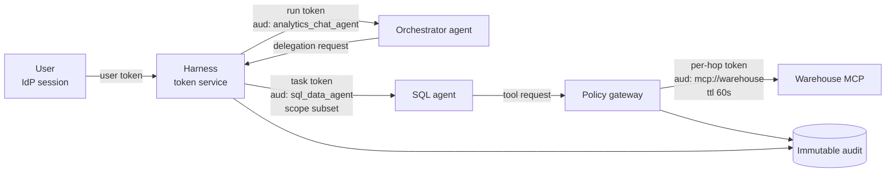

Principles:

1. Identity per actor: users, agents (by version), plugins, MCP servers, and operators each have a workload identity (SPIFFE-style) and are mutually authenticated (mTLS inside the mesh).
2. Per-hop token: each boundary crossing gets a fresh token minted by the harness token service, with `aud` set to the exact callee, `scope` a subset of the caller's, `ttl` of seconds to minutes, and a `chain` claim.
3. No credential forwarding: the user's IdP token stays at the edge; the model never sees any token; MCP servers never see user credentials, only the per-hop token and, where needed, a plugin credential fetched by the harness (section 11).
4. Policy at every boundary: the policy gateway evaluates allow, deny, or require-approval with a decision record, before execution.
5. Content is data: anything that came from a tool result, a document, a memory, or another agent is tagged with its origin and is never parsed as an instruction by the harness; the context assembler wraps it so the model can tell.

### Delegation token

```json
{
  "iss": "https://harness.example/token",
  "sub": "agent:sql_data_agent@1.4.2",
  "aud": "mcp://warehouse",
  "exp": 1762143971,
  "iat": 1762143911,
  "jti": "tok_01J9...",
  "tenant": "tenant_01J9...",
  "on_behalf_of": "user_01J9...",
  "purpose": "Retrieve WAU trend and segment breakdowns",
  "scope": ["read:warehouse_aggregates"],
  "action_classes": ["read"],
  "data_categories": ["product_usage"],
  "chain": [
    {"delegator": "user_01J9...", "delegate": "agent:analytics_chat_agent@3.2.0", "del_id": "del_root", "scope": ["read:*", "write:bi_export"]},
    {"delegator": "agent:analytics_chat_agent@3.2.0", "delegate": "agent:sql_data_agent@1.4.2", "del_id": "del_101", "scope": ["read:product_metrics", "read:warehouse_aggregates"]}
  ],
  "run_id": "run_8842",
  "task_id": "task_01J9...",
  "cnf": {"x5t#S256": "..."},
  "revocation_check": "https://harness.example/revoked"
}
```

Rules enforced by the token service: scope at each link is a subset of the previous link; `exp` never exceeds the parent's; the chain length is bounded by tenant policy; tokens are sender-constrained (`cnf`) so a stolen token is useless off the issuing workload. Revocation: cancelling a run or delegation adds every `jti` beneath it to a revocation list that the policy gateway checks (cached 5 s); TTLs are short enough that the list stays small.

### Policy gateway

Policy is code (OPA/Rego or Cedar), versioned and tested like any other code. Input to every decision:

```json
{
  "actor": {"kind": "agent", "id": "sql_data_agent@1.4.2", "token": "tok_01J9..."},
  "action": {"kind": "tool", "id": "warehouse.run_aggregate_query", "class": "read", "args_summary": {"return_raw_rows": false, "minimum_cohort_size": 50}},
  "resource": {"data_categories": ["product_usage"], "residency": "eu-west", "pii": false},
  "context": {"tenant": "tenant_01J9...", "user_roles": ["pm"], "run_risk": "low", "spend_so_far_usd": 0.41, "preferences": {"require_approval_for_export": true}}
}
```

Output: `{"decision": "allow" | "deny" | "require_approval", "decision_id": "pd_01J9...", "policy_version": "policies@118", "reasons": ["tenant.aggregate_only"], "obligations": [{"kind": "redact", "paths": ["/rows/*/user_id"]}]}`. Obligations are post-conditions the gateway must apply to the result (redaction, watermarking, retention tag).

### Human-in-the-loop approvals

| Trigger | Approver | Expiry | On expiry |
| --- | --- | --- | --- |
| `dangerous` action class | User, or designated approver for the tenant | 15 min interactive, 24 h background | Deny, task fails, compensations if needed |
| `write` above user's approval threshold (section 12) | User | 15 min | Deny |
| Policy obligation `require_approval` | Role named by policy | Policy-defined | Deny |
| Spend above budget warning line | User or tenant admin | 15 min | Pause run |

Approval request payload shows exactly what will happen: action, target, arguments (redacted), reversibility, cost estimate, and the delegation chain that led here. The decision is signed by the approver's identity and stored with the decision record. Approvals are single-use and bound to the argument hash; a changed argument needs a new approval.

### Immutable audit trail

Audit events are written to an append-only, hash-chained log (each event carries the hash of the previous one) with WORM retention per tenant policy. Evidence bundle per run: policy decisions, tokens issued (claims, not secrets), approvals with signatures, tool invocations with redacted arguments and result hashes, artifacts' hashes, and model call metadata. Retention: 1 year default, 7 years for tenants with regulatory flags, with legal hold support.

### Tenant, residency, PII, confidentiality, regulatory controls

| Control | Mechanism |
| --- | --- |
| Tenant isolation | Tenant claim in every token; policy denies any cross-tenant resource by default |
| Data residency | Tools, models, memory stores, and artifact buckets carry a region label; policy refuses a call whose region is outside the tenant's allowed set; model routing (section 10) is residency-aware |
| PII | Schema annotations (`x-pii`) drive redaction obligations; PII never enters semantic memory unless the category is explicitly allowed; DLP scan on artifacts before external write |
| Confidentiality labels | Artifacts and memories carry a label (`public`, `internal`, `confidential`, `restricted`); the context assembler refuses to mix `restricted` content into a run whose output channel is not cleared for it |
| Regulatory | Policy packs per regime (GDPR erasure, SOX change control, HIPAA minimum necessary) enable obligations and retention rules; right-to-erasure cascades through memory, artifacts, and event logs via tombstones |

### Failure modes and mitigations

| Failure | Mitigation |
| --- | --- |
| Prompt injection via tool output asks the agent to export data | Output tagged as untrusted; export is `write` requiring approval; token scope lacks `write:bi_export` for the SQL agent anyway |
| Token replay by a compromised worker | Sender-constrained tokens, 60 s TTL, audience binding |
| Policy engine unavailable | Fail closed for `write` and `dangerous`; `read` falls back to a cached decision for the same (actor, action) for at most 60 s, flagged in audit |
| Approval fatigue | Approval thresholds in preferences; batching of similar approvals in one card; risk scoring so low-risk writes auto-approve under tenant policy |
| Audit log tampering | Hash chain, WORM storage, periodic anchor of the chain head to an external notary |

### Example flow

The user says "export the charts to the leadership deck". The orchestrator requests `bi.export_dashboard` (class `write`). The policy gateway finds the user preference `require_approval_for_export: true`, returns `require_approval`, and the harness emits `APPROVAL_REQUESTED` with the chain `user -> analytics_chat_agent -> bi plugin`. The user approves; the token service mints a 60 s token with `aud: plugin:leadership_deck`, scope `write:bi_export`, bound to the approved argument hash. The export runs, the decision and approval signature land in the audit log, and the artifact's hash is recorded.

## 7. Agent state management

**Intent.** State is layered by lifetime and owner, the trajectory log is the single source of truth, and every other view is a replayable projection, so a run can be paused, moved, resumed, rolled back, or audited without ambiguity.

**Problem.** Agents that keep state in a process-local message list cannot survive restarts, cannot be inspected, and cannot undo side effects. Mixing user identity, secrets, and conversation text in one blob makes erasure and least-privilege impossible.

### State layers

| Layer | Lifetime | Owner | Store | Contents | Replayable from log |
| --- | --- | --- | --- | --- | --- |
| Conversation | Session (days to months) | Harness | Document store, partitioned by tenant and session | Messages, message summaries, task brief, open questions | Yes |
| Run | One run (seconds to hours) | Run executor | Workflow engine history plus checkpoints | Current step, plan, pending tool calls, spend, cursor into context | Yes |
| Task / delegation | One task | Delegation broker | Task table plus artifacts | Task object (section 2), child tasks, artifacts | Yes |
| Domain / application | Application-defined | Application services | Application DBs | Tickets, dashboards, orders; agent touches only via tools | No (external) |
| UI / shared | Session | Client and agent | State store (section 4) | Shared partition, pinned items, selections | Yes (`STATE_*` events) |
| Identity, consent, secrets | Per user and plugin | Token service, secret manager | KMS-backed vault, consent ledger | Tokens (by reference), OAuth grants, consent records, approval signatures | Consent yes; secrets never in log |

The model only ever sees projections of the first, second, third, and fifth layers through the context assembler; it never sees the sixth, and it sees the fourth only through tool results.

### Event-sourced trajectory log

Every run appends to one ordered log. The UI event stream (section 3) is a filtered projection of it; so are the audit trail, the cost ledger, and the memory ingestion queue.

```json
{
  "evt_id": "evt_01J9...",
  "run_id": "run_8842",
  "seq": 118,
  "ts": "2026-11-03T04:25:31.410Z",
  "kind": "tool.result",
  "actor": "agent:sql_data_agent@1.4.2",
  "task_id": "task_01J9...",
  "causation_id": "evt_01J9...117",
  "correlation_id": "run_8842",
  "payload_ref": "blob://runs/run_8842/118",
  "payload_inline": {"tool_call_id": "tool_201", "status": "ok", "artifact_id": "art_wau_001", "duration_ms": 1840},
  "redaction": {"applied": ["/args/filters"], "policy": "redact@7"},
  "hash": "sha256:...",
  "prev_hash": "sha256:..."
}
```

Event kinds (prefix families): `run.*`, `step.*`, `model.request`, `model.response`, `tool.call`, `tool.result`, `delegation.*`, `approval.*`, `memory.read`, `memory.write`, `state.delta`, `checkpoint.created`, `compensation.*`, `operator.*`. Large payloads live in blob storage with a hash in the event; the log stays small enough to replay quickly.

Projections, each rebuilt from the log by a deterministic reducer and cached:

| Projection | Consumer |
| --- | --- |
| Run status view | Query API, UI |
| Task tree with spend | Delegation broker, cost service |
| Conversation transcript | Context assembler, memory ingestion |
| Cost ledger entries | Budget service |
| Audit evidence bundle | Compliance |
| Eval trajectory | Evaluation pipeline (section 14) |

### Checkpointing before side effects

A checkpoint is a compact, self-contained record of everything needed to resume a run: the canonical state (section 9's task brief, the current plan, pending tool call, context cursor, spend), the layer versions, and the compensation stack.

```json
{
  "checkpoint_id": "cp_01J9...",
  "run_id": "run_8842",
  "seq": 140,
  "reason": "before_side_effect",
  "pending_action": {"kind": "tool", "id": "bi.export_dashboard", "class": "write", "idempotency_key": "run_8842/step/23/7c1e", "args_hash": "sha256:..."},
  "canonical_state_ref": "blob://runs/run_8842/cp_01J9.../state.json",
  "versions": {"conversation": 310, "shared": 44, "task_tree": 12},
  "compensation_stack": [
    {"for_seq": 97, "action": "bi.delete_export", "args": {"export_id": "$result.export_id"}}
  ],
  "spend": {"usd": 0.97, "tool_calls": 11},
  "created_at": "2026-11-03T04:26:02Z"
}
```

Rules: a checkpoint is written and acknowledged before any `write` or `dangerous` tool call, before any delegation, and every N steps (default 5) or M minutes (default 2). The executor's rule is "checkpoint, then act, then record result"; a crash between act and record is resolved on resume by querying the idempotency key at the gateway.

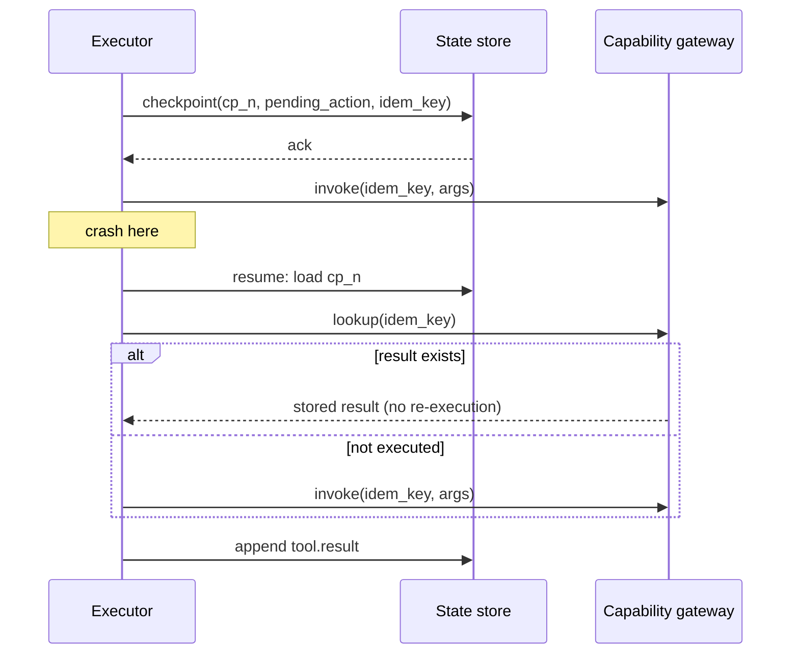

### Recovery, rollback, compensation, idempotency

| Scenario | Strategy |
| --- | --- |
| Executor crash | Workflow engine re-leases the run; the new executor loads the latest checkpoint and replays events after it to rebuild in-memory state; tool calls resolve via idempotency keys |
| Model returns garbage mid-plan | Step-level retry with the same context (temperature 0 for the retry); after 2 failures, escalate model tier; after 3, fail the step with a user-visible error |
| Side effect succeeded, later step failed | Compensation stack runs in reverse for completed `write` actions when the task is cancelled or the user asks to undo; each compensation is itself idempotent and audited |
| Rollback to earlier point | Operator or user picks a checkpoint; the run is forked (`forked_from: run_8842@cp_n`) rather than rewritten, so history stays immutable |
| Duplicate user submission | Session-level idempotency on `client_message_id` |
| Partial memory writes | Memory writes are events first; the memory service consumes them with at-least-once semantics and deduplicates by `evt_id` |

### Identity, consent, and secret state

Consent is a ledger: each record names the user, the scope (memory category, data sharing, personalisation), the version of the terms, and the time; revocation appends a new record. The harness consults the ledger at run creation and freezes the applicable consent snapshot into the run record. Secrets are never in any layer the model or the log can see: the log stores `secret_ref` identifiers, the vault resolves them for the gateway at call time, and rotation changes the vault entry without touching any run.

### Failure modes and mitigations

| Failure | Mitigation |
| --- | --- |
| Log grows without bound | Compaction snapshots per run; completed runs archive the log to cold storage after the retention window, keeping the final projection and evidence bundle |
| Projection drift | Projections are versioned by reducer version; a reducer change triggers a background rebuild from the log |
| Checkpoint too large | Canonical state is bounded by the context policy (section 9); artifacts are references |
| Replay non-determinism | Model and tool results are read from the log during replay; the executor never calls providers during replay |

### Security, privacy, and governance

Log events are redacted at write time by policy; raw payloads with sensitive fields are stored under a separate key with tighter access and shorter retention. Erasure requests tombstone the user's payload blobs and memory records; the hash chain remains valid because hashes were computed on the redacted event, not the blob.

### Example flow

At seq 140 the orchestrator is about to export charts. It writes `cp_01J9...` with the pending action and idempotency key, then invokes the plugin. The pod is evicted. A new pod re-leases `run_8842`, loads the checkpoint, asks the gateway about the key, finds the export completed, appends `tool.result` from the stored result, and continues to draft the leadership summary without a second export appearing in the deck.

## 8. Memory architecture

**Intent.** Memory is a governed, tiered store with explicit write and read policies, scoped by tenant, user, agent, and workspace, and measured for whether it helps, not a transcript that grows until it breaks the context window.

**Problem.** Chat history as memory is unbounded, unfiltered, unpermissioned, and unmeasurable. It stores secrets next to preferences, forgets nothing, retrieves by recency only, and cannot answer "why did the agent believe that?".

### Tiers

| Tier | What it holds | Lifetime | Store | Written by | Read into context as |
| --- | --- | --- | --- | --- | --- |
| Working | Bounded current context: active plan, last K messages, scratchpad, task variables, open tool calls | One run | Run state (section 7), in-memory plus checkpoint | Executor, model (scratchpad) | Directly, under the context budget |
| Episodic | Timestamped records of what happened: conversations, tool calls, observations, decisions, outcomes, user feedback | Months, per retention | Document store plus vector and BM25 index | Memory ingestion from the trajectory log | Retrieved, as compact summaries with `run_id` provenance |
| Semantic | Durable facts: user preferences (section 12 is the authority for those), entity profiles, metric definitions, domain knowledge, learned constraints | Until superseded, decayed, or erased | Fact store (triples or typed records) plus vector index plus graph edges | Promotion from episodic, explicit user statements, curated ingestion | Retrieved facts with confidence and validity |
| Procedural | Reusable skills: workflows, prompt templates, tool-use strategies, successful playbooks | Versioned | Skill registry (versioned documents) | Promotion from repeated successful episodes, authored by humans | Retrieved playbook injected as instructions |
| Retrieval index | Hybrid index over the three durable tiers plus documents | Follows source | Vector DB, keyword index, structured filters, graph | Ingestion pipeline | Not a tier of content; the mechanism |

### Memory record schema

One envelope for every tier, with a tier-specific `body`:

```json
{
  "memory_id": "mem_01J9...",
  "tier": "semantic",
  "kind": "metric_definition",
  "scope": {"tenant_id": "tenant_01J9...", "workspace_id": "ws_product", "user_id": null, "agent_id": null},
  "visibility": "workspace",
  "body": {
    "subject": "metric:weekly_active_users",
    "predicate": "defined_as",
    "object": "distinct authenticated users with at least one qualifying event in a UTC week",
    "structured": {"window": "P1W", "tz": "UTC", "event_filter": "qualifying"}
  },
  "summary": "WAU = distinct authenticated users with a qualifying event in a UTC week",
  "embedding_ref": "vec://semantic/mem_01J9...",
  "keywords": ["WAU", "weekly active users", "metric definition"],
  "provenance": {
    "source_kind": "tool",
    "source_id": "tool_118",
    "source_system": "metrics_catalog",
    "run_id": "run_7719",
    "task_id": "task_01J8...",
    "artifact_id": null,
    "stated_by": null,
    "captured_at": "2026-09-14T11:02:00Z"
  },
  "confidence": 0.98,
  "importance": 0.9,
  "valid_from": "2026-09-14T00:00:00Z",
  "valid_until": "2027-01-01T00:00:00Z",
  "last_accessed_at": "2026-11-03T04:25:12Z",
  "access_count": 17,
  "status": "active",
  "supersedes": null,
  "superseded_by": null,
  "contradicts": [],
  "links": [
    {"rel": "derived_from", "target": "run:run_7719"},
    {"rel": "about", "target": "entity:metric:weekly_active_users"},
    {"rel": "used_by", "target": "agent:sql_data_agent"}
  ],
  "data_categories": ["business_metadata"],
  "pii": false,
  "retention": {"policy": "workspace_default", "expires_at": null},
  "consent_ref": null,
  "version": 3,
  "created_at": "2026-09-14T11:02:00Z",
  "updated_at": "2026-10-01T09:00:00Z"
}
```

How records link to the rest of the platform:

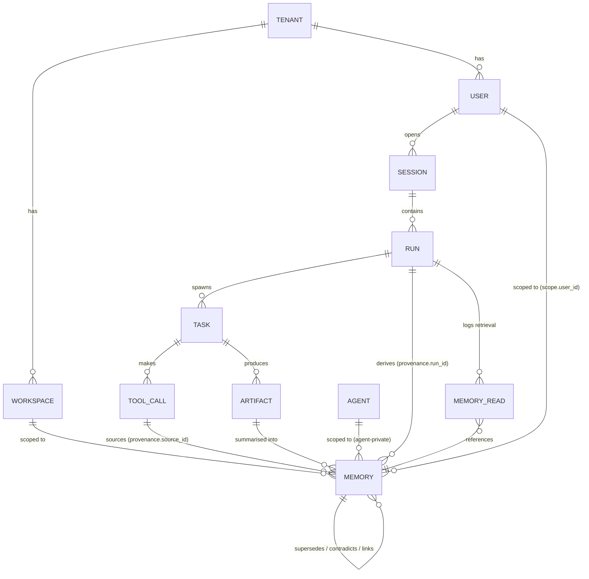

`MEMORY_READ` is an event in the trajectory log recording which memories were retrieved, their scores, and whether they were included in context; it is what makes influence measurable.

### Retrieval (hybrid)

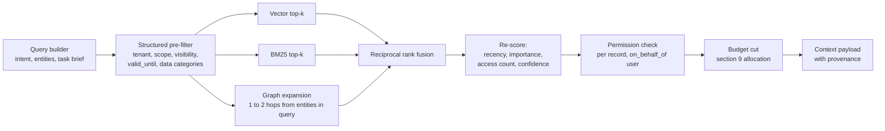

Score: `0.45 * fused_relevance + 0.15 * recency_decay(half_life_days) + 0.2 * importance + 0.1 * confidence + 0.1 * log1p(access_count)`, with weights set per agent memory policy and tuned by the evaluation suite. Permission is checked per record after ranking, never assumed from the filter, because scope and visibility can change between indexing and query.

### Write policy

| Trigger | What is captured | Tier |
| --- | --- | --- |
| Run completes | Compressed episode: goal, outcome, decisions, tool calls (by ID), artifacts, user feedback | Episodic |
| User states a fact or preference explicitly ("WAU excludes bots") | Fact with `stated_by: user`, confidence 0.95 | Semantic (or preference service) |
| Tool returns authoritative reference data (metric catalogue) | Fact with `source_system`, confidence from source | Semantic |
| Same fact observed in 3 or more episodes with no contradiction | Promotion to semantic, confidence raised | Semantic |
| Task succeeded with a tool sequence that matches a known template or repeats 3 or more times | Candidate playbook, human-reviewed before `active` | Procedural |
| Approval or policy decision | Never stored as memory; audit only | None |

Rules:

- Capture is asynchronous from the trajectory log; the run never waits on memory writes.
- Deduplication: a new record whose embedding cosine similarity exceeds 0.92 to an existing record in the same scope and the same `subject` or `predicate` merges (increment `access_count`, keep the higher confidence, union provenance) rather than inserting.
- Contradiction: a new record with the same `subject` and `predicate` but a different `object` creates a `contradicts` link; if the new source authority is higher (user statement beats inference, catalogue beats model summary) the old record is marked `superseded_by`; otherwise both stay with the conflict flagged and the context assembler surfaces both with their provenance.
- Confidence: `stated_by user` 0.95, authoritative system 0.9 to 1.0, model inference 0.5 to 0.7, promoted-by-repetition adds 0.05 per corroborating episode up to 0.9.
- Expiration: `valid_until` from the source where known; otherwise a tier default (episodic 90 days, semantic facts 365 days with decay, procedural none) adjusted by the user's memory preferences and tenant retention policy.
- Exclusions: the write policy never stores secrets, credentials, raw rows, or data categories the user or tenant has excluded (section 12's `memory` preferences); PII categories are blocked unless explicitly consented.

### Read policy

- Gating: retrieval runs only if the query builder finds an entity, a reference to the past ("last time", "as before"), or a task type whose policy says memory helps; a greeting retrieves nothing.
- Budget: section 9 allocates tokens; retrieval returns summaries first and expands to full bodies only within the allocation.
- Provenance: every injected memory carries `source`, `captured_at`, `confidence`, and `run_id`; the system prompt instructs the model to treat memories as evidence to verify, not facts to assert.
- Freshness: a semantic record past `valid_until` is excluded; an episodic record older than the agent's `freshness_horizon` is included only if it ranks in the top 3.
- Permissions: the per-record check uses the run's `on_behalf_of` user, the agent's scope, and the record's visibility; cross-user records require `workspace` or `tenant` visibility.

### Lifecycle

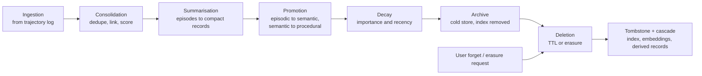

User-controlled forgetting: `DELETE /memory?scope=user&kind=...` or a natural-language request routed through the harness (not the model) tombstones matching records, their embeddings, and any record whose provenance derives solely from them, within 24 h, and emits a `memory.forget` audit event. Right-to-erasure cascades to episodic payloads in blob storage; the trajectory log keeps hashes and redacted events only.

### Isolation

| Scope | Who can read | Example |
| --- | --- | --- |
| `user` | That user only, any agent acting for them | "Prefers concise executive summaries" |
| `agent` | That agent version, for any user in the tenant, never user-specific content | Learned tool-use strategy for the warehouse |
| `workspace` | Members of the workspace | Metric definitions, prior analyses |
| `tenant` | All tenant users, admin-curated | Company glossary |

Indexes are partitioned by tenant (separate collections or namespaces), and the structured pre-filter always includes tenant and scope; a query without a tenant filter is rejected at the memory service, not at the caller.

### Evaluation

| Metric | Method | Target |
| --- | --- | --- |
| Retrieval precision at k | Labelled query set per agent; judged relevance of the top 5 | over 0.7 |
| Retrieval recall | Known-answer set; fraction of required memories retrieved | over 0.85 |
| Task-success lift | A/B: memory on vs off on golden tasks; `MEMORY_READ` influence tagging | positive, significant |
| Hallucination reduction | Fact-check rate of claims with vs without memory provenance | lower with memory |
| Staleness | Share of injected memories past `valid_until` or contradicted | under 2% |
| Privacy leakage | Red-team suite: cross-user, cross-tenant, erased-record queries; canary records | 0 leaks |
| Cost | Tokens of memory per run and cost per successful task | within section 9 allocation |

### Failure modes and mitigations

| Failure | Mitigation |
| --- | --- |
| Memory asserts a stale cause ("it was the iOS crash") | Episodic records injected as hypotheses with date; system prompt rule; freshness horizon |
| Index and store drift | Ingestion is idempotent by `evt_id`; nightly reconciliation job |
| Erased data resurfaces from a derived summary | Cascade by provenance links; canary records in the leak suite |
| Runaway promotion (everything becomes a fact) | Promotion requires corroboration count and authority threshold; semantic tier has a per-user cap with importance-based eviction |

### Example flow

After `run_8842`, ingestion produces one episodic record (goal, outcome, the iOS/EMEA finding, artifacts `art_wau_001` and `art_stats_002`, user feedback positive) and, because the user said "label it as a suspected cause", a user-scoped semantic preference `leadership_summaries: label_causes_as_suspected` with confidence 0.95. The raw 96-row table is not stored, per the user's `remember_raw_query_results: false`. Six weeks later a similar question retrieves the episode as a hypothesis with its date and the metric definition with its catalogue provenance.

## 9. Smart context management

**Intent.** The context window is a budgeted, ranked, permission-filtered, provenance-tagged payload assembled per model call, with a durable task brief as its spine, so that every token in the prompt is there because it earns its place.

**Problem.** Appending everything produces prompts that are expensive, slow, leak data the model should not see, bury the decision in noise, and silently drop the beginning of the conversation when the window fills.

### Assembly pipeline

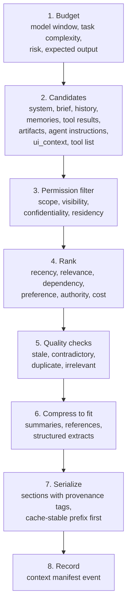

### Budget policy

The assembler computes a budget per model call from the model's window `W`, a reserve `R` for the response, and a per-category allocation. Defaults for a 200k window, interactive analytics task:

| Category | Allocation | Floor | Ceiling | Notes |
| --- | --- | --- | --- | --- |
| Response reserve | 8% | 4k tokens | 32k | Raised for synthesis tasks (expected output size) |
| System prompt and agent instructions | 6% | fixed | fixed | Cache-stable prefix |
| Tool schemas | 5% | top 8 tools | 40 tools | Only tools relevant to the plan or allowlisted for the step |
| Task brief | 3% | always | 6k | Never evicted |
| Conversation history | 25% | last 4 turns | 60k | Older turns summarised |
| Retrieved memories | 8% | 0 | 16k | Gated |
| Tool results (current run) | 25% | current step's results | 60k | Older results compressed to summaries plus artifact refs |
| Task artifacts from children | 10% | summaries | 24k | Full body only if the step consumes it |
| UI context | 0.5% | 0 | 512 tokens | Allowlist only |
| Slack | remainder |  |  | Given to the highest-ranked overflow |

Dynamic adjustment: `complexity` (from a light-model classifier: simple, multi-step, research) scales history and memories up or down by 0.5 to 1.5; `risk` (from policy) forces lossless inclusion of approval, financial, legal, medical, or security content; `expected_output` (from the plan) raises the reserve; a smaller model window scales every category proportionally except brief and reserve floors.

### Selection and ranking

Each candidate chunk gets a score; chunks are added in score order until the category budget is met, then overflow competes for slack.

```python
from dataclasses import dataclass

@dataclass(frozen=True)
class Chunk:
    id: str
    category: str          # history | memory | tool_result | artifact | doc
    tokens: int
    recency: float         # 0..1, exponential decay from age
    relevance: float       # 0..1, hybrid retrieval score vs current step query
    dependency: float      # 1.0 if the current step references it, else 0
    preference: float      # 0..1 from user prefs (e.g. prefers charts -> chart artifacts up)
    authority: float       # 0..1 (user statement 1.0, catalogue 0.9, model summary 0.5)
    is_security_critical: bool

def score(c: Chunk, w: dict[str, float]) -> float:
    base = (w["recency"] * c.recency + w["relevance"] * c.relevance
            + w["dependency"] * c.dependency + w["preference"] * c.preference
            + w["authority"] * c.authority)
    cost_penalty = w["cost"] * (c.tokens / 4000)
    return float("inf") if c.is_security_critical else base - cost_penalty
```

Default weights: recency 0.2, relevance 0.35, dependency 0.25, preference 0.05, authority 0.1, cost 0.05; tuned per agent by the evaluation suite.

Retrieval gating: memories, documents, and prior tool outputs are fetched only when the step's query builder produces a non-empty query (entity, reference to the past, or a plan step that names a source). Preference for references: any candidate over 1,500 tokens is replaced by its summary plus a `resource_ref` the model can expand with a tool call; raw documents enter only when the step is an extraction over that document.

Permission filtering happens before ranking and again at serialization: a chunk whose confidentiality label exceeds the run's output clearance, whose scope is outside the token's, or whose residency is disallowed is dropped and logged in the manifest as `excluded: permission`.

### Compression

| Content | Method | Preserve always |
| --- | --- | --- |
| Older conversation turns | Light-model summarisation into the task brief, 1 summary per 6 turns, re-summarised hierarchically | Decisions, commitments, constraints, named entities, open questions, risks, user corrections |
| Tool outputs | Structured extraction (schema-driven: row counts, aggregates, top-N, anomalies) plus artifact ref; raw output kept in blob storage for audit and UI | Status, errors, data\_as\_of, policy decision |
| Child task artifacts | The artifact's `summary` field plus key fields chosen by the consuming step's schema | Coverage flags, partial markers, confidence |
| Documents | Extracted sections relevant to the query, with section anchors | Citations |
| Lossless classes | No compression: approval requests and decisions, amounts and currencies, legal and medical statements, security findings, credentials-adjacent instructions | Everything |

The durable task brief is the compression target for history and the anchor of every prompt:

```json
{
  "brief_id": "brief_01J9...",
  "session_id": "sess_01J9...",
  "version": 9,
  "goal": "Explain last week's WAU drop, segment by platform and region, draft a leadership summary",
  "constraints": ["aggregate_only (tenant policy)", "min cohort 50", "label causes as suspected"],
  "decisions": [{"at": "2026-11-03T04:27Z", "by": "user", "text": "Include iOS release as suspected cause"}],
  "completed_steps": ["trend retrieved (art_wau_001)", "segment stats (art_stats_002, partial)", "charts emitted"],
  "current_plan": ["draft leadership summary", "export charts (approval pending apr_301)"],
  "key_evidence": [{"claim": "iOS/EMEA is 58% of decline", "artifact": "art_stats_002", "confidence": 0.86}],
  "open_questions": [],
  "risks": ["statistics task was partial: 3 of 4 tests ran"],
  "entities": ["metric:weekly_active_users", "release:ios_8.4.2", "region:EMEA"],
  "updated_at": "2026-11-03T04:27:40Z"
}
```

The brief is updated by a light model after every step from the step's events, validated against its schema, and versioned; it is also the canonical state restored after interruption (section 7) and the seed for episodic memory (section 8).

### Context payload schema

```json
{
  "context_id": "ctx_01J9...",
  "run_id": "run_8842",
  "step": 23,
  "model": {"id": "tier:strong", "window": 200000},
  "budget": {"total": 200000, "reserve": 16000, "allocated": {"system": 9800, "tools": 6100, "brief": 1400, "history": 21000, "memory": 2900, "tool_results": 14200, "artifacts": 5200, "ui_context": 180}},
  "sections": [
    {"kind": "system", "cache_key": "sys@14+agent@3.2.0", "tokens": 9800},
    {"kind": "tools", "tool_ids": ["bi.export_dashboard", "statistics.*"], "tokens": 6100},
    {"kind": "brief", "ref": "brief_01J9...@9", "tokens": 1400},
    {"kind": "history", "items": [{"id": "sum_turns_1_12", "tokens": 900}, {"id": "m13", "tokens": 240}], "tokens": 21000},
    {"kind": "memory", "items": [{"memory_id": "mem_291", "score": 0.91, "tokens": 120, "provenance": {"source": "metrics_catalog", "captured_at": "2026-09-14", "confidence": 0.98}}], "tokens": 2900},
    {"kind": "tool_results", "items": [{"tool_call_id": "tool_201", "mode": "summary+ref", "artifact_id": "art_wau_001", "tokens": 310}], "tokens": 14200},
    {"kind": "artifacts", "items": [{"artifact_id": "art_stats_002", "mode": "summary", "tokens": 420}], "tokens": 5200},
    {"kind": "ui_context", "tokens": 180}
  ],
  "excluded": [
    {"id": "mem_512", "reason": "freshness_horizon"},
    {"id": "art_raw_rows_01", "reason": "permission:aggregate_only"}
  ],
  "quality_flags": [{"id": "mem_480", "flag": "contradicts", "with": "mem_291"}],
  "provenance_policy": "every_item_tagged",
  "hash": "sha256:..."
}
```

The manifest (not the rendered text) is logged as a `context.assembled` event; the rendered prompt is stored in the redacted payload blob with the retention of model telemetry (section 14).

### Summarisation, eviction, and promotion rules

1. Summarise history when it exceeds 70% of its allocation; keep the most recent 4 turns verbatim; summarise the oldest 6 turns into the brief and a `history_summary` chunk.
2. Evict tool results older than the current and previous step down to summary plus reference; evict entirely if no later step references them and the brief has recorded their outcome.
3. Promote any chunk the model cited in its answer (detected by artifact or memory ID in the output) to `dependency = 1.0` for the next 3 steps.
4. Never summarise or evict lossless classes; if they do not fit, the assembler fails the step with `context_overflow` rather than truncating, and the run escalates to a larger-window model or asks the user to narrow scope.
5. Re-summarise hierarchically: summaries of summaries carry the union of preserved fields and a `compression_depth` counter; depth over 3 triggers a brief rebuild from the trajectory log.

### Lifecycle

- Retention: rendered prompts 30 days (redacted), manifests with the run's retention, the brief for the life of the session plus 90 days, history summaries alongside the conversation.
- Session continuation: a new run in an existing session starts from the brief, the last 4 turns, and the `shared` state; nothing else is loaded until gated retrieval asks for it.
- Cross-session memory comes only through the memory service (section 8), never by loading a previous session's history.
- Compact canonical state for recovery is exactly the brief plus the run's checkpoint; a restart renders a fresh context from those and the log, not from a saved prompt.

### Quality controls

| Check | Detection | Action |
| --- | --- | --- |
| Stale | `data_as_of` or `valid_until` older than policy horizon | Exclude or tag `stale` with date |
| Contradictory | Same subject and predicate, different object across chunks | Include both, tag, instruct the model to surface the conflict |
| Duplicate | Embedding similarity over 0.95 or identical artifact hash | Keep the higher-authority copy |
| Irrelevant | Relevance under 0.2 and no dependency | Exclude |
| Provenance | Every item carries source, query, timestamp, author, confidence, permissions, version | Missing provenance is an assembly error |

### Metrics

| Metric | Definition | Why |
| --- | --- | --- |
| Utilisation | Tokens used / window, by category | Spot waste and starvation |
| Relevance precision | Share of included chunks the model cited or that a judge marks useful | Is selection working |
| Compression loss | Judge comparison of brief vs full history on preserved fields; QA probes answered from compressed vs raw | Are summaries losing decisions |
| Cost impact | Task success per 1k context tokens, by category, vs ablations | Does context pay for itself |
| Overflow rate | Steps hitting `context_overflow` | Budget tuning |
| Permission exclusions | Count of chunks dropped by permission | Leak attempts and policy drift |

### Failure modes and mitigations

| Failure | Mitigation |
| --- | --- |
| Decision lost in summarisation | Preserved-field schema on summaries; probes in the eval suite; user corrections are lossless |
| Model acts on stale memory | Freshness tags, hypothesis framing, horizon exclusion |
| Prompt cache thrash | Cache-stable prefix (system, tools, brief header) serialised first and unchanged within a run |
| Oversized tool schemas | Tool list filtered to the plan step; schema trimming of descriptions |

### Example flow

At step 23 the assembler budgets for a strong model, pulls the brief (v9), summarises turns 1 to 12, includes `mem_291` (metric definition) and excludes `mem_512` (March incident) as beyond the freshness horizon, compresses `art_wau_001` to a 310-token summary plus reference, carries the pending approval `apr_301` losslessly, and logs a manifest showing 61k of 200k tokens used with 16k reserved.

## 10. Cost optimization and cost management

**Intent.** Cost is a first-class signal enforced before spend at every layer (model, tool, plugin, memory, delegation, UI), attributed along the delegation chain, and governed by quality and safety floors that savings may never cross.

**Problem.** Agent systems spend in many currencies at once (tokens, API calls, plugin fees, bandwidth, human attention) and most platforms only discover the bill afterwards. Cheap routing without quality gates silently degrades outcomes; uncapped delegation and UI chatter multiply cost invisibly.

### Model routing policy

| Task class | Default tier | Escalate to | Escalation trigger | Degrade to | Degrade trigger |
| --- | --- | --- | --- | --- | --- |
| Intent routing, classification | light | standard | confidence under 0.7 | rules-based | provider outage |
| Extraction, schema fill | light | standard | validation failure | none |  |
| Summarisation (history, tool output) | light | standard | preserved-field probe fails | none |  |
| Planning, decomposition | strong | strongest | plan validation fails twice; `risk: high` | standard | cost mode `saver` and `risk: low` |
| Tool argument generation | standard | strong | schema repair needed twice | light | simple tools with 3 or fewer args |
| Statistical or numeric reasoning | strong | strongest | self-check disagreement | never below strong |  |
| Final synthesis for leadership | strong | strongest | `response_style: executive` and length over 800 tokens | standard | cost mode `saver`, user warned |
| High-risk decisions (`dangerous` actions, approvals text) | strongest | human | always human for the action; model for the explanation | never |  |
| Subagent worker steps | standard | strong | task `risk` or artifact validation failure | light | per Agent Card `model_tier` |

Tiers are logical (`light`, `standard`, `strong`, `strongest`) bound to concrete provider models per tenant and region by the config service, which keeps the policy vendor-neutral and residency-aware. Every routing decision is logged with its reason so cost and quality can be joined later.

### Token and request optimisation

- Prompt caching: the context assembler emits a cache-stable prefix (system prompt, agent instructions, tool schemas, brief header) with a `cache_key`; adapters use provider prompt caching where available and a local prefix cache for providers without it; expect 40 to 70% of input tokens to be cache hits on multi-step runs.
- Template caching: MCP Prompts and agent prompt templates are versioned and compiled once per version.
- Tool result caching: deterministic `read` tools with `idempotent: true` are cached by `(tool_id, version, args_hash, scope)` with the descriptor's `freshness_ttl_s`; invalidation on `data_as_of` change, explicit tool `invalidate` hints, or tenant data refresh events.
- Retrieval caching: memory and document retrieval results cached per `(query_hash, scope)` for 10 minutes within a session.
- Batching: independent tool calls in one model turn execute concurrently; independent light-model calls (classification of several chunks) batch into one request where the provider supports it; embeddings batched by 64.
- Redundancy avoidance: the run keeps a `results_index` of `(tool_id, args_hash)` so a repeated call within the run or across sibling tasks returns the stored artifact; the orchestrator passes artifact refs to children instead of letting them re-query.

### Execution controls

| Scope | Limits | Enforcement point |
| --- | --- | --- |
| Tenant | monthly and daily USD, concurrent runs, plugin spend per plugin | Admission at run creation, ledger reconciliation |
| User | daily USD, concurrent runs, approval threshold | Admission, approval card |
| Session | USD, tokens | Executor before each model call |
| Agent version | USD per run, duration, tool calls, delegation depth and fan-out | Executor and delegation broker |
| Task | USD, tool calls, duration, retries | Delegation broker reserves at creation |
| Plugin | invocations per day, USD, concurrency | Capability gateway |
| Delegation chain | depth, fan-out, total chain USD | Delegation broker |

Budget enforcement flow:

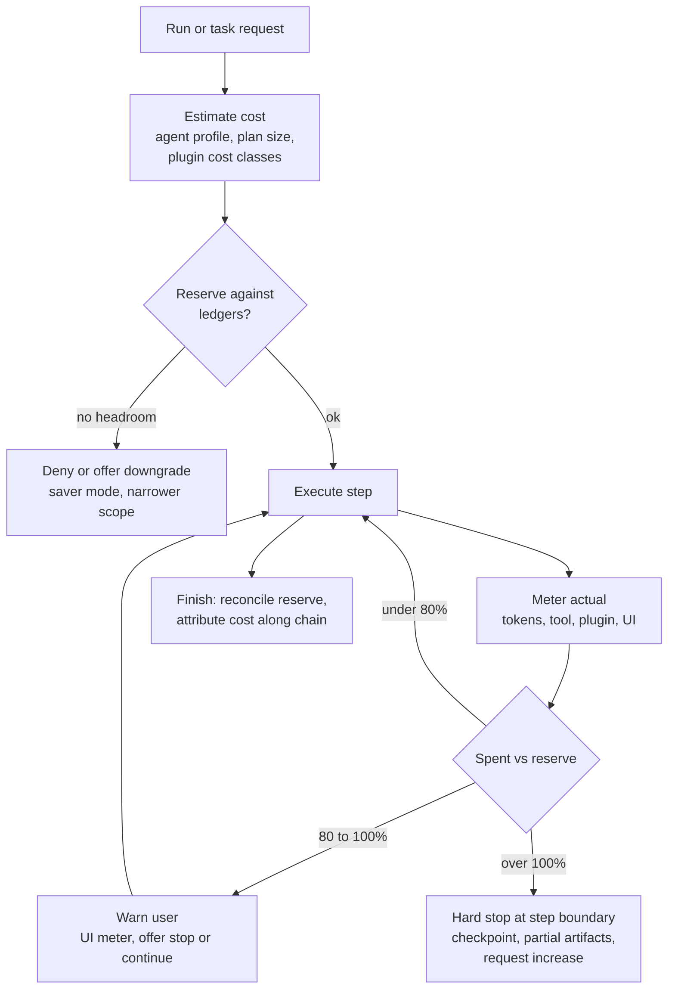

Progressive refinement: the orchestrator first runs a cheap draft (light or standard model, cached results, summaries only) and escalates only when a validator flags low confidence, a schema fails, or the user's cost mode is `quality`. Early termination: after each step a light model checks whether the goal in the brief is satisfied and whether the next planned step's expected value (from the plan's `expected_gain`) exceeds its estimated cost; if not, the run finishes with what it has and says so.

### UI cost management

UI-facing consumption is metered separately from backend model consumption so that "what the user saw" and "what the harness spent" are never conflated.

| UI cost source | Measure | Limit or rule |
| --- | --- | --- |
| Streamed text | tokens delivered | Counted once; counts toward user-visible usage |
| Reasoning exposure | tokens delivered | Off by default; summarised reasoning preferred; counts toward user-visible usage when shown |
| Tool-call cards | events and bytes | Argument previews capped at 1 KB; results via artifact link |
| State deltas | events, bytes, patch ops | Coalesced per 250 ms; max 32 KB per event |
| Activity events | events | Throttled to 4 per second per run; coalesced |
| Custom UI events | bytes, render cost class from plugin manifest | Max 64 KB; charts as specs not images; heavy widgets lazy-loaded |
| Telemetry from client | events | Sampled 10% for interaction events, 100% for errors |

Retention: UI event logs 30 days, custom event payloads 7 days unless pinned as artifacts. Users see a usage meter (user-visible tokens and spend), spend limits, warnings at 80%, and a downgrade option (saver mode) in the UI; internal harness tokens (summarisation, routing, retrieval) are shown separately under "platform overhead" so users are not billed in confusion for tokens they never read.

UI event cost record:

```json
{
  "kind": "ui_event_cost",
  "run_id": "run_8842",
  "event_type": "CUSTOM",
  "custom_name": "app.chart",
  "bytes": 2210,
  "token_equivalent": 0,
  "user_visible": true,
  "render_cost_class": "medium",
  "throttled": false,
  "dropped": false,
  "ts": "2026-11-03T04:26:10Z"
}
```

### Plugin cost management

| Cost class | Meaning | Default control |
| --- | --- | --- |
| `free` | No external cost | Rate limit only |
| `metered` | Internal compute cost tracked | Quota |
| `per_call` | Fixed external fee per invocation | Spend cap, warn over threshold |
| `usage_based` | Variable by data volume or duration | Estimate before call; cap |
| `premium` | High fixed fee or licence | Approval required unless pre-authorised |
| `per_seat` | Licence per user | Enablement check, no per-call cost |
| `external_api` | Pass-through third-party bill | Spend cap, attribution to user and tenant |

Plugin cost record (also the plugin telemetry schema for section 11):

```json
{
  "kind": "plugin_cost",
  "plugin_id": "leadership_deck",
  "plugin_version": "1.8.0",
  "invocation_id": "plug_01J9...",
  "run_id": "run_8842",
  "task_id": "task_root",
  "delegation_chain": ["del_root"],
  "tenant_id": "tenant_01J9...",
  "user_id": "user_01J9...",
  "agent_id": "analytics_chat_agent@3.2.0",
  "cost_class": "per_call",
  "count": 1,
  "duration_ms": 2400,
  "bytes_in": 5120,
  "bytes_out": 880,
  "external_cost_usd": 0.05,
  "internal_cost_usd": 0.002,
  "retry_cost_usd": 0.0,
  "failure_cost_usd": 0.0,
  "quota": {"used": 14, "limit": 100, "window": "day"},
  "status": "ok"
}
```

Controls: quotas and spend caps per plugin per tenant and user; concurrency limits from the manifest; approval requirement for `premium` or any call whose estimate exceeds the user's approval threshold; a warning card before invoking an expensive plugin showing the estimate; automatic disablement of a plugin when its tenant cap is reached, with an admin notification and a UI notice to users.

### Delegation cost control

- A delegation request must carry `purpose`, `expected_artifacts`, `estimated_cost`, and `budget`; the broker rejects requests without them.
- The broker denies a delegation when the parent could do the work itself at lower cost (estimate under the agent's `delegation_overhead_usd`, default 0.05) unless the child holds a scope the parent lacks.
- Depth and fan-out caps per tenant and agent; the chain's total budget is reserved at the root and partitioned downward, so children cannot exceed what the root reserved.
- Cost attribution is additive along the chain: each cost record carries `delegation_chain`; roll-ups per parent are projections of the ledger.

### Cost telemetry schema

One record shape for all cost events, emitted per model call, tool call, plugin call, memory retrieval, delegation hop, and UI event, and rolled up per task, run, user, tenant:

```json
{
  "cost_id": "cost_01J9...",
  "ts": "2026-11-03T04:25:20Z",
  "tenant_id": "tenant_01J9...",
  "user_id": "user_01J9...",
  "session_id": "sess_01J9...",
  "run_id": "run_8842",
  "task_id": "task_01J9...",
  "delegation_chain": ["del_root", "del_101"],
  "agent_id": "sql_data_agent@1.4.2",
  "source": "model",
  "source_id": "call_77",
  "model": {"provider": "vendorA", "id": "standard-2026-06", "tier": "standard", "region": "eu-west"},
  "tokens": {"prompt": 14210, "cached_prompt": 9800, "completion": 612, "reasoning": 0},
  "usd": {"model": 0.0191, "tool": 0.0, "plugin": 0.0, "memory": 0.0, "infra": 0.0004, "ui": 0.0, "total": 0.0195},
  "user_visible": false,
  "routing_reason": "task_class:tool_args;tier:standard",
  "cache": {"prompt_hit_ratio": 0.69, "tool_cache": "n/a"},
  "quality_link": {"eval_id": null, "task_success": null}
}
```

Observability on top: forecasts (per tenant month-to-date spend with a linear and seasonal projection), budget alerts at 50, 80, 100%, anomaly detection (run cost over 3 standard deviations from the agent's 7-day baseline, delegation depth spikes, plugin retry storms), and attribution dashboards by tenant, user, agent, plugin, task class, and delegation chain, all joinable to quality, latency, success, escalation rate, and satisfaction through `run_id`.

### Cost-quality-safety governance

| Dimension | Floor that savings cannot cross | Enforcement |
| --- | --- | --- |
| Safety | `dangerous` actions always go through the strongest tier for explanation and a human for approval | Policy gateway |
| Numeric correctness | Statistical and financial reasoning never below `strong`; results self-checked | Routing policy |
| Lossless context | Approval, financial, legal, medical, security content never compressed | Context assembler |
| Task success | A cheaper route is adopted only if the eval suite shows no significant drop (non-inferiority margin 2 points) | Deployment manager |
| Confidence | Low-confidence outputs on high-risk tasks escalate to a stronger model or human review regardless of budget | Validator |

Trade-off matrix:

| Lever | Cost saving | Quality risk | Safety risk | Allowed when |
| --- | --- | --- | --- | --- |
| Light model for summarisation | high | medium (lost decisions) | low | Preserved-field probes pass |
| Aggressive history compression | high | medium | low unless lossless classes involved | Never for lossless classes |
| Tool result caching | medium | low (staleness) | low | `freshness_ttl_s` honoured |
| Skip memory retrieval | low to medium | medium | low | Gating says no entities |
| Standard instead of strong for planning | medium | high on multi-step | medium | `risk: low`, saver mode, plan validator passes |
| Reduce delegation (do it in parent) | medium | low | low | Parent has scope and skill |
| Suppress reasoning stream to UI | low (bandwidth) | none | none | Preference |
| Early termination | medium | medium | low | Goal check passes |
| Cheaper plugin or fallback tool | varies | varies | low | Fallback declared in registry |

### Example: cost optimisation for the WAU workflow

| Step | Naive approach | Optimised approach | Saving |
| --- | --- | --- | --- |
| Intent and clarification check | strong model, full history | light model, brief plus last 4 turns | roughly 90% of that call |
| Planning | strong, all tools listed | strong, 8 relevant tools, cached prefix | roughly 40% input tokens |
| SQL agent | 4 uncached queries, raw rows inlined | schema and metric validation cached (TTL 1 h), aggregate query artifact plus 310-token summary | roughly 85% context tokens on the parent |
| Statistics agent | strong model, full table in prompt | strong model, artifact summary plus structured input; capped at 5 tool calls | roughly 60% |
| Visualization agent | standard model, base64 PNG events | light model, chart spec events (2 KB each) | 95% of UI bytes |
| Leadership summary | strongest | strong, escalate only if executive-style validator fails | roughly 50% on that call |
| Export | per-call plugin, no estimate | estimate shown, approval card, single call with idempotency key | avoids duplicate fee on retry |

Illustrative run total: naive roughly $1.90, optimised roughly $0.65, with the same artifacts and a passing eval score; the exact figures depend on the tenant's model bindings and should be read from the cost ledger, not assumed.

### Failure modes and mitigations

| Failure | Mitigation |
| --- | --- |
| Cheap route degrades quality silently | Eval-gated routing changes; shadow evaluation; quality join on `run_id` |
| Reserve starvation (reservations never reconciled) | Reservations expire with the run's `max_duration_s` plus grace |
| Cache serves stale results | TTLs from descriptor, invalidation hooks, `data_as_of` surfaced to the model |
| Plugin bill shock | Estimates before call, caps, auto-disable, attribution |
| UI bandwidth blowup | Event size limits, throttling, coalescing, artifact references |

### Security, privacy, and governance

Cost records carry IDs, never content. Billing exports are per tenant and residency-bound. Users can see their own usage; tenant admins see aggregates and per-user totals under the tenant's privacy policy. Routing to a cheaper provider never bypasses residency or data-category rules.

## 11. Plugin management

**Intent.** A plugin is a signed, versioned package that declares exactly what it needs (permissions, data, cost, UI surface) and runs in a sandbox with credentials it never sees in the clear, so third-party capability can be added without widening the platform's trust boundary.

**Problem.** Unmanaged integrations become the softest part of the system: over-broad OAuth scopes, secrets in environment variables, no way to know what a plugin read, no way to remove it cleanly.

### Plugin kinds

| Kind | What it provides | Runtime |
| --- | --- | --- |
| Tool plugin | One or more tools (section 1 descriptors) | Sandboxed worker or remote MCP server |
| Connector | Credentialed access to an external system, exposing tools and resources | Remote MCP server behind the gateway |
| MCP server | Any MCP-compliant server packaged with a manifest | stdio in sandbox, or HTTP with mTLS |
| Skill | Procedural memory package: instructions, playbooks, prompt templates | No code; loaded by the context assembler |
| UI widget | Custom event renderers (cards, forms, charts) | Client-side sandbox (iframe or isolated component) |
| Third-party integration | Bundle of the above with a publisher identity | As above |

### Manifest schema

```json
{
  "manifest_version": "1",
  "plugin_id": "com.example.leadership_deck",
  "name": "Leadership Deck",
  "version": "1.8.0",
  "publisher": {"id": "pub_example", "name": "Example Analytics Ltd", "verified": true},
  "description": "Saved dashboards, metric definitions, and export to the leadership deck",
  "kinds": ["connector", "ui_widget", "skill"],
  "compatibility": {"harness_api": ">=2.3 <3", "mcp": "2025-06", "ui_protocol": ">=1.2"},
  "signing": {"algorithm": "ed25519", "key_id": "pub_example_k3", "signature": "base64...", "sbom_ref": "sbom://com.example.leadership_deck@1.8.0"},
  "runtime": {"type": "remote_mcp", "endpoint": "https://mcp.example.com/deck", "transport": "streamable-http", "mtls": true, "egress": ["api.example.com:443"]},
  "tools": [
    {"id": "bi.list_dashboards", "action_class": "read", "cost_class": "free"},
    {"id": "bi.get_metric_definition", "action_class": "read", "cost_class": "free"},
    {"id": "bi.export_dashboard", "action_class": "write", "cost_class": "per_call", "cost_estimate_usd": 0.05, "idempotent": true, "compensation": "bi.delete_export"}
  ],
  "resources": [{"uri_template": "bi://dashboards/{id}", "data_categories": ["business_metadata"]}],
  "prompts": [{"id": "executive_summary_style", "version": 2}],
  "permissions": {"$ref": "#/permission_schema"},
  "data_access": {"reads": ["business_metadata", "aggregated_metrics"], "writes": ["external_documents"], "pii": false, "retention_days": 30, "residency": ["eu-west", "us-east"]},
  "cost": {"class": "per_call", "currency": "USD", "estimate_endpoint": "/estimate", "quota_default": {"per_day": 100}},
  "supported_agents": ["analytics_chat_agent", "*"],
  "ui": {
    "widgets": [{"event_name": "com.example.deck_preview", "version": 1, "schema_ref": "#/schemas/DeckPreview", "render_cost_class": "medium", "max_bytes": 65536}],
    "actions": [{"id": "open_in_bi", "label": "Open in BI", "kind": "link"}],
    "forms": [{"id": "export_options", "schema_ref": "#/schemas/ExportOptions"}],
    "state_contributions": [{"path": "/shared/plugins/leadership_deck", "schema_ref": "#/schemas/DeckState", "max_bytes": 4096}]
  },
  "health": {"endpoint": "/health", "interval_s": 60},
  "lifecycle": {"status": "certified", "deprecated_at": null, "min_supported_version": "1.5.0"},
  "review": {"security": "passed:2026-10-02", "privacy": "passed:2026-10-02", "compatibility": "passed:2026-10-05", "certification_id": "cert_01J9..."}
}
```

### Permission schema

```json
{
  "scopes": [
    {"scope": "read:bi_dashboards", "required": true, "reason": "List and read saved dashboards"},
    {"scope": "write:bi_export", "required": false, "reason": "Export charts into decks", "risk": "medium", "approval": "user_threshold"}
  ],
  "resources": [{"pattern": "bi://dashboards/*", "actions": ["read"]}, {"pattern": "bi://decks/leadership/*", "actions": ["write"]}],
  "data_categories": {"may_read": ["business_metadata", "aggregated_metrics"], "may_write": ["external_documents"], "forbidden": ["pii", "row_level_user_data", "credentials"]},
  "retention": {"plugin_side_max_days": 30, "must_support_deletion": true},
  "credentials": {"type": "oauth2", "grant": "authorization_code", "scopes": ["dashboards.read", "decks.write"], "token_exchange": true, "rotation": "on_expiry"},
  "network": {"egress_allow": ["api.example.com:443"]},
  "revocation": {"webhook": "https://mcp.example.com/deck/revoke", "must_ack_within_s": 300}
}
```

Permissions are granted at install time per level (platform, tenant, group, user); the effective grant is the intersection of the manifest's request, the tenant admin's approval, and the user's consent. Optional scopes are off until a user or admin turns them on, and the UI explains each with the manifest's `reason`.

### Registry and enablement

| Level | Who | Effect |
| --- | --- | --- |
| Platform | Platform operator | Certified catalogue; global denylist; version pinning |
| Tenant | Tenant admin | Allowlist of plugins and versions; tenant-wide credentials (service accounts); spend caps; data category overrides (stricter only) |
| Group | Group admin | Enablement for teams; default optional scopes |
| User | User | Personal enablement and OAuth grant; personal quota within tenant cap |

The registry stores the manifest, signature verification result, review status, and per-level enablement; the capability gateway consults the registry on every invocation (cached 30 s) so a disabled plugin stops immediately.

### Sandboxing and isolation

- Local plugins run in per-tenant sandboxes (gVisor or Firecracker class isolation, or WebAssembly for small tools) with no host filesystem, egress limited to the manifest's `egress_allow`, CPU and memory quotas, and a wall-clock limit per invocation.
- Remote plugins are reached only through the capability gateway with mTLS and the per-hop token; the harness never exposes internal services to them.
- UI widgets render in an isolated frame with a message bridge; they receive only the event payload and the plugin's own state contribution, never the full state document or the conversation.
- Skills contain no code; their instructions are rendered as untrusted-origin content in context and cannot grant scopes.

### Credential management

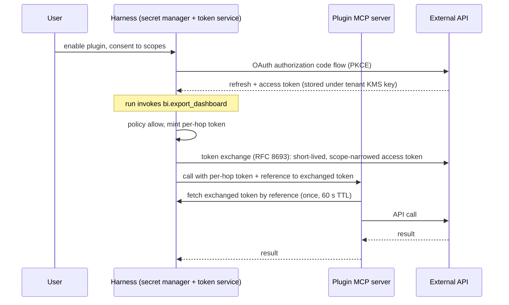

Rules: user-level OAuth tokens are stored encrypted under the tenant's key and bound to the user; service accounts are tenant-level with their own rotation schedule; plugins receive a short-lived exchanged token by reference, never the refresh token; rotation is driven by the secret manager and never requires a run to change; revocation deletes the stored grant and calls the plugin's revocation webhook, which must acknowledge within 5 minutes or the plugin is flagged.

### Execution policy

| Control | Mechanism |
| --- | --- |
| Allowlist and denylist | Tenant and platform lists by plugin ID and version range; denylist wins |
| Risk scoring | Manifest permissions, action classes, publisher verification, review age, and observed error rate produce a score 0 to 100; above 70 requires admin approval per invocation of `write` tools |
| Rate limits and quotas | Per plugin per tenant and user; from manifest defaults, overridable downward |
| Spend caps | Section 10 plugin ledgers; auto-disable at cap |
| Approval | `dangerous` always; `write` by user threshold or risk score |

### UI integration

Plugins contribute cards (rendered from `CUSTOM` events with their registered schema), forms (schema-driven, submitted over the control channel as `custom_action`), actions (links or harness-mediated tool invocations), approvals (the standard approval card, with plugin-supplied preview), streaming updates (progress events scoped to the plugin's invocation), and state contributions (a bounded subtree of `shared` under `/shared/plugins/<id>` that only that plugin and the client may write).

### Observability

Every invocation produces a span under the tool span (section 13), a plugin telemetry record (the `plugin_cost` shape in section 10 plus `permissions_used`, `data_accessed` categories, `ui_events_emitted`), and audit events for credential fetches, scope use, and data category access. Dashboards per plugin: invocation count, p50 and p95 latency, error rate, cost, quota consumption, data access by category, widget render failures.

### Review and certification

| Review | Checks | Outcome |
| --- | --- | --- |
| Security | Signature and SBOM, dependency vulnerabilities, sandbox escape tests, egress conformance, secret handling | pass or fail with findings |
| Privacy | Data categories vs actual access in test runs, retention and deletion support, PII handling, residency | pass or fail |
| Compatibility | Manifest validation, schema conformance of tools and events, harness API version, UI protocol tests | pass or fail |
| Certification | All passed, publisher verified, support contact, changelog | `certified`; required for tenant-wide enablement |

Updates re-run the reviews; a minor version with unchanged permissions can auto-certify if tests pass; any permission change requires re-consent from users and admins.

### Lifecycle example: install, authorise, invoke, update, revoke, uninstall

1. Install: tenant admin enables `com.example.leadership_deck@1.8.0`; the registry verifies the signature and certification and records the tenant allowlist entry with a $20/day cap.
2. Authorise: the PM enables it personally and completes OAuth; the grant is stored under the tenant key, scopes `dashboards.read` and `decks.write`; `write:bi_export` remains an optional scope the PM turns on.
3. Invoke: the orchestrator calls `bi.export_dashboard`; policy requires approval (user preference), the PM approves, the gateway exchanges a 60 s token, the plugin exports, telemetry records $0.05 and the data categories accessed.
4. Update: 1.9.0 adds a new optional scope `decks.delete`; the update installs but the new scope is off; admins and users see a re-consent prompt only if they enable it.
5. Revoke: the PM revokes the plugin; the grant is deleted, the revocation webhook fires, the plugin acknowledges deletion of its cached data within 5 minutes.
6. Uninstall: the tenant admin removes the plugin; the harness disables all tools immediately, revokes all grants, deletes plugin state contributions from `shared`, and schedules artifact cleanup for plugin-produced artifacts after the retention window, leaving tombstones and audit records.

### Failure modes and mitigations

| Failure | Mitigation |
| --- | --- |
| Plugin exfiltrates data via egress | Egress allowlist in sandbox; data category audit; DLP on outbound writes |
| Scope creep on update | Permission diff triggers re-consent; auto-certify only when unchanged |
| Plugin outage | Health probes; circuit breaker; fallback tools; UI notice |
| Widget breaks the client | Isolated frame, payload limits, generic card fallback |
| Orphaned credentials after uninstall | Uninstall is a workflow with verification steps and audit |

## 12. User preference management

**Intent.** Preferences are typed, layered, consented settings that the harness resolves deterministically and injects selectively, so personalisation changes behaviour where it should and nowhere else.

**Problem.** Dumping a profile into the system prompt leaks private detail into every call, costs tokens, lets a preference silently override a policy, and leaves the user unable to see or undo what the agent "knows".

### Preference schema

```json
{
  "preference_set_id": "pref_01J9...",
  "scope": {"level": "user", "tenant_id": "tenant_01J9...", "user_id": "user_01J9...", "workspace_id": null, "session_id": null, "task_id": null},
  "version": 12,
  "consent": {"personalisation": true, "consented_at": "2026-09-01T10:00:00Z", "terms_version": "3"},
  "communication": {"language": "en-GB", "tone": "professional", "verbosity": "concise", "formatting": {"tables": "prefer", "bullets": "when_scannable", "em_dashes": false}, "accessibility": {"screen_reader": false, "reduced_motion": false, "min_font_px": null}},
  "interaction": {"streaming": "stream", "reasoning_visibility": "summary", "tool_card_visibility": "collapsed", "confirmation_frequency": "writes_only"},
  "defaults": {"preferred_tools": ["warehouse_sql", "product_metrics", "bi_dashboards"], "preferred_plugins": ["leadership_deck"], "workspace": "ws_product", "timezone": "Europe/London", "locale": "en-GB", "units": "metric", "currency": "GBP"},
  "memory": {"allow_remember": true, "categories_allowed": ["business_metadata", "work_preferences", "prior_analyses"], "categories_excluded": ["financial_details", "personal_life"], "retention_days": 90, "remember_raw_query_results": false},
  "cost": {"model_quality": "balanced", "spend_limit_usd_per_day": 10.0, "cost_saving_mode": false, "approval_threshold_usd": 0.50},
  "privacy": {"data_sharing_scope": "workspace", "telemetry_opt_in": true, "full_capture_opt_in": false, "personalisation_opt_in": true},
  "delegation": {"allowed_subagents": ["sql_data_agent", "statistics_agent", "visualization_agent"], "require_approval_for": ["export", "external_write"], "max_depth": 2, "max_fanout": 3},
  "task_rules": [
    {"id": "tr_1", "when": {"task_class": "research"}, "set": {"cost.model_quality": "economy"}, "source": "explicit", "stated_at": "2026-10-20T09:12:00Z"},
    {"id": "tr_2", "when": {"action": "refund", "amount_lte": 50}, "set": {"interaction.auto_approve": true}, "source": "explicit", "stated_at": "2026-10-20T09:13:00Z"}
  ],
  "provenance": {"tr_1": "explicit", "communication.verbosity": "explicit", "defaults.preferred_tools": "inferred:0.72"},
  "audit": {"created_at": "2026-09-01T10:00:00Z", "updated_at": "2026-10-20T09:13:00Z", "updated_by": "user_01J9..."}
}
```

Every leaf has a provenance of `explicit` (user set it), `inferred:<confidence>` (the harness proposed it from behaviour and the user accepted), or `default`. Inferred preferences are never applied silently: they are proposed in the UI, applied only after acceptance, and carry their confidence.

### Storage and precedence

| Level | Stored by | Typical content |
| --- | --- | --- |
| Platform defaults | Platform | Safe baselines |
| Tenant policy | Tenant admin | Mandatory floors and ceilings (max spend, forbidden memory categories, required approvals) |
| Tenant defaults | Tenant admin | Suggested defaults users can change |
| Workspace overrides | Workspace admin | Preferred tools, data policy for the workspace |
| User profile | User | Everything above, personal |
| Session overrides | User, in session | "For this chat, be verbose" |
| Task overrides | User or orchestrator for one task | "Use the strong model for this summary" |

Resolution order, most specific wins, except that tenant policy is a hard bound at every level:

```python
ORDER = ["platform_default", "tenant_default", "workspace", "user", "session", "task"]

def resolve(leaf: str, layers: dict[str, dict], policy: dict) -> tuple[object, str]:
    """Return (value, source). Tenant policy clamps the final value."""
    value, source = None, "unset"
    for layer in ORDER:
        if leaf in layers.get(layer, {}):
            value, source = layers[layer][leaf], layer
    bound = policy.get(leaf)
    if bound is not None:
        clamped = bound.clamp(value)
        if clamped != value:
            return clamped, f"{source}+policy_clamped"
    return value, source
```

Conflicts inside one level (two task rules match) resolve by specificity (more `when` conditions wins), then most recently stated. The resolved set is frozen into the run record with each leaf's source so behaviour is explainable and reproducible. Storage is per tenant cell, encrypted at rest under the tenant key, residency-bound; every write produces a new version with a diff and the actor, and any version can be restored.

### Injection policy

| Phase | Preferences injected | Form |
| --- | --- | --- |
| Planning | `cost`, `delegation`, `defaults.preferred_tools`, relevant `task_rules` | Structured block, not prose |
| Tool and plugin selection | `defaults.preferred_tools`, `defaults.preferred_plugins`, `delegation.allowed_subagents` | Filter on the tool list and delegation graph (harness-side, not prompt) |
| Response generation | `communication`, `defaults.timezone/locale/units/currency`, `interaction.reasoning_visibility` | Short style block (under 150 tokens) |
| UI rendering | `interaction`, `communication.accessibility` | Client-side; never in the prompt |
| Delegation | Child gets only the leaves its Agent Card declares it honours (usually `communication.language`, `cost`) | Structured, in the task inputs |
| Memory | `memory.*` | Harness-side write and read filters; never in the prompt |

The prompt never receives the whole profile. The context assembler asks the preference service for `relevant_for(phase, task_class, tools_in_plan)` and gets back only matching leaves, each tagged with its source. Preferences cannot override mandatory safety, compliance, or tenant policy: the clamp step above runs before injection and the policy gateway re-checks at action time (a preference saying "always approve" is advisory to the UI, never to the policy engine).

### Lifecycle

- Capture: explicit via settings UI or natural language ("from now on keep it short"), which the harness converts to a structured proposal the user confirms; inferred proposals come from repeated behaviour (three sessions in a row asking for shorter answers) with a confidence score and a one-tap accept or dismiss.
- View, edit, delete, export, reset: a preferences page shows every leaf with source and date; export as JSON; reset to tenant defaults with version history retained.
- Staleness and contradiction: a preference unused for 180 days is flagged; a new explicit preference that contradicts an existing one (verbosity `concise` vs task rule `verbose for research`) prompts the user to confirm the override or scope it.
- Explanation: when a preference materially changes behaviour (model downgrade, auto-approval, tool choice), the UI shows a short "because of your setting X" note on the relevant card, with a link to change it.

### Worked example

The user sets four preferences: "concise answers", "use cheap model for research", "always approve refunds", "do not remember financial details".

| Statement | Stored as | Resolution and effect |
| --- | --- | --- |
| concise answers | `communication.verbosity = concise` (explicit) | Injected at response generation as a style line; summaries target under 150 words |
| use cheap model for research | `task_rules[tr_1]: when task_class=research set cost.model_quality=economy` | Planning phase routes research steps to `light` or `standard`; final synthesis still obeys the routing floors in section 10 |
| always approve refunds | Proposed as `task_rules: when action=refund set interaction.auto_approve=true`; tenant policy clamps to `amount_lte: 50` and `action_class != dangerous` | UI skips the approval card for refunds up to 50; above that the card appears with the note "your auto-approve setting is capped at 50 by your organisation"; audit records every auto-approval with the rule ID |
| do not remember financial details | `memory.categories_excluded += financial_details` | Memory write policy drops any record classified `financial_details`; existing records in that category are tombstoned within 24 h and the user is told how many were removed |

### Failure modes and mitigations

| Failure | Mitigation |
| --- | --- |
| Preference used as a policy bypass | Clamp plus policy gateway re-check; preferences are inputs, never authorisations |
| Whole profile leaks into every prompt | Phase-scoped injection; token cap on the style block |
| Inferred preference surprises the user | Proposal and accept flow; explanation notes |
| Stale preference drives wrong behaviour | 180-day staleness flag; contradiction prompts |

### Security, privacy, and governance

Preferences are personal data: encrypted, residency-bound, exportable, erasable, versioned with actor. Sensitive categories (health, protected attributes) are not preference leaves at all; accessibility needs are stored as functional settings (font size, reduced motion) rather than conditions. Tenant admins see aggregate preference statistics, not individual profiles, unless the tenant's policy and the user's `data_sharing_scope` allow it.

## 13. Observability

**Intent.** One OpenTelemetry trace joins a user request to every model call, tool, plugin, delegation hop, memory operation, UI event, and approval it caused, with correlation IDs that survive queues, retries, and restarts.

**Problem.** Agent failures are rarely in one place: a slow answer may be queue wait, a retried tool, a stuck approval, or a child agent three hops down. Without end-to-end tracing and cost-joined metrics, operators guess.

### Span model

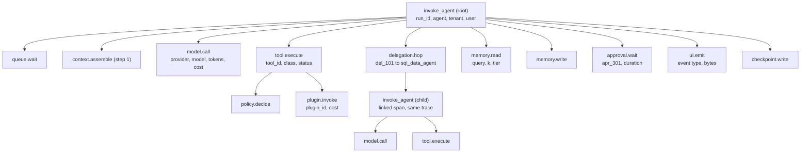

Span naming follows the OpenTelemetry GenAI semantic conventions where they exist (`gen_ai.*` attributes on model spans: system, request model, response model, input and output tokens, finish reasons) and a harness namespace (`harness.*`) for the rest. Child agents run as linked spans in the same trace (`trace_id` propagated in the envelope), with `harness.delegation.depth` and `harness.delegation.chain` attributes so a trace can be rendered as a tree.

### Correlation IDs

| ID | Attribute | Set by | Propagated via |
| --- | --- | --- | --- |
| tenant | `harness.tenant_id` | Edge | Envelope, baggage |
| user | `harness.user_id` (hashed in exports) | Edge | Envelope |
| session | `harness.session_id` | Edge | Envelope |
| run | `harness.run_id` | Executor | Envelope, event stream, cost records |
| step | `harness.step` | Executor | Span attribute |
| task | `harness.task_id` | Delegation broker | Envelope |
| agent | `harness.agent_id`, `harness.agent_version` | Executor | Span attribute |
| model call | `harness.call_id` | Model router | Span, cost record |
| tool call | `harness.tool_call_id` | Gateway | Span, event stream, cost record |
| plugin call | `harness.plugin_invocation_id` | Gateway | Span, plugin telemetry |
| delegation hop | `harness.delegation_id` | Broker | Span link, token chain |
| approval | `harness.approval_id` | Policy | Span, audit |
| context | `harness.context_id` | Assembler | Span, manifest |

W3C `traceparent` and `baggage` headers carry the trace across HTTP and MCP calls; the queue carries them in message metadata; the workflow engine restores them on resume so a run that spans two pods is one trace.

### Structured logs

```json
{
  "ts": "2026-11-03T04:25:14.021Z",
  "severity": "INFO",
  "logger": "harness.gateway",
  "message": "tool executed",
  "trace_id": "4bf92f35...",
  "span_id": "00f067aa...",
  "harness": {"tenant_id": "tenant_01J9...", "run_id": "run_8842", "task_id": "task_01J9...", "tool_call_id": "tool_201", "tool_id": "warehouse.run_aggregate_query", "action_class": "read"},
  "attrs": {"duration_ms": 1840, "status": "ok", "attempt": 1, "args_redacted": {"metric": "weekly_active_users", "group_by": ["week", "platform", "region"], "filters": "[REDACTED:pii]"}},
  "redaction": {"policy": "redact@7", "applied": ["attrs.args_redacted.filters"]},
  "retention_class": "ops_30d"
}
```

Rules: severity per OTel log levels; redaction at the emitter by field-path policy from tool and plugin schemas (`x-pii`, `x-secret`); prompts, completions, and raw tool payloads are never in logs, only IDs and hashes (full capture lives in the opt-in telemetry store, section 14); retention classes `ops_30d`, `security_1y`, `audit_7y` set per log kind; tenant ID on every line for scoping.

### Sampling

| Condition | Sampling |
| --- | --- |
| Error or exception on any span | 100%, tail-based |
| Approval requested or resolved | 100% |
| `dangerous` or `write` action | 100% |
| Policy deny or violation | 100% |
| Cost anomaly (run over 3 sigma or over budget warning) | 100% |
| Latency over SLO | 100% |
| Canary agent version | 100% |
| Everything else | Head sampling 10%, raised per tenant on request |

Tail-based sampling runs in the collector so the decision can look at the whole trace; the run's trace is held for up to 10 minutes after the terminal event before the decision is final.

### Metrics and dashboards

| Dashboard | Key metrics (all by tenant, agent version, model tier) |
| --- | --- |
| Latency | `run.duration` p50 p95 p99, time-to-first-token, `queue.wait`, `model.call.duration`, `tool.execute.duration`, `approval.wait` |
| Tokens and cost | prompt, cached, completion tokens per run; USD per run, per task class, per successful task; cache hit ratio |
| UI | events per run by type, bytes per run, throttled and dropped counts, reconnects, render errors |
| Plugins | invocations, error rate, p95, cost, quota consumption, auto-disable events |
| Tools | success rate by tool version, circuit breaker state, fallback usage, deprecated-tool usage |
| Delegation | depth distribution, fan-out, child failure rate, chain cost |
| Reliability | error rate by kind, completion rate (runs ending `FINISHED`), executor restarts, replay count |
| Human loop | approval request rate, approval wait time, expiry rate, auto-approval share |

### SLOs and alerts

| SLO | Target | Alert |
| --- | --- | --- |
| Interactive run time-to-first-token | p95 under 2.5 s | Page at 5 min breach |
| Interactive run completion | 99% end with a terminal event within `max_duration_s` plus 60 s | Page |
| Run success rate | 97% `FINISHED` (excluding user cancels) | Ticket at 95%, page at 90% |
| Tool success rate (per tool) | 99% | Ticket at 97%, page at 95% or breaker open over 5 min |
| Approval wait | p50 under 2 min interactive | Ticket |
| Cost per successful task | within 20% of 7-day baseline | Ticket at 20%, page at 50% |
| Event stream availability | 99.9% | Page |
| Trace completeness | over 99% of runs have a root span and terminal event | Ticket |

### Failure modes and mitigations

| Failure | Mitigation |
| --- | --- |
| Trace breaks across the queue or a resume | IDs in message metadata; workflow engine restores context; completeness SLO catches regressions |
| Logs leak content | Emitter-side redaction, schema-driven; DLP scan on the log pipeline as a backstop |
| Cardinality explosion | No free-text or user IDs as metric labels; user ID only in traces and logs |
| Sampling hides a slow-burn issue | Always-on aggregate metrics; sampling applies to traces only |

### Security, privacy, and governance

Observability data is tenant-scoped and residency-bound; exports hash user IDs; operator access to traces is itself audited; retention is per class and honours erasure by scrubbing user-linked attributes from retained traces.

### Example flow

An operator sees the approval-wait p50 jump. Filtering the trace view by `harness.approval_id` shows that `apr_*` spans for the `leadership_deck` plugin average 9 minutes because requests fire outside the approver's hours; the dashboard links the same runs to cost (idle reservations) and the fix is a background priority class with a 24 h expiry for that action.

## 14. Telemetry and evaluation

**Intent.** AI-specific telemetry is captured privacy-safe by default, joined on `run_id`, and fed into offline and online evaluation so that every routing, compression, memory, or prompt change is judged by task outcomes rather than by eyeballing transcripts.

**Problem.** Standard observability tells you a call took 900 ms; it does not tell you whether the answer was right, whether the memory helped, whether the cheaper model lost a decision, or whether a prompt change regressed a tenant.

### Telemetry families

| Family | Fields | Notes |
| --- | --- | --- |
| Model | provider, model id and version, tier, region, prompt tokens, cached tokens, completion tokens, reasoning tokens, cost, latency, time-to-first-token, finish reason, safety outcomes (provider filters, harness classifier flags), routing reason, cache key hit | One record per `model.call` |
| Tool | tool id and version, redacted arguments (schema-driven), status, duration, retries, circuit state, action class, side-effect flag, provenance (`data_as_of`, policy decision), cache hit | One per invocation |
| Plugin | plugin id and version, invocation count, permissions used, data categories accessed, external API cost, quota consumption, errors, UI events emitted | Section 10's `plugin_cost` shape plus access fields |
| UI | event type, payload bytes, token-equivalent (text and reasoning), rendering latency (client-reported), dropped and throttled counts, reconnects, user interactions (expand card, approve, cancel, pin) | Client interactions sampled; errors 100% |
| Delegation | parent, child, purpose, scope, depth, status, artifacts produced, elapsed, cost, join policy outcome | One per hop |
| Memory | query (hashed, with entity IDs), sources and tiers, k, scores, included vs excluded, write, promotion, forget events, influence (cited in output or judge-attributed) | `MEMORY_READ` and `memory.write` events |
| Quality | task success (validator, judge, or user), user feedback (thumbs, edits, corrections), escalations (to stronger model or human), hallucination and policy flags, eval scores | Joined to the run after completion |

Quality record:

```json
{
  "run_id": "run_8842",
  "agent_id": "analytics_chat_agent@3.2.0",
  "task_class": "analytics_explain",
  "success": {"validator": true, "judge": 0.88, "user_feedback": "positive"},
  "corrections": [{"kind": "instruction", "text_hash": "sha256:...", "at_step": 24}],
  "escalations": [{"kind": "model_tier", "from": "standard", "to": "strong", "reason": "validator_fail", "step": 9}],
  "flags": {"hallucination": false, "policy": [], "stale_memory_used": false},
  "eval": {"suite": "analytics_golden_v7", "case_id": null, "score": null},
  "cost_usd": 0.65,
  "latency_s": 71
}
```

### Privacy-safe capture

| Data | Default | Opt-in full capture |
| --- | --- | --- |
| Prompts and completions | Not stored; hashes, token counts, and the context manifest only | Stored encrypted in the telemetry store, tenant key, 30-day retention, access audited |
| Tool arguments and results | Schema-redacted arguments; result hash and artifact ID | Full arguments and inline results, same conditions |
| Plugin payloads | Sizes and categories | Full payloads, same conditions |
| Memory content | IDs and scores | Content snippets, same conditions |
| User text | Never in telemetry; lives in conversation state under conversation retention | Same |

Opt-in is per tenant with user-level opt-out, recorded in the consent ledger, and the capture store is a separate system with its own access policy. Evaluation datasets built from captured data go through de-identification and a review step before leaving the tenant boundary, and most tenants never allow that.

### Evaluation

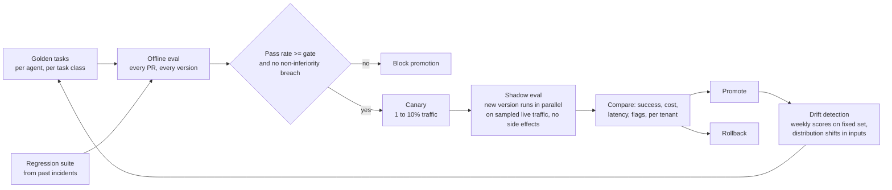

| Mode | What | Cadence |
| --- | --- | --- |
| Golden tasks | 50 to 300 cases per agent with expected artifacts, judged by validators (schema, numeric tolerance), LLM judge with rubric, and human spot checks | Every change to prompt, tools, routing, context policy, memory policy |
| Regression suite | Cases from incidents and user corrections, each tagged with the failure it guards | Every change |
| Component evals | Context compression probes (preserved fields), memory retrieval precision and recall, router confidence calibration, summariser fidelity | Every change to that component |
| Canary | Live traffic slice with full tracing | Per promotion |
| Shadow | Candidate executes against recorded or live inputs with tools stubbed from recorded results, no side effects; outputs compared | Per promotion, and continuously for routing experiments |
| Drift | Fixed set re-scored weekly; input distribution monitors (task class mix, document types, language); provider model version changes trigger a full re-run | Weekly and on provider change |
| Online | User feedback, correction rate, escalation rate, task success by validator, per tenant and agent version | Continuous |

Cost and quality are always reported together: a change is accepted only if quality holds within the non-inferiority margin and cost or latency improves, or quality improves within budget.

### Failure modes and mitigations

| Failure | Mitigation |
| --- | --- |
| Judge model drifts or is gamed | Judge pinned by version; human calibration set; disagreement between judge and validator flagged |
| Eval set goes stale | Incident-driven additions; drift detection on inputs; quarterly refresh |
| Shadow runs cause side effects | Tools stubbed; `write` and `dangerous` calls hard-blocked in shadow mode by the policy gateway |
| Telemetry re-identifies users | Hashing, separate store, consent-gated full capture |

### Example flow

A proposal to route history summarisation from `standard` to `light` runs the compression probes (preserved fields 98.7% vs 99.1%, within margin), the golden suite (no change), then a two-week shadow across three tenants showing a 31% cost drop on summarisation with no change in task success or correction rate. It is promoted; drift detection re-scores weekly.

## 15. End-to-end example: conversational product-analytics chatbot

The PM asks: "Why did weekly active users drop last week, and which segments were most affected? Show me the trend, break it down by platform and region, and draft a summary for leadership." The run below exercises every section: retrieval, delegation, statistics, charts, a clarifying question, an approval, memory writes, and cost control, in 91 UI events and roughly $0.65.

### Participants and resolved preferences

| Participant | Role | Trust boundary |
| --- | --- | --- |
| Product Manager | Primary user | user to harness |
| Analytics Chat Agent (orchestrator) | Owns the conversation, plans, delegates, synthesises | harness to model |
| SQL/Data Agent | Governed warehouse queries, data quality checks | agent to agent, then agent to tool |
| Statistics Agent | Segment impact, significance, anomaly tests | agent to agent |
| Visualization Agent | Chart specs and captions | agent to agent |
| Data Warehouse MCP Server | Governed SQL, schema, metrics, row-level security | harness to capability |
| BI Plugin (`leadership_deck`) | Saved dashboards, metric definitions, export | harness to plugin |
| Policy Gateway | Tenant, PII, row-level security, approvals | every boundary |

Preferences resolve in the order task override, session override, user, workspace default, tenant policy (section 12), giving `response_style: concise_executive`, `language: en-GB`, `chart_preference: interactive`, `statistics_preference: show_confidence_and_sample_size`, `data_privacy: aggregate_only`, `cost_mode: balanced`, delegation allowed to the three specialists with `require_approval_for_export: true`, and memory policy `remember_metric_definitions: true`, `remember_raw_query_results: false`, `retention_days: 90`. Tenant policy clamps: raw user-level rows never returned, aggregates only above a minimum cohort of 50.

### Sequence

```mermaid
sequenceDiagram
  autonumber
  participant PM
  participant UI
  participant H as Harness
  participant O as Orchestrator (model)
  participant S as SQL agent
  participant ST as Stats agent
  participant V as Viz agent
  participant PG as Policy gateway
  participant W as Warehouse MCP
  participant BI as BI plugin
  PM->>UI: question
  UI->>H: POST /sessions/sess/runs
  H->>H: admit, reserve $2.00, create run_8842, brief v1, assemble context
  H-->>UI: RUN_STARTED (seq 1)
  H->>O: plan (strong tier)
  O-->>H: plan + text m1
  H-->>UI: TEXT_MESSAGE m1 deltas
  H->>H: memory read: mem_291 (WAU definition), mem_512 (March incident, hypothesis)
  H->>S: delegation del_101 (budget $0.35, 8 calls, 90 s)
  H-->>UI: SUBAGENT_STARTED del_101
  S->>PG: warehouse_run_aggregate_query (return_raw_rows=false)
  PG-->>S: allow pd_01 (row-level security, aggregate only)
  S->>W: query (per-hop token, 60 s)
  W-->>S: 96 rows -> art_wau_001
  S-->>H: artifacts wau_trend, platform_breakdown, region_breakdown
  H-->>UI: SUBAGENT_FINISHED del_101
  H->>ST: delegation del_102 (input art_wau_001)
  ST-->>H: art_stats_002 (partial: 3 of 4 tests)
  H->>V: delegation del_103 (inputs art_wau_001, art_stats_002)
  V-->>H: chart specs
  H-->>UI: CUSTOM app.chart x2, STATE_DELTA
  H->>O: synthesise with clarification (strong)
  O-->>H: m2 question
  H-->>UI: TEXT_MESSAGE m2
  PM->>UI: include it as suspected cause; export charts
  UI->>H: new run turn (run continues, brief v8)
  H->>PG: bi.export_dashboard (write)
  PG-->>H: require_approval (user pref)
  H->>H: checkpoint cp_140 before side effect
  H-->>UI: APPROVAL_REQUESTED apr_301 (seq 70)
  PM->>UI: approve
  UI->>H: control: approve apr_301
  H->>BI: export (exchanged token, idempotency key)
  BI-->>H: export_id
  H-->>UI: APPROVAL_RESOLVED, TOOL_CALL_RESULT
  H->>O: draft leadership summary (strong)
  O-->>H: m3 summary
  H-->>UI: TEXT_MESSAGE m3, STATE_DELTA, RUN_FINISHED (seq 91)
  H->>H: memory ingest, cost reconcile ($0.65 of $2.00), eval sample
```

### Step 1: run creation and context

The harness admits the run (user daily budget has headroom, 1 of 3 concurrent runs), reserves the agent default $2.00, creates `run_8842`, opens the `invoke_agent` span, builds brief v1 from the message, and assembles a 38k-token context for a 200k window: system and agent instructions (cache-stable), 8 relevant tool schemas, the brief, the last 8 turns of the session, 3 semantic memories, a compact warehouse schema summary. Full historical messages are not included (compressed into the brief); raw prior query results are not included (artifact references only).

```json
{"type": "RUN_STARTED", "runId": "run_8842", "sequence": 1, "payload": {"agent": "analytics_chat_agent@3.2.0", "budget_usd": 2.0}}
```

### Step 2: memory retrieval and the hypothesis rule

Retrieval is gated on the entities `weekly_active_users`, `platform`, `region`. Two records qualify:

```json
{"memory_id": "mem_291", "tier": "semantic", "summary": "WAU = distinct authenticated users with a qualifying event in a UTC week", "provenance": {"source_system": "metrics_catalog", "captured_at": "2026-09-14"}, "confidence": 0.98, "valid_until": "2027-01-01"}
```

```json
{"memory_id": "mem_512", "tier": "episodic", "summary": "March WAU decline caused by iOS release crash in new-user onboarding", "provenance": {"run_id": "run_7719", "captured_at": "2026-03-19"}, "relevance": 0.81}
```

The context assembler injects `mem_512` under the `hypotheses` label with its date, and the system prompt rule says prior incidents are hypotheses to test, not causes to assert. The plan therefore asks the SQL agent to pull release, crash, and onboarding signals for the current window rather than assuming the March cause.

### Step 3: SQL agent delegation

```json
{"type": "SUBAGENT_STARTED", "sequence": 9, "payload": {"delegationId": "del_101", "parentAgent": "analytics_chat_agent", "childAgent": "sql_data_agent", "purpose": "Retrieve WAU trend and segment breakdowns", "scope": ["read:product_metrics", "read:warehouse_aggregates"], "budget": {"maxModelCostUsd": 0.35, "maxToolCalls": 8, "maxDurationSeconds": 90}, "expectedArtifacts": ["wau_trend", "platform_breakdown", "region_breakdown"]}}
```

The SQL agent calls `warehouse_get_schema` (cache hit, TTL 1 h), `warehouse_validate_metric` (cache hit), `warehouse_run_aggregate_query`, and `warehouse_detect_data_quality_issues`. The policy gateway validates the scoped token, confirms the approved metric definition, applies row-level security, blocks raw rows, and records `pd_01`. The 96-row result is stored as `art_wau_001` (table, 18.7 KB, sha256 recorded) and the agent receives a 310-token summary: overall week-over-week change minus 12.4%, largest decline iOS/EMEA at minus 31.8%, no missing days, 1.2% late-arriving events. The three expected artifacts validate and the task completes at $0.09.

### Step 4: statistics agent

`del_102` receives only `art_wau_001` as input and a budget of $0.25 and 5 tool calls. It runs `statistics_segment_impact`, `statistics_cohort_comparison`, `statistics_anomaly_detection`, and attempts `statistics_significance_test` per segment; the fifth call exceeds the cap, so the task completes with `partial: true` and three findings:

| Segment | WAU change | Share of total decline | Sample size | 95% CI | Significance |
| --- | --: | --: | --: | --- | --- |
| iOS / EMEA | -31.8% | 58% | 41,200 | \[-36.2, -27.4\] | high |
| Android / EMEA | -9.1% | 14% | 68,400 | \[-11.8, -6.4\] | medium |
| Web / all regions | -1.2% | 3% | 121,000 | \[-2.6, 0.2\] | low |

Possible drivers recorded in `art_stats_002`: iOS 8.4.2 crash rate up from 0.4% to 3.1%, EMEA onboarding completion down from 71% to 54%, no material change in marketing traffic or web engagement. The brief records the partial coverage as a risk.

### Step 5: charts and state

The visualization agent (light tier) returns chart specifications, not images. The harness emits two `CUSTOM` events (`app.chart@2`, about 2 KB each) and one `STATE_DELTA`:

```json
{"type": "CUSTOM", "sequence": 44, "payload": {"name": "app.chart", "version": 2, "value": {"chartId": "chart_wau_trend", "title": "Weekly Active Users, last 8 weeks", "kind": "line", "x": "week", "y": "wau", "annotations": [{"week": "2026-10-26", "label": "WAU down 12.4% week over week"}], "sourceArtifactId": "art_wau_001"}}}
```

```json
{"type": "STATE_DELTA", "sequence": 46, "payload": {"partition": "shared", "base_version": 41, "new_version": 42, "patch": [{"op": "add", "path": "/analysis/run_8842/charts", "value": ["chart_wau_trend", "chart_segment_impact"]}, {"op": "replace", "path": "/analysis/run_8842/status", "value": "analysis_complete"}]}}
```

The UI renders interactive charts from the specs and the full 96-row table on demand through the artifact endpoint; nothing larger than 2 KB travelled through the prompt or the event stream.

### Step 6: clarifying question and approval

The orchestrator asks one targeted question (`m2`): whether to include the suspected iOS release issue in the leadership summary or keep it observational. The PM answers "include it, but label it as a suspected cause, and export the charts to the leadership deck." The brief gains a decision and a constraint.

Export is a `write` action on a `per_call` plugin. Policy returns `require_approval` (user preference). The harness writes checkpoint `cp_140` with the pending action and idempotency key, then emits:

```json
{"type": "APPROVAL_REQUESTED", "sequence": 70, "payload": {"approvalId": "apr_301", "action": "bi.export_dashboard", "plugin": "leadership_deck@1.8.0", "risk": "medium", "reason": "External write to the leadership deck; your settings require approval for exports", "arguments": {"deck": "leadership_weekly", "charts": ["chart_wau_trend", "chart_segment_impact"]}, "estimated_cost_usd": 0.05, "reversible": true, "compensation": "bi.delete_export", "chain": ["user", "analytics_chat_agent@3.2.0", "plugin:leadership_deck"], "expires_at": "2026-11-03T04:42:00Z"}}
```

The PM approves. The decision is signed, bound to the argument hash, and audited. The token service mints a 60 s token for `aud: plugin:leadership_deck` with scope `write:bi_export`; the plugin receives an exchanged BI access token by reference; the export runs once (idempotency key stored), returns `export_id`, and the compensation entry stays on the stack until the run finishes.

### Step 7: leadership summary

The strong model drafts `m3` in `concise_executive` style, en-GB, with confidence intervals and sample sizes per the statistics preference, the iOS release labelled "suspected cause", and a caveat that one significance test did not run. The validator checks numbers against `art_stats_002` (tolerance 0.1 points) and style (under 150 words) before the text streams. `RUN_FINISHED` is seq 91.

### Step 8: memory, cost, evaluation

Memory ingestion writes one episodic record (goal, outcome, finding, artifacts, positive feedback) and one user-scoped semantic preference (`leadership_summaries: label_causes_as_suspected`, confidence 0.95); raw rows are not stored. The cost ledger reconciles:

| Source | Cost (USD) |
| --- | --: |
| Orchestrator model calls (plan, clarify, synthesise; 69% prompt cache hit) | 0.31 |
| SQL agent (model plus warehouse metering) | 0.09 |
| Statistics agent | 0.14 |
| Visualization agent (light tier) | 0.03 |
| Summarisation and routing (light tier, platform overhead) | 0.02 |
| BI plugin export | 0.05 |
| UI events (91 events, 24 KB) | 0.01 |
| Total (reserve released: 1.35) | 0.65 |

The run is head-sampled into the eval stream (it had an approval, so it is 100% sampled) and its quality record joins the validator pass, judge score 0.88, and the PM's thumbs-up. Six weeks later, when a similar question arrives, the episode is retrieved as a dated hypothesis and the summary preference shapes the draft without the PM restating it.

## 16. Document upload as context

**Intent.** An uploaded file becomes a governed, chunked, permissioned document resource that the context assembler can cite and retrieve from, never a blob pasted into the prompt.

**Problem.** Naive upload handling inlines the whole file (blowing the budget and leaking everything in it), loses provenance (the model cannot cite page 4), ignores permissions (a file shared in one chat leaks into another), and treats a scanned PDF and a spreadsheet the same way.

### Components

| Component | Responsibility |
| --- | --- |
| Upload service | Accepts files (resumable, size-capped), virus and DLP scan, content-type sniffing, stores the original in the tenant's object store under a KMS key |
| Document registry | One record per document: owner, scope (session, workspace, tenant), labels, versions, retention, consent |
| Parsing pipeline | Converts to a canonical structured form: text blocks with page and section anchors, tables as rows, images with captions, OCR for scans, code with language |
| Chunker and indexer | Structure-aware chunking (headings, tables, slides), embeddings plus BM25, structured metadata, graph links to entities |
| Document resource adapter | Exposes documents as MCP Resources (`doc://{doc_id}/{section}`) and tools (`doc.search`, `doc.get_section`, `doc.get_table`) through the capability gateway |
| Context integration | The assembler treats documents as a ranked candidate category with its own budget (section 9) |

### Ingestion pipeline

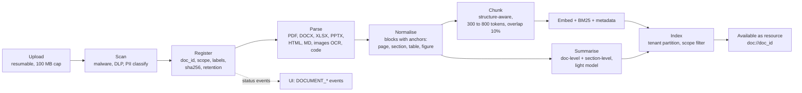

Upload status streams to the UI as `CUSTOM` events (`app.document_status@1`: `scanning`, `parsing`, `indexing`, `ready`, `failed` with reason) so the user can keep typing while a large file indexes; a run that needs a document still `indexing` waits on it with a progress event rather than failing.

### Document record

```json
{
  "doc_id": "doc_01J9...",
  "tenant_id": "tenant_01J9...",
  "owner_user_id": "user_01J9...",
  "scope": {"kind": "workspace", "id": "ws_product"},
  "name": "Q3 product review.pdf",
  "content_type": "application/pdf",
  "bytes": 2411000,
  "sha256": "...",
  "version": 2,
  "previous_version": "doc_01J8...",
  "storage_ref": "blob://tenant_01J9/docs/doc_01J9.../v2",
  "parse": {"status": "ready", "pages": 34, "blocks": 412, "tables": 9, "figures": 14, "ocr_pages": 0, "language": "en"},
  "index": {"chunks": 128, "embedding_model": "embed-v4", "indexed_at": "2026-11-03T04:31:00Z"},
  "classification": {"confidentiality": "internal", "pii": false, "data_categories": ["business_metadata"], "dlp_findings": []},
  "summary_ref": "art://tenant_01J9/doc_01J9.../summary",
  "retention": {"policy": "workspace_default", "expires_at": "2027-05-03T00:00:00Z"},
  "consent": {"use_for_memory": false, "use_for_eval": false},
  "links": [{"rel": "uploaded_in", "target": "sess_01J9..."}, {"rel": "mentions", "target": "entity:metric:weekly_active_users"}],
  "uploaded_at": "2026-11-03T04:30:12Z"
}
```

Chunk record (what the index returns):

```json
{
  "chunk_id": "chk_01J9...",
  "doc_id": "doc_01J9...",
  "doc_version": 2,
  "anchor": {"page": 12, "section": "3.2 Retention by platform", "block_range": [201, 207], "table_id": null},
  "kind": "text",
  "text": "...",
  "tokens": 512,
  "headings_path": ["3 Engagement", "3.2 Retention by platform"],
  "entities": ["platform:iOS", "region:EMEA"],
  "embedding_ref": "vec://docs/chk_01J9...",
  "confidentiality": "internal",
  "provenance": {"source": "upload", "uploaded_by": "user_01J9...", "doc_sha256": "...", "parsed_at": "2026-11-03T04:30:40Z", "parser": "docparse@3.1"}
}
```

### How uploads enter context

| Situation | Treatment |
| --- | --- |
| File attached to the current message | The document summary (under 400 tokens) and its `doc://` reference are included in the step's context; the model is told the document exists and how to query it |
| User asks a question answerable from the file | Retrieval gating fires; `doc.search` runs hybrid retrieval scoped to the session's and workspace's documents; top chunks enter the `documents` category under the section 9 budget (default 10% of window, ceiling 24k tokens), each with its anchor for citation |
| Task is an extraction over the whole document ("summarise this", "fill this schema from it") | The run iterates sections through `doc.get_section` in a map-reduce pattern on a light model, then synthesises; the full document never enters one prompt unless it fits inside the document budget |
| Spreadsheet or table | Tables are exposed as structured rows via `doc.get_table`; the model gets the header, row count, and a sample; analysis runs through a code or SQL tool, not by reading rows in the prompt |
| Images and figures | Captions and OCR text are indexed; the image itself is passed to a vision-capable model only when the step asks about that figure |
| Documents from earlier sessions in the same workspace | Retrievable if scope and permission allow; ranked below current-session documents by the `recency` weight |

The model cites by anchor (`[doc_01J9... p.12 §3.2]`); the UI resolves anchors to a document viewer with the highlighted block. Citations are validated post-generation: a cited anchor that was not in context is flagged and the sentence marked unverified.

### Permissions, privacy, lifecycle

- Scope at upload: `session` (only this conversation), `workspace` (colleagues in the workspace, section 17), or `tenant` (admin-curated). Default is `session`; promotion to `workspace` is an explicit user action and is audited.
- Confidentiality and PII classification from the DLP scan set the document's labels; the context assembler's permission filter applies them (a `restricted` document never enters a run whose output goes to an external write).
- Documents are never written to semantic memory unless `consent.use_for_memory` is set; retrieval across sessions is a document search, not a memory.
- Versioning: re-uploading the same name creates a new version; chunks of old versions are kept until the run that referenced them is past retention, so replay stays correct.
- Deletion: user or admin delete tombstones the document, its chunks, embeddings, summaries, and any artifact derived solely from it, within 24 h, and emits an audit event; retention expiry does the same automatically.
- Residency: object store, index partition, and parsing workers all run in the tenant's region.

### Failure modes and mitigations

| Failure | Mitigation |
| --- | --- |
| Prompt injection inside a document ("ignore your instructions") | Document chunks are wrapped as untrusted-origin data; instructions in content are never executed by the harness; a classifier flags injection-like text and the UI shows a warning |
| Parser mangles tables or scanned pages | Parser confidence per block; low-confidence blocks are flagged in the chunk and the model is told; OCR fallback engine |
| Huge file stalls the run | Async indexing with status events; run waits with progress or proceeds on the summary with a caveat |
| Stale citation after re-upload | Anchors carry `doc_version`; the UI resolves against that version |
| Cross-session leakage | Scope filter at the index, permission check per chunk at assembly |

### Example flow

The PM drags in "Q3 product review.pdf" (34 pages) while asking the WAU question. The upload scans clean, registers at `session` scope with `internal` confidentiality, parses in 28 s, and indexes 128 chunks. The orchestrator's context gets the 380-token document summary and `doc://doc_01J9...`. When drafting the leadership summary, retrieval returns two chunks from section 3.2 about the iOS onboarding redesign shipped in week 42; the model cites them by anchor as supporting evidence for the suspected cause, and the UI links the citation to page 12.

## 17. Collaborative workspaces

**Intent.** A workspace is a shared, role-governed container for sessions, documents, artifacts, memory, and preferences, in which several colleagues and the agent act on the same state with clear ownership of every change.

**Problem.** Single-user chat makes analysis a private artefact: colleagues cannot see the reasoning, re-run it, approve on each other's behalf, or build on the same documents, and sharing a transcript loses the live state, the permissions, and the audit trail.

### Model

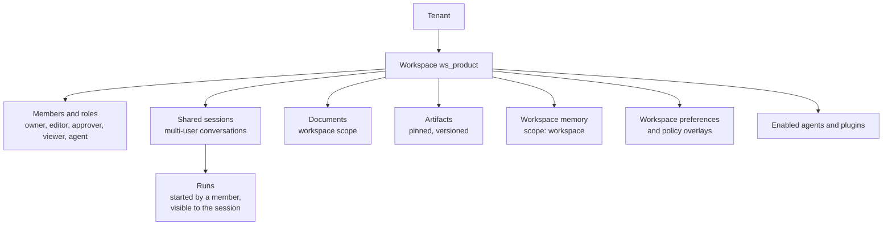

| Role | Can |
| --- | --- |
| owner | Everything, including membership, policy overlays, deletion |
| editor | Start runs, write `shared` state, upload and promote documents, pin artifacts, propose workspace memory |
| approver | Resolve approvals for actions in the workspace (named in policy), plus viewer rights |
| viewer | Read sessions, artifacts, documents; cannot start runs or write state |
| agent | A service identity for scheduled or background runs owned by the workspace, with its own scoped token |

Roles are per workspace; tenant admins can set defaults and clamps. A user's effective permission for any object is the intersection of workspace role, object-level share (a session can be narrower than the workspace), and tenant policy.

### Shared sessions and multi-user runs

- A session has an owner and participants; every message carries its author; the context assembler labels turns by author so the model knows who said what and who asked the current question.
- One run at a time per session by default (the executor serialises); a second participant's message during a run is queued and shown as pending, or, if they choose, forks a branch session that shares the brief and documents.
- The run acts on behalf of the user who started it: its token's `on_behalf_of` is that user, so data access is theirs, not the union of the room's. A result the starter could see but a viewer could not is redacted for that viewer by the stream broker's per-viewer filter.
- Approvals can be routed to an `approver` role member instead of the starter; the approval card shows who requested and who may approve; the decision is signed by the approver.
- Presence: a lightweight presence channel (who is viewing, who is typing, who is looking at which artifact) runs beside the event stream and is never stored or sent to the model.

```mermaid
sequenceDiagram
  participant A as Alice (editor)
  participant B as Bob (approver)
  participant UI
  participant H as Harness
  A->>UI: asks the WAU question in shared session
  UI->>H: run (on_behalf_of Alice)
  H-->>UI: events to Alice and Bob (per-viewer redaction)
  B->>UI: pins the segment chart, adds a comment
  UI->>H: shared-state patch (author Bob)
  H-->>UI: STATE_DELTA broadcast; Alice sees the pin
  H-->>UI: APPROVAL_REQUESTED (export), routed to approver role
  B->>UI: approves
  H->>H: export on behalf of Alice, approved by Bob, both in audit
```

### Concurrent editing of shared state and artifacts

- `shared` state uses the section 4 protocol with server-ordered patches; conflicts on scalar leaves resolve last-writer-wins with a `STATE_CONFLICT` notice, and set-like arrays merge.
- Documents the agent and users co-edit (a draft summary, a plan) are stored as CRDT documents (text and structured) so concurrent edits from two people and an agent merge without a lock; the agent edits through a tool that applies operations to the CRDT, never by overwriting the whole document, and each operation carries the author.
- Artifacts are immutable per version; "editing" an artifact creates a new version with `derived_from`; pinning is a workspace-level reference to a specific version.
- Comments anchor to artifact versions, document blocks, or run events; a comment can be addressed to the agent, which turns it into a run in the session with the comment as the message and the anchor as `ui_context`.

### Shared memory and preferences

- Workspace memory (section 8, scope `workspace`) holds metric definitions, glossary, prior analyses, and agreed constraints; promotion from a user's episodic memory into workspace memory is a proposal that an owner or editor accepts, so one person's assumptions do not silently become the team's facts.
- Workspace preferences (section 12) set defaults for tools, style, and approval routing; users override only within the tenant clamps.
- Personal memory is never visible to other members; the context assembler loads the starter's personal memory and the workspace memory, never another participant's.

### Invitations, sharing, and leaving

| Action | Effect |
| --- | --- |
| Invite member | Role assigned; access to workspace-scoped objects from now on; audit event |
| Share a session narrower than the workspace | Session participant list overrides workspace membership for that session |
| Share a link externally | Only for artifacts, with a signed, expiring, read-only link and a watermark; disabled by tenant policy if confidentiality is `confidential` or above |
| Remove member | Tokens revoked, presence dropped, access ends immediately; their authored messages and comments stay with attribution; their personal memory and documents at `session` scope stay theirs |
| Delete workspace | Sessions, documents, artifacts, workspace memory tombstoned after a grace period; audit retained |

### Failure modes and mitigations

| Failure | Mitigation |
| --- | --- |
| Viewer sees data the starter could see but they cannot | Per-viewer redaction in the stream broker; artifacts served with the viewer's own token |
| Two runs stomp the same shared state | One active run per session; forks for parallel exploration; version-checked patches |
| Agent overwrites a colleague's edit | CRDT operations with authorship; agent edits are operations, not replacements |
| Team memory polluted by one user's guess | Promotion by proposal and acceptance; provenance on every workspace record |
| Approval by the wrong person | Approver role in policy; signature on decision; audit shows requester and approver |

### Security, privacy, and governance

Every object carries workspace and tenant IDs; membership changes are audit events; external links are time-limited and watermarked; the service identity for workspace-owned runs has the narrowest scope the workspace's agents need and no personal memory. Residency and confidentiality rules apply per object, not per workspace, so a `restricted` document in a workspace stays restricted to those cleared for it.

### Example flow

Alice runs the WAU analysis in the `ws_product` shared session. Bob, an approver, watches the events, pins the segment chart, and comments "check week 42 onboarding change" addressed to the agent. The comment becomes a run on Bob's behalf with the chart as `ui_context`; the agent retrieves the Q3 review document (workspace scope) and replies in the session. The export approval routes to Bob; he approves; the audit shows requester Alice, approver Bob, and the artifact version exported.

## 18. Recommended libraries and standards (as of November 2026)

The stack below keeps the harness vendor-neutral: open protocols at every boundary, and one swappable implementation per layer. Versions and dates are as reported by the linked sources; check them against PyPI before pinning. Python is the primary language throughout, with TypeScript only where the client needs it.

### Protocols at the boundaries

| Boundary | Standard | Status (Nov 2026) | Why here |
| --- | --- | --- | --- |
| Harness to tools, resources, prompts (section 1) | [MCP 2026-07-28](https://modelcontextprotocol.io/specification/2026-07-28/changelog) | Stable since 28 Jul 2026; stateless core, Tasks as an extension, OAuth hardening | The capability gateway speaks MCP to every connector and plugin; the registry mirrors `tools/list` |
| Agent to agent (section 2) | [A2A v1.0](https://a2a-protocol.org/latest/) | v1.0.0 shipped Mar 2026 under the Linux Foundation; Signed Agent Cards; now in the Agentic AI Foundation alongside MCP ([LF press release](https://www.linuxfoundation.org/press/a2a-protocol-surpasses-150-organizations-lands-in-major-cloud-platforms-and-sees-enterprise-production-use-in-first-year)) | Agent Cards and Task objects in section 2 map onto A2A's card and task model; use A2A for cross-organisation delegation, the internal broker for in-platform delegation |
| Harness to UI (sections 3 and 4) | [AG-UI](https://docs.ag-ui.com/) | Event-based protocol from CopilotKit; adapters for LangGraph, Pydantic AI, CrewAI, Microsoft Agent Framework; Thoughtworks Radar lists it as "Assess" and notes MCP-side UI (MCP Apps) is questioning whether a separate layer is needed ([Thoughtworks](https://www.thoughtworks.com/zh-cn/radar/platforms/ag-ui-protocol)) | The section 3 event catalogue is AG-UI compatible by design (`RUN_STARTED`, `TEXT_MESSAGE_CONTENT`, `STATE_DELTA`, `CUSTOM`); adopt its SDK rather than inventing a wire format |
| Observability (section 13) | [OpenTelemetry GenAI semantic conventions](https://opentelemetry.io/docs/specs/semconv/gen-ai/) | Moved to a dedicated repository in mid-2026; sources disagree on whether the conventions are stable or still "Development" ([TrueFoundry, Aug 2026](https://www.truefoundry.com/blog/opentelemetry-genai-semantic-conventions)); MCP conventions define their own spans and context propagation | Use `gen_ai.*` and the MCP conventions as the vocabulary; pin the semconv version in the collector so attribute renames do not break dashboards |
| Delegated authorization (section 6) | OAuth 2.0 Token Exchange (RFC 8693), W3C Trace Context | Stable | Per-hop tokens are token-exchange results; the IETF "Transaction Tokens for Agents" draft formalises the per-task capability pattern ([overview](https://tianpan.co/blog/2026/04/25/policy-as-code-agent-permissions-opa-rego)) |

Implications of the 2026-07-28 MCP revision for this design (from the [changelog](https://modelcontextprotocol.io/specification/2026-07-28/changelog)):

- No protocol sessions and no `initialize` handshake: the capability gateway can route any request to any server instance; any cross-call state is a server-minted handle passed as an ordinary tool argument, which fits the artifact-reference pattern.
- SSE resumability was removed from the MCP transport; a broken stream means re-issuing the request. The harness's own UI stream (section 3) keeps `Last-Event-ID` semantics because it is a different protocol on a different boundary.
- Sampling, Roots, and Logging are deprecated: the model router is the only path to a model, servers log to OTel, and file access goes through tool parameters or resource URIs.
- Multi Round-Trip Requests replace server-initiated elicitation: a tool that needs user input returns `input_required`; the harness maps that to the section 2 `waiting_input` state and retries the original request with the answer.
- List results carry `ttlMs` and `cacheScope`, and servers should return tools in deterministic order; both feed the tool-result cache and prompt-cache stability in section 10.
- Tasks live in an official extension with polling via `tasks/get`; long-running tools map directly onto the durable Task object.

### Implementation libraries by layer

| Layer | Recommendation | Alternatives | Notes |
| --- | --- | --- | --- |
| Durable run executor (sections 5, 7) | [Temporal](https://temporal.io/) Python SDK (`temporalio`) | LangGraph checkpointing for single-process prototypes; Restate; DBOS | Full event history, retries, signals for human input and approvals, replay for debugging; integrations with Pydantic AI and OpenAI Agents SDK are GA ([Temporal blog](https://temporal.io/blog/announcing-openai-agents-sdk-partnership)); Replay 2026 added serverless workers and workflow streams ([summary](https://dev.to/truongandev/what-is-temporal-durable-execution-engine-explained-2h99)) |
| Agent loop and typed tools | [Pydantic AI](https://ai.pydantic.dev/) v2 (2.0.0 on 23 Jun 2026; 2.57.0 by mid-Oct 2026) | [LangGraph](https://langchain-ai.github.io/langgraph/) 1.2.x for graph-shaped multi-agent control; OpenAI Agents SDK; Google ADK | Pydantic AI gives typed inputs and outputs, dependency injection, MCP client support, and OTel-native tracing with a thin API ([comparison, Oct 2026](https://www.developersdigest.tech/agent-frameworks/compare/pydantic-ai-vs-langgraph)); keep the harness's own orchestration in Temporal and use the agent framework only for the model-facing loop |
| MCP client and server | Official MCP Python SDK (`mcp`) | FastMCP for authoring servers quickly | Target 2026-07-28; keep 2025-11-25 compatibility for third-party servers during the deprecation window |
| UI event stream | [AG-UI Python SDK](https://docs.ag-ui.com/) (`ag-ui-protocol`) with SSE over FastAPI or Starlette; WebSocket for multiplexed sessions | Vercel AI SDK stream protocol if the client is Next.js only | Keep the section 3 broker as the single emitter so AG-UI is a serialisation, not the state of record |
| State sync (section 4) | `jsonpatch` (Python) and `fast-json-patch` (TypeScript), JSON Schema 2020-12 via `jsonschema` | Immer-style patches | RFC 6902 end to end; schema-validate every patch |
| Collaborative documents (section 17) | [Yjs](https://yjs.dev/) in the client with `y-py` or `yrs` server-side; Hocuspocus or y-sweet as the sync server | Automerge 3 for JSON-tree sync; Loro for rich text and tree moves; Liveblocks if hosted is acceptable | Yjs remains the default for editor bindings (Tiptap, ProseMirror, CodeMirror, BlockNote) ([2026 comparison](https://www.pkgpulse.com/guides/yjs-vs-automerge-vs-loro-crdt-libraries-2026)); the agent edits through a tool that applies Yjs operations with authorship |
| Policy engine (section 6) | [Cedar](https://www.cedarpolicy.com/) evaluated in-process or as a sidecar | [OPA](https://www.openpolicyagent.org/) with Rego where policies span infrastructure too; Dogwood for temporal rules over trajectories ([Harness blog](https://www.harness.io/blog/policy-as-code-in-2026-opa-kyverno-cedar-and-what-s-next)) | Cedar's fixed principal, action, resource, context model matches the section 6 decision input and is formally verified; it is also the engine inside Amazon Bedrock AgentCore Policy since Mar 2026 ([analysis](https://tianpan.co/blog/2026/04/25/policy-as-code-agent-permissions-opa-rego)); use OPA if the team already runs it |
| Model gateway and routing (section 10) | [Envoy AI Gateway](https://github.com/envoyproxy/ai-gateway) when the platform runs on Kubernetes with Envoy or Istio; [LiteLLM](https://github.com/BerriAI/litellm) proxy for provider breadth and quick starts | Kong AI Gateway, Apache APISIX, Bifrost | Put token accounting, provider failover, and residency routing in the gateway; keep the section 10 routing policy in the harness so decisions are logged with reasons ([gateway comparison](https://dev.to/kuldeep_paul/open-source-llm-gateways-for-production-which-one-fits-your-stack-in-2026-13lo)) |
| Memory and document index (sections 8, 16) | PostgreSQL with [pgvector](https://github.com/pgvector/pgvector) plus full-text search for hybrid retrieval when already on Postgres | [Qdrant](https://qdrant.tech/) for native hybrid and filtered search at tens of millions of vectors; Weaviate for built-in BM25 fusion | pgvector keeps memory records, filters, and lexical search in one transactional store with row-level security for tenant isolation ([comparison](https://aquila-network.pages.dev/compare/pgvector-vs-qdrant)); graduate to Qdrant when vector load competes with transactional traffic |
| Document parsing (section 16) | [Docling](https://github.com/docling-project/docling) (2.14x line in Oct 2026) | Unstructured; Marker; provider document APIs | Layout, reading order, table structure, OCR, lossless JSON, chart understanding, and an MCP server; MIT, hosted by LF AI and Data ([PyPI](https://pypi.org/project/docling/)) |
| Embeddings | Provider embeddings behind the model gateway; a local model (e.g. a sentence-transformers family model) for air-gapped tenants |  | Record the embedding model on every index so re-embedding on upgrade is tracked |
| Sandboxing (section 11) | Firecracker microVMs for untrusted plugin and code execution; [E2B](https://e2b.dev/) OSS self-hosted if a ready SDK is wanted | gVisor (Modal, Daytona) for lighter isolation; Kubernetes Agent Sandbox project ([Tembo, Jul 2026](https://www.tembo.io/blog/ai-agent-sandbox)) | One sandbox per invocation, destroyed on completion; egress allowlist from the manifest |
| Secrets and tokens | HashiCorp Vault or OpenBao, or the cloud KMS; `authlib` for OAuth flows and RFC 8693 exchange |  | Per-tenant keys; plugin tokens by reference |
| Event log and queues | PostgreSQL append-only tables for the trajectory log with periodic archive to object storage; NATS JetStream or Kafka for fan-out | Redis Streams for small deployments | Hash-chain the audit projection; keep the run event log small by referencing blobs |
| Observability | `opentelemetry-sdk` and `opentelemetry-instrumentation-*`; Collector with tail sampling; backend of choice (Grafana Tempo and Loki, or a GenAI-aware backend such as Langfuse or Logfire) |  | Emit `gen_ai.*` attributes yourself from the model router so the trace is independent of any framework's instrumentation |
| Evaluation (section 14) | Pydantic Evals or a custom harness over golden tasks; Langfuse datasets; promptfoo for regression suites | Braintrust, LangSmith | Pin judge model versions; store eval results as `gen_ai.evaluation.result` events |
| Client state store | Zustand or Redux Toolkit with the section 4 reducer; TanStack Query for REST reads |  | The reducer is the protocol contract; keep it framework-independent |

### Stack at a glance

```mermaid
flowchart LR
  UI["Web client\nAG-UI SDK, Yjs, Zustand"] --> API["FastAPI edge\nSSE / WebSocket"]
  API --> T["Temporal workflows\nrun executor"]
  T --> PA["Pydantic AI\nagent loop"]
  PA --> GW["Envoy AI Gateway or LiteLLM\nmodel routing, cost"]
  T --> CAP["Capability gateway\nMCP Python SDK"]
  CAP --> CED["Cedar\npolicy decisions"]
  CAP --> SB["Firecracker sandboxes\nplugins"]
  CAP --> MCPS["MCP servers\nA2A for external agents"]
  T --> PG[("PostgreSQL\nevent log, pgvector memory, docs")]
  DOC["Docling\ningestion"] --> PG
  T --> OT["OpenTelemetry\nGenAI semconv"]
```

### Selection rules

1. Prefer the open protocol at every boundary and the thinnest library that speaks it; the harness's own schemas (sections 1 to 17) are the contract, the library is an adapter.
2. One durable execution engine for all runs and tasks; agent frameworks never own persistence.
3. Postgres first for state, memory, documents, and audit; add a dedicated vector or stream system only when a measured load justifies it.
4. Pin protocol and semantic-convention versions explicitly and run the deprecation windows (MCP has a twelve-month minimum) as planned migrations, not surprises.
5. Re-check this table quarterly; the agent tooling landscape in 2026 moves faster than any other layer of the stack.

### Sources

- [MCP 2026-07-28 changelog](https://modelcontextprotocol.io/specification/2026-07-28/changelog)
- [A2A protocol documentation](https://a2a-protocol.org/latest/) and [Linux Foundation, Apr 2026](https://www.linuxfoundation.org/press/a2a-protocol-surpasses-150-organizations-lands-in-major-cloud-platforms-and-sees-enterprise-production-use-in-first-year)
- [AG-UI documentation](https://docs.ag-ui.com/) and [Thoughtworks Technology Radar, Apr 2026](https://www.thoughtworks.com/zh-cn/radar/platforms/ag-ui-protocol)
- [OpenTelemetry GenAI conventions overview, TrueFoundry, Aug 2026](https://www.truefoundry.com/blog/opentelemetry-genai-semantic-conventions)
- [Temporal and OpenAI Agents SDK, GA Mar 2026](https://temporal.io/blog/announcing-openai-agents-sdk-partnership)
- [Pydantic AI vs LangGraph, Oct 2026](https://www.developersdigest.tech/agent-frameworks/compare/pydantic-ai-vs-langgraph) and [Agentic Wire on Pydantic AI 2.0](https://www.agenticwire.news/article/pydantic-ai-vs-langgraph)
- [Docling on PyPI](https://pypi.org/project/docling/)
- [Yjs vs Automerge vs Loro, 2026](https://www.pkgpulse.com/guides/yjs-vs-automerge-vs-loro-crdt-libraries-2026)
- [Policy as code in 2026, Harness](https://www.harness.io/blog/policy-as-code-in-2026-opa-kyverno-cedar-and-what-s-next) and [Policy-as-code for agents](https://tianpan.co/blog/2026/04/25/policy-as-code-agent-permissions-opa-rego)
- [pgvector vs Qdrant, Jun 2026](https://aquila-network.pages.dev/compare/pgvector-vs-qdrant)
- [Open-source LLM gateways, 2026](https://dev.to/kuldeep_paul/open-source-llm-gateways-for-production-which-one-fits-your-stack-in-2026-13lo)
- [AI agent sandboxes, Tembo, Jul 2026](https://www.tembo.io/blog/ai-agent-sandbox)
