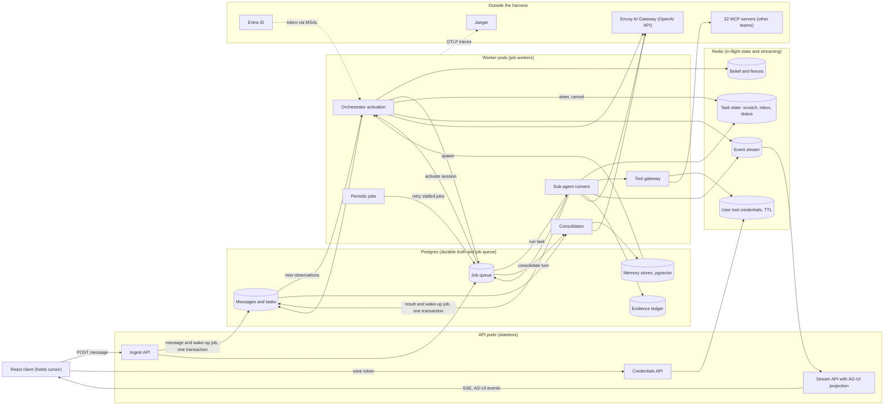
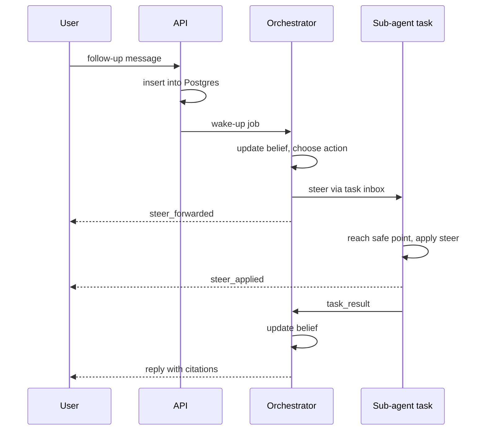
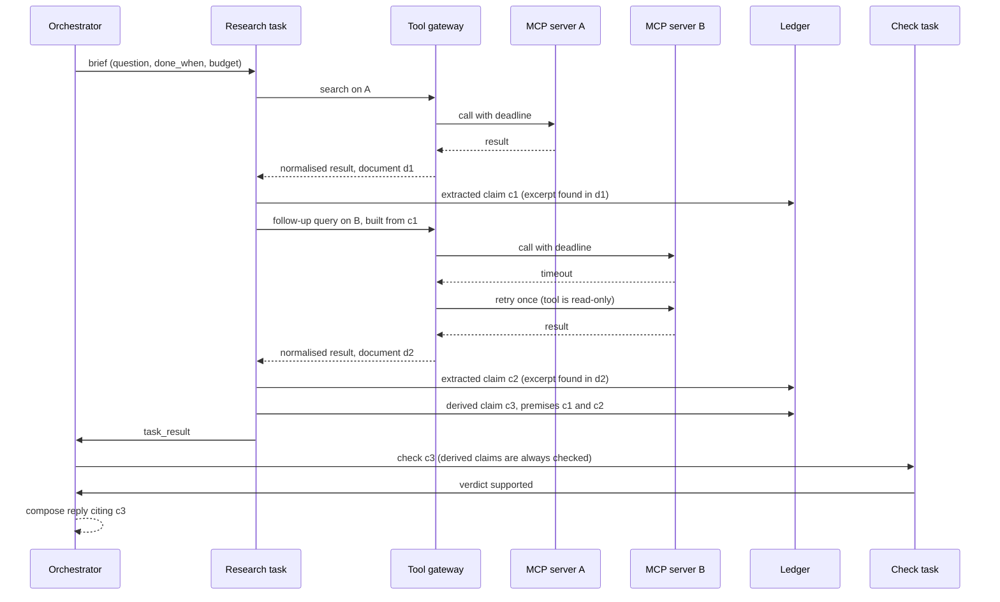

# Async Steerable Chat Harness: High-Level Design

**A POMDP orchestrator over MDP sub-agents**

| | |
|---|---|
| Document | High-level design (HLD): what the system is and why it is shaped this way |
| Companion | `LLD.md`: how to build it, module by module, with libraries and work packages |
| Status | All decisions settled. Ready for implementation |
| Owner | Adi |
| Date | 2026-11-15 |
| Scope | Conversation harness, orchestration, tools, persistence, streaming, memory and learning, web client |
| Build target | Local devcontainer with Postgres, Redis and Jaeger. An AWS deployment follows the same design |

---

## 1. How to read this document

- Read this HLD to understand the concepts, the components, the rules that must never be broken, and the reasons behind each decision.
- Read the LLD to implement. It names files, functions, tables, keys, libraries and acceptance checks.
- When the two disagree, the HLD wins on intent and the LLD wins on mechanics. Fix the other document in the same change.
- Section 4.4 (design rules) and section 15 (safety) are invariants. Code that breaks one is wrong even if its tests pass.

---

## 2. Summary

This is a chat harness in which a user can send follow-up messages while earlier work is still running, and those messages steer the work instead of queueing behind it.

The design rests on eight decisions:

1. **Sessions are durable state machines, connections only observe them.** Any request can land on any pod. No pod holds a conversation in memory on behalf of a socket.
2. **The orchestrator is modelled as a POMDP agent.** It never sees the user's true goal or the true state of the world. It keeps an explicit belief, updates it from observations, and chooses actions that either make progress or reduce uncertainty. It has memory, can act, plan, collaborate and learn.
3. **Sub-agents are modelled as MDP solvers.** Each receives a brief that makes its task fully specified, works to a termination condition under a budget, and reports back. In hierarchical RL terms they are options, and the orchestrator is a semi-Markov decision maker over options.
4. **Postgres is the durable truth and the work queue; Redis carries everything in flight.** Completed work and the queue of jobs live in Postgres. Tokens, working state, fences and user tool credentials live in Redis. Postgres is written at human rate and at task boundaries, never per token.
5. **Simple queries are fast, complex ones are thorough.** The orchestrator answers a simple query itself in one model call. A complex query goes through evidence collection first, and the orchestrator composes the answer afterwards. The orchestrator model decides which, with no separate router.
6. **Tools are untrusted, noisy sensors.** The MCP tools are built by other teams and their quality is outside this system's control. Every tool call passes through one defensive tool gateway, every tool result is an observation with a reliability attached, and nothing a tool returns can become an instruction.
7. **Answers are built from a ledger of claims, including multi-hop answers.** A query may need several retrieval hops and several documents. Each hop produces claims with sources, and a claim that joins other claims records its premises, so every sentence in an answer traces back through the chain to the documents.
8. **Standards live at the edges, the core stays native.** The client stream speaks AG-UI events, tools speak MCP, procedural know-how is packaged as Agent Skills, and inference speaks the OpenAI API. Each standard is confined to one adapter, so the core does not move when a standard does.

The orchestrator does no long-running work itself. That keeps it free to react to the user within one short model call, which is what makes steering feel immediate.

---

## 3. Goals and non-goals

### Goals

- Accept a follow-up at any time and apply it to in-flight work with low latency.
- Survive the loss of any single pod, and the loss of Redis, without corrupting durable history.
- Give every answer traceable citations by construction, including answers that needed several hops or several documents.
- Stay correct and useful when a tool is slow, wrong, badly described or unavailable.
- Keep Postgres write volume proportional to human messages and completed tasks, not to tokens.
- Make the orchestrator's understanding of the user inspectable and correctable.
- Let the system improve with use: learn about the user, the world it operates in, and its own tools.
- Keep the code small enough to hold in one's head: a library wherever one removes real custom code, plain code everywhere else.

### Non-goals

- Solving the POMDP exactly. The formalism structures the design; an LLM approximates belief update and policy.
- Fine-tuning model weights online. Learning here means updating durable stores that condition future beliefs and decisions.
- Exactly-once execution of external side effects. The design targets at-least-once with idempotency, and explicit handling where that is impossible.
- A fixed catalogue of sub-agents. Capabilities are registered, versioned and replaceable.
- Fixing other teams' tools. The harness measures them, defends against them and routes around them.
- Executing code bundled with skills. Skills are instructions and reference files only in this build.
- An agent framework. The activation loop and the task loop are the product, so they are written here and not delegated to a framework that would own them.

---

## 4. Conceptual model

### 4.1 The orchestrator as a POMDP

The orchestrator cannot observe what it most needs to know: what the user actually wants, what is true in the world, and how its sub-agents and tools are really doing. It only receives evidence about those things. That is the definition of a partially observable problem.

| POMDP element | In this system |
|---|---|
| Hidden state `s` | The user's real goal, constraints and acceptance criteria; facts about the world; true progress and quality of in-flight tasks; true reliability of each tool |
| Actions `a` | Reply, ask the user, spawn a task, steer a task, cancel a task, revise the plan, wait |
| Observations `o` | User messages and decisions, task events (started, result, failure, question), notices about the orchestrator's own actions that could not be carried out |
| Transition `T` | Goals shift as the user learns; tasks advance; the world changes; tools change under other teams' control |
| Observation model `Z` | A user message is noisy, underspecified evidence of the goal. A task result is noisy evidence about the world, and its noise depends on the tools that produced it |
| Reward `R` | Goal satisfied at response time, minus tokens, latency, user attention and the cost of being wrong |
| Belief `b` | A structured, versioned document: goal threads with their hypotheses and plans, constraints, evidence, task table |

Three consequences matter for the design:

- **Information-gathering is a first-class action.** Asking the user and spawning an investigation are both ways to reduce uncertainty, each with a different cost. The orchestrator chooses between them deliberately.
- **Results are observations, not truths.** A sub-agent's output updates belief with a confidence attached. An independent check exists to sharpen the observation model when the stakes justify the cost.
- **Tool quality is part of the observation model.** A claim is only as good as the tool that produced its source. The system measures each tool and lets that measurement decide how much checking a claim needs.

### 4.2 Sub-agents as MDP solvers

A sub-agent works on a problem where the state is fully observed: the brief, its workspace and its own working transcript. Its actions are tool calls, transitions are tool results, and its reward is meeting the brief's completion criterion within budget.

In the options framework each sub-agent invocation is an option `(I, pi, beta)`:

| Option element | In this system |
|---|---|
| Initiation set `I` | The capability's preconditions: required inputs, permissions, available tools, connected credentials |
| Policy `pi` | The sub-agent's prompt, skills, tools and loop |
| Termination `beta` | Completion criterion met, budget exhausted, cancelled, or escalation |

The orchestrator therefore decides at the level of options, over variable time spans. Steering is option interruption: the orchestrator intervenes when its belief says continuing as briefed is worth less than changing course.

The MDP assumption is only as good as the brief. When a sub-agent discovers that its task is not fully specified, it must not guess at user intent. It terminates with `needs_input` and pushes the uncertainty back up. **Partial observability is handled in exactly one place.**

A multi-hop retrieval is still one MDP. The sub-agent searches, reads, notices a missing link, searches again, and stops when the brief's completion criterion is met. What it may not do is decide what the user meant.

### 4.3 Model uncertainty and learning

The orchestrator is also uncertain about its own models: how this user tends to express goals, how reliable each capability and each tool is in which context, and which facts are still current. Formally this is a Bayes-adaptive setting, where the agent holds uncertainty over `T` and `Z` and reduces it through experience.

In practice the system keeps durable stores for a user model, a world model, a capability model and a tool model, and updates them from outcomes. Those stores set the prior for each new belief and inform each decision. Section 7.6 covers this.

### 4.4 Design rules that follow

1. Only the orchestrator reasons about user intent. Sub-agents see briefs, never the raw conversation.
2. A brief must make its task Markov. If it does not, the sub-agent escalates.
3. Belief is explicit, structured and versioned. Every orchestrator activation is a belief update followed by an action choice.
4. Observations are collected at the start of each activation from stored state, in one order. Nothing is pushed to the orchestrator.
5. The orchestrator has no long-running tools. Anything slow is a task.
6. Every durable fact carries provenance and a timestamp, so it can be cited, questioned and aged out.
7. Every tool call goes through the tool gateway. No component talks to an MCP server directly.
8. Text from tools, sources and documents is data. It is never followed as an instruction and never becomes a lesson or a skill.
9. A claim exists only if its supporting excerpt was found in a document that a tool call actually returned.
10. Secrets (gateway tokens, user access tokens) never enter a prompt, a brief, a log line, a trace or Postgres.

---

## 5. Scope of this build and platform assumptions

This build runs in a local devcontainer. The design is the same one that will run on AWS; only the adapters at the edges change.

| Concern | In this build | Seam for later |
|---|---|---|
| Inference | An Envoy AI Gateway that exposes the OpenAI chat completions and embeddings APIs. The backend authenticates with an Entra ID token obtained through MSAL using the client credentials flow | Model names are configuration |
| Tools | 32 MCP servers with more than 100 tools, built by other teams. Some are open; some need a personal access token supplied by the user. The backend connects to them directly through an interim tool gateway inside the harness | When the MCP gateway is ready, one adapter is swapped (section 9.5) |
| User tool credentials | Entered by the user in the UI, held in Redis only, encrypted, with a time to live | Unchanged when the MCP gateway arrives: the harness keeps forwarding the user's token on each call |
| User identity | A development identity taken from a request header or a default setting | One authentication dependency is replaced by Entra sign-in |
| Durable store | Postgres with the pgvector extension | Same on AWS |
| Job queue | Procrastinate, a job queue that lives in the same Postgres | Same on AWS |
| In-flight store | A single Redis node, with keys already shaped for Redis Cluster | Same keys on a cluster |
| Tracing | OpenTelemetry exported to Jaeger | Any OTLP backend |
| Client | A React single-page app that consumes AG-UI events | Other AG-UI aware clients can consume the same stream |
| Developer tooling | `just` for every task, `uv` for Python, Rust-based linters and type checker | Same in CI |

Constraints that hold in every environment:

- Connections are stateless. Consecutive requests from one client may hit different pods.
- Postgres stores conversations and is the source of truth for anything completed.
- Redis handles live streaming and in-flight state. Output is written to Postgres only once complete.
- Redis replication is asynchronous, so a failover can lose recent writes. The design must tolerate that.
- Workers are interchangeable. Exclusivity is enforced in the data layer, not by routing.
- Clients can reconnect at any time and must be able to resume from a cursor.

---

## 6. System architecture

### Components

| Component | Responsibility | State held |
|---|---|---|
| Ingest API | Validate, then store the user message or decision and enqueue the session's wake-up job in one transaction. Acknowledge with a sequence number | None |
| Stream API | Serve SSE by tailing the event stream from the client's cursor, translating each harness event into AG-UI events on the way out | None |
| Credentials API | Accept, list and delete a user's access tokens for MCP servers | None |
| Orchestrator activation | Collect new observations, update belief, choose and commit actions, dispatch them | None between activations |
| Sub-agent runner | Execute one task to termination, honouring steers and cancels at safe points | None beyond the running job |
| Tool gateway | The only path to MCP servers: validate, authorise, call, time out, normalise, scan, measure | None |
| Job queue | Hold every piece of background work as a job in Postgres. Run one job per session and one per task at a time. Retry a job whose worker died | Job rows, deleted when the job succeeds |
| Periodic jobs | Retry stalled jobs, report Redis usage, remove old job rows | None |
| Consolidator | After a turn completes, extract what should be learned and update memory stores | None |
| Web client | Render the conversation, plan, tasks, citations, decisions and credential prompts; never block the composer | A cursor and a view of the session |

Every backend component is a stateless process. All coordination happens through Postgres rows and Redis keys.

---

## 7. The orchestrator

The orchestrator has five faculties: memory, acting, planning, collaborating and learning. They all operate on the belief state.

### 7.1 Belief state

The belief is one structured document per session. It holds:

- **Goal threads.** Each line of work has its own goal hypotheses with probabilities, assumptions acted on without confirmation, unresolved points, a short plan and a `plan_generation` counter.
- **Constraints.** Stated by the user, remembered from earlier conversations, or inferred.
- **A task table.** One short row per task: what it is for, its status and a summary of its result.
- **Claim views.** A short view of each ledger claim this conversation has produced, with its verification state.
- **Recalled memory.** A small bounded set of items loaded from long-lived memory as priors.
- **Pending decisions.** Structured questions the user must answer before a gated step may run.
- **A short tail of recent messages**, so the orchestrator can resolve references such as "the second one".

**Ownership is split.** Facts are maintained by code; judgment is maintained by the model.

| Part of the belief | Owner | Updated from |
|---|---|---|
| Task table, claim views, recalled memory, pending decisions, message tail, approvals | Code | Task events, user decisions and store reads, applied deterministically |
| Stated and remembered constraints | Code | Recorded verbatim when the model flags a user statement as a constraint; never rewritten afterwards |
| Goal hypotheses, assumptions, unresolved points, plan, inferred constraints | Model | Rewritten each activation, validated against the schema |

The model receives the whole belief but returns only the parts it owns. Code merges that output with the factual parts, so a model call can never drop a task or alter what the user said. A judgment that fails schema validation gets one repair attempt and is then discarded, leaving the previous judgment in place.

The belief is not a numerical posterior, and the probabilities are coarse. Their value is that they force the orchestrator to keep alternatives alive and make it possible to test whether its confidence is calibrated.

**Goal threads.** One belief holds every line of work in the conversation. Constraints, evidence and recalled memory are shared across threads, so what is learned for one goal is available to the others.

### 7.2 Memory

Memory is tiered by lifetime. Each tier has one owner and one write path.

| Tier | Contents | Store | Written |
|---|---|---|---|
| Working | Belief, plan, task table | Redis, snapshot in Postgres | Each activation; snapshot at flush points |
| Episodic | Messages, tasks, traces | Postgres | At ingest and at completion |
| Evidential | Claims, their premises and their sources for this conversation | Postgres ledger | At task completion |
| User model | Preferences, standing constraints, expertise | Postgres `user_memory` | By the consolidator |
| World model | Durable facts with freshness | Postgres `world_memory` | By the consolidator |
| Procedural | Capability cards, capability and tool statistics, lessons | Postgres | Registry sync and the consolidator |
| Procedural, authored | Skills: reviewed instructions for doing a kind of task well | Files in the repository | By pull request |

At the start of a session, and when the goal shifts, the orchestrator retrieves a small bounded set of items from the long-lived tiers into the belief. Retrieval is by vector similarity using pgvector in the same Postgres database, which avoids a separate vector store. Recalled items act as priors. They are marked `remembered`, so the orchestrator can tell a fact the user said in this conversation from one carried over.

### 7.3 Acting

The action set is closed and small. None of these actions blocks.

| Action | Effect |
|---|---|
| Reply | Send text to the user, citing ledger claims |
| Ask | Put a question to the user, optionally with options |
| Spawn | Start a task for a capability with a brief |
| Steer | Send a change to a running task |
| Cancel | Stop a task |
| Wait | Do nothing until the next observation |

An activation is a short critical section, run as a job: claim the session, collect new observations, apply facts, let the model update its judgment and choose actions, enforce the invariants in code, commit, dispatch. Three properties make this safe:

- **Commit before dispatch.** The belief and the action list are written atomically. The belief records how far observations have been read, so the read position commits with it. A crash after commit is recovered by re-dispatching.
- **Deterministic action ids.** Each id is derived from the session, the activation and the action's index, so every dispatch is idempotent.
- **No side effects before commit.** If a user message arrives during the model call, the activation is abandoned and restarted with the new message included.

### 7.4 Planning

The orchestrator plans with a receding horizon:

1. Keep a short explicit plan in the belief: the next few steps and their dependencies.
2. Commit only the steps that are ready now.
3. Re-plan on every activation, because every activation brings new observations.

This gives the user a visible plan to react to while keeping the orchestrator able to change course cheaply.

**Planning for multi-hop and multi-document questions.** The orchestrator has two ways to cover a question that one lookup cannot answer, and it may combine them:

- **Depth inside one task.** A research capability follows a chain: each finding decides the next query. The orchestrator uses this when the hops depend on each other.
- **Breadth across tasks.** Independent sub-questions or independent sources become parallel tasks. A later analysis step joins their claims. The orchestrator uses this when the parts do not depend on each other.

Dependencies between steps are expressed in the plan. A step that needs another step's claims waits for them, and receives them as ledger references in its brief.

**Approval gate.** Rolling planning starts work without sign-off, which is wrong for work that is expensive or hard to undo. Before committing any step, the orchestrator drafts the full plan for the thread and asks the user to approve it when either condition holds:

- The plan includes an Act-class capability, meaning an external side effect.
- The plan's estimated cost exceeds the deployment's approval threshold. The initial setting is 200,000 tokens or 10 minutes of wall time, whichever comes first, and it is tuned from the waste metric in section 16.

The thread moves to `awaiting_approval`, the client receives `plan_proposed`, and nothing in that thread is dispatched until the user approves. Approval is a structured decision made with a button, not free text interpreted by the model, because a side effect must never depend on how a sentence was read. Other threads keep running. After approval, planning for that thread is rolling again, and the gate re-opens only if a re-plan adds a new side effect or pushes the estimate past the threshold.

**Asking versus acting.** A clarifying question costs the user's attention and adds a round trip. The orchestrator asks only when all three hold:

- The leading goal hypotheses would produce materially different plans.
- Being wrong would cost more than the interruption.
- No cheap task could resolve the uncertainty instead.

Otherwise it acts on the most likely reading and records the assumption. Assumptions are shown to the user in the reply, so a wrong one is cheap to correct.

**Two response paths.** Every user message takes one of two paths. Simple queries are answered by the orchestrator at once. Complex ones take as long as the evidence needs, and the orchestrator answers only after it has been collected.

| | Direct path | Deliberate path |
|---|---|---|
| For | Queries the orchestrator can answer now | Queries that need evidence, computation or action |
| Model calls before the first token | One | One, producing an acknowledgement and a plan |
| Sub-agents | None | As many as the plan needs |
| What the user sees first | The answer, streaming | A one-line acknowledgement and the plan |
| Final answer | The same call | A later orchestrator activation, composed from the ledger once evidence is in and required checks have passed |
| Postgres writes | The user message and the reply | The same, plus one per completed task |

**The orchestrator decides.** There is no router, no classifier, no route field and no rule that assigns a path. Choosing between answering now and collecting evidence first is the same action choice the orchestrator makes on every activation: a reply on its own is the direct path, and anything that spawns work is the deliberate path. The two paths are names for what it chose, not a mechanism that chooses for it.

It makes that call from its belief, weighing:

- Whether the belief, the ledger, recalled memory and its own stable knowledge already support a good answer.
- Whether the answer depends on facts that may have changed or on data it has not seen.
- What a wrong answer would cost this user for this goal.
- What it has learned about how much depth this user wants, and about when quick answers on similar questions were later corrected.

It can also mix the two: answer what it can at once and spawn work for the rest, or answer directly and say what it did not check.

Code does not second-guess the choice. It enforces only the invariants that hold whatever the orchestrator chooses:

- The approval gate above, for side effects and costly plans.
- The verification policy in section 10, for claims taken from the ledger.
- A reply may cite only ledger claims, and never an unsupported one. Statements from the orchestrator's own knowledge are shown without citations.

**The direct path stays fast because nothing sits in front of it.** The orchestrator's model call either begins with reply text, which streams as it is generated, or with actions. Three rules keep the direct path short:

- The activation loads only the belief. It does not read task traces or the ledger tables.
- Reply tokens are the one output emitted before the activation commits. They carry the activation's epoch, so if the activation is abandoned the client is told to discard them.
- The reply is written to Postgres after the last token, not before the first.

The initial target for the direct path is a first token within 1.5 seconds of ingest at the 95th percentile.

**The judgment improves with use.** A direct answer that the user then asks to deepen or correct, and an investigation the user did not need, are both surprises in the sense of section 7.6. They become lessons that inform the next choice.

**Moving between paths.** The route is chosen per message, not per conversation.

- A status question during a deliberate run takes the direct path and touches no sub-agent.
- "Go deeper" after a direct answer starts a deliberate run on the same goal thread, with the direct answer recorded as an unverified starting point.
- On the deliberate path the orchestrator may send interim findings as they arrive, marked as interim. The final answer is always a single orchestrator reply with citations.

**Plan generation.** When a follow-up changes a thread's goal, the orchestrator increments that thread's `plan_generation`. Results stamped with an older generation still enter the ledger as evidence but are not treated as answers to the current goal.

**Several goals at once.** An unrelated request opens a new goal thread instead of waiting. A follow-up is routed to the thread it most plausibly refers to, using the message content and which thread was last active. When that is unclear, the orchestrator asks which thread is meant. Budgets are set per thread and capped per session.

### 7.5 Collaborating

The orchestrator collaborates in three directions.

**With the user (mixed initiative).**

- The user can steer at any time; the orchestrator can ask at any time.
- The plan and the current assumptions are emitted as events, so the client can show what is happening and why.
- A steer produces two acknowledgements: `steer_forwarded` when the orchestrator has routed it, `steer_applied` when the sub-agent has acted on it.
- Decisions that belong to the user are handed back, not made silently: an approval, a confirmation of a side effect, a missing credential, a choice between readings.
- The user can dispute a source, correct an assumption or remove a remembered fact. Each of those is an observation like any other.

**With sub-agents.**

- Downward: a brief, then steers and cancels.
- Upward: results, failures, and `needs_input` when the brief is insufficient.
- The orchestrator may answer a `needs_input` from its belief, or turn it into a question for the user.

**Between sub-agents.**

- Sub-agents do not talk to each other. They share work through the evidence ledger, which acts as a blackboard.
- This keeps each one an MDP: its inputs are fixed references, not a moving conversation.
- Dependencies between tasks are expressed in the plan and enforced by the orchestrator.

### 7.6 Learning

Learning means updating the durable stores that set future priors and inform future choices. Model weights are not changed. There are three loops, at three speeds.

**Loop 1: within a conversation.** Belief update on each activation. This is the POMDP filter and needs no extra machinery.

**Loop 2: after a turn completes.** The consolidator runs off the hot path and proposes updates:

| Target | Learned from | Example of what is stored |
|---|---|---|
| User model | What the user stated, corrected or repeatedly chose | A standing constraint, a preferred level of detail |
| World model | Verified claims likely to stay useful | A fact with `valid_as_of` and a review date |
| Capability statistics | Task outcomes and costs | Attempts and successes per capability, version and task type |
| Tool statistics | Every tool call | Calls, failures by kind, empty results, latency per tool |
| Lessons | Surprises: a failed plan, a corrected assumption, a costly detour, a tool that misled | "When X, prefer Y", with evidence count |

A proposed item is inserted if new, reinforces an existing item if it agrees, and supersedes it if it contradicts. History is kept and nothing is overwritten.

**Loop 3: when the world changes.** Change arrives in four forms.

- **A capability is added, changed or removed.** The registry is versioned. A new version enters as `probation`, and every result it produces gets an independent check. It becomes `active` automatically once its 20 most recent live outcomes show at least 90% agreement with that check. There is no offline gate, so live use is the test. Two limits keep that safe: a probation capability is chosen only where a wrong result is cheap to discard, and an Act-class capability on probation runs only with the user's confirmation for each call. Statistics are kept per version, so a changed capability does not inherit the old one's reputation. Deprecation is announced to live sessions as a `capability_changed` observation.
- **A tool changes under another team's control.** The tool catalogue is re-synced from the MCP servers. When a tool's schema or description changes, every capability that uses it gets a new version on probation, so the change is tested before it is trusted. A tool that disappears makes its capabilities unavailable.
- **A fact changes.** Every claim and every world-memory item has `valid_as_of`. Items past their review date are treated as hypotheses and re-checked before being cited. New evidence that contradicts an old item supersedes it and keeps the history.
- **Something surprising happens.** A result contradicts the ledger, a tool fails in a new way, or the user corrects the orchestrator. Surprise is the trigger for learning: the event is flagged for the consolidator and may produce a lesson.

**Learning when to use which capability.** Capability choice is treated as a contextual bandit with the model in the loop. A scorer draws a Thompson sample of each capability's success rate from its statistics for each task type; the orchestrator sees the candidates with those numbers and makes the choice. Sampling gives untried capabilities a fair chance without a separate exploration schedule. Exploration is restricted to capabilities whose tools are all read-only or idempotent.

**Guardrails on learning.**

- Content returned by tools is data. It can become a claim with a source; it can never become a lesson, a skill or an instruction.
- User facts are stored only when stated, or when inferred from repeated evidence. Inferred items stay marked as inferred.
- The user can see, correct and delete what is remembered about them.
- Every memory item has provenance, confidence and age. Confidence decays without reinforcement.
- Lessons are scoped to the user they came from. A lesson observed independently for 3 or more users is queued for human review, and it applies to all users only after a reviewer approves it. Nothing is promoted automatically.
- Capability and tool statistics are the exception: they contain no user content and are shared across users from the start.
- A skill changes only through a reviewed pull request. An approved global lesson is a candidate for a skill edit, made by a person.

---

## 8. Sub-agents

### 8.1 Capability registry

A capability is a named, versioned contract: a prompt, a tool allowlist, a set of skills, a budget and input and output expectations. Capabilities are data, defined in configuration files and synced into Postgres. One generic sub-agent loop runs all of them. The system does not assume a fixed set.

Capabilities fall into five classes, which determine how they may be retried, explored and cancelled:

| Class | What it does | Side effects | Retry on crash |
|---|---|---|---|
| Gather | Retrieves information from outside the system, in one hop or many | None | Safe |
| Analyse | Computes over ledger claims or supplied inputs, including joining claims across documents | None | Safe |
| Check | Independently assesses claims against their sources | None | Safe |
| Produce | Renders an artefact such as a chart, document or code | Internal only | Safe |
| Act | Changes something in an external system | External | Only with an idempotency key, or not at all |

The orchestrator sees capability cards and statistics; it does not see implementations or individual tools. With more than 100 tools available, this is also what keeps prompts small: the orchestrator chooses among a few dozen capabilities, and each sub-agent sees only the handful of tools its capability lists.

### 8.2 Brief and result contracts

A brief states the user's aim in a sentence or two, this task's specific question, constraints, references to known ledger claims, a checkable completion condition and a budget. A result states a status, the claims the task wrote to the ledger, artefact references, a short summary, open questions and a confidence.

The brief is the point where the orchestrator's partial observability is converted into a fully specified problem. A weak brief is the most common way this pattern fails, so briefs are logged and evaluated in their own right.

### 8.3 Run loop

A task is a loop of steps. A step is either one model call or one tool call. Between steps there is a **safe point** where the runner reads its inbox:

- A steer is applied at a safe point as an amendment to the brief.
- A cancel that arrives mid-step aborts a model stream immediately and aborts a tool call only if the tool is cancellable. The interrupted step is recorded with a "cancelled" outcome, so the transcript stays valid.
- Every finished step is appended to a scratch list in Redis, so another runner can resume the task after a crash.

**Finishing.** Completion must not race with a late steer. The task closes only if its inbox is empty, then writes its result, claims and sources to Postgres in one transaction keyed by the task id. The same transaction enqueues the session's wake-up job, so a stored result always has an activation coming to read it. A steer that arrives after the close is refused at delivery. The orchestrator records it as a `steer_undeliverable` notice for its next activation, and can spawn a follow-up task seeded with the finished result.

### 8.4 Escalation

A sub-agent returns `needs_input` when:

- The brief admits two readings that lead to different work.
- A constraint in the brief cannot be satisfied.
- It would need to judge what the user wants in order to continue.
- A tool call needs the user's confirmation or a credential the user has not connected.

It returns `partial` when the budget runs out, with what it has and what remains. It never widens its own scope.

### 8.5 Skills

A skill is a folder containing a `SKILL.md` file in the open Agent Skills format: a name, a description, and instructions, with optional reference files. Skills hold procedural know-how that is too long or too specific for a capability prompt.

- **Where they attach.** A capability lists the skills it may use. The orchestrator sees skill names and descriptions on the capability card, which tells it what the capability is good at.
- **Progressive disclosure.** A sub-agent starts with only the name and description of each skill. It loads a skill's instructions when the task calls for them, and a reference file only when the instructions point to it. Context is spent only on what is used.
- **What they are for here.** Two uses matter most. Method skills describe how to do a kind of work, for example how to run a multi-hop retrieval and when to stop. Tool skills describe how to use a specific team's MCP server well, including its quirks, which matters because the tool descriptions those teams ship cannot be relied on.
- **Trust.** Skills are written and reviewed by this team and live in the repository. They are trusted in a way tool output never is.
- **Limits.** Skills are instructions and reference files only. Bundled scripts are ignored, because this build has no sandbox to run them in.

---

## 9. Tools: untrusted MCP servers

### 9.1 The problem

The tools are not this team's. Other teams build and change them. A tool may be slow, return errors, return nothing, return far too much, describe itself badly, change its schema without notice, or return text that reads like an instruction. A query may also need several tools in sequence. The design treats this as the normal case.

### 9.2 One defensive gateway

Every tool call goes through the tool gateway. It does the same nine things for every call:

1. **Resolve.** Look the tool up in the catalogue. Unknown or disabled tools are refused.
2. **Authorise.** Confirm the tool is on the calling capability's allowlist. A brief cannot grant more.
3. **Validate.** Check the arguments against the tool's input schema before anything leaves the harness.
4. **Protect.** Refuse the call when the server's circuit breaker is open after repeated failures.
5. **Authenticate.** Attach the user's access token for that server, if the server needs one.
6. **Call with a deadline.** A limit on concurrent calls per server keeps the harness from overloading another team's service. Retry once only when the tool is declared read-only or idempotent.
7. **Normalise.** Turn whatever came back into one result shape with a typed error kind, cap its size, and keep the full text aside as a document the sub-agent can page through.
8. **Scan.** Score the result for prompt injection with a classifier that runs locally. The score is recorded and reported. It never changes or withholds the result.
9. **Measure.** Record latency and outcome for the tool statistics.

### 9.3 Catalogue and overlay

A registry file lists the MCP servers. A sync command reads each server's tool list into a catalogue table. Because the servers' own metadata cannot be relied on, the registry carries an overlay owned by this team:

- **Retry class.** Each tool is `read_only`, `idempotent` or `at_most_once`. The class comes from the overlay. A tool with no overlay entry is treated as `at_most_once`, the most cautious class, whatever the server claims about itself.
- **Description.** The overlay may replace a poor description. Deeper guidance belongs in a tool skill.
- **Limits.** Per-tool deadline and result size cap.

Tool names are namespaced as `server__tool`. That is the same convention the Envoy AI Gateway's MCP support uses when it aggregates servers, so names do not change when the MCP gateway arrives.

### 9.4 Credentials

- Open servers need nothing.
- Servers that need a personal access token get it from the user, through the UI. The token is encrypted and held in Redis only, with a time to live (initially 8 hours). It is never written to Postgres.
- When a token is missing or has expired, the capability is shown to the orchestrator as unavailable, and the client is asked to connect that server. If Redis is lost, the user connects again.
- A token is attached by the tool gateway at call time and exists nowhere else: not in the brief, the scratch, the transcript, the logs or the traces.

### 9.5 Interim access and the move to the MCP gateway

The MCP gateway is not ready, so in this build the tool gateway connects to each MCP server directly. Everything above the tool gateway is unaware of that.

| | Interim (this build) | With the MCP gateway |
|---|---|---|
| Connection | One client per server, opened per task as needed | One endpoint for all servers |
| Tool names | `server__tool`, built by the harness | `server__tool`, built by the gateway |
| Catalogue | Synced from each server | Synced from the one endpoint |
| User tokens | Held by the harness, sent to the server | Held by the harness, sent to the gateway, which forwards each to its own backend only |
| Policy | Allowlist enforced by the harness | Enforced by both |

The move is one adapter behind one interface, selected by configuration. Validation, normalisation, measurement, circuit breaking and the catalogue overlay stay in the harness in both modes, because a gateway does not make another team's tool correct.

### 9.6 Reliability feeds decisions

- **Selection.** Tool statistics roll up into capability statistics, which the orchestrator sees when choosing.
- **Verification.** A claim whose only support comes from a tool with a poor record is checked before use (section 10).
- **Injection reports.** A result that the scan rates high or critical is counted against its tool, and any claim that rests on it is checked before use (section 10).
- **Health.** A server that keeps failing is cut off by its circuit breaker for a short period. Its capabilities are shown as unavailable, and the orchestrator plans around them or tells the user.
- **Learning.** A tool that misled is a surprise, and can become a lesson or a tool skill edit.

---

## 10. Evidence ledger, multi-hop retrieval and citations

Citations are produced by construction, not added at the end.

- Capabilities that gather or analyse return **claims**, each with at least one source. They do not return prose for the user.
- A source records where it came from, which tool returned it, when, and the excerpt that supports the claim.
- **Grounding rule.** A claim is accepted only if its excerpt is found in a document that a tool call in that task actually returned. A sub-agent cannot cite something it did not retrieve.
- A check capability receives claims and sources only, without the reasoning of the task that produced them. That independence is what makes its verdict informative.
- The orchestrator's reply marks the claims it relies on. The client renders citations from those marks.
- A reply may not cite a claim marked `unsupported`. A claim marked `conflicting` or `disputed` must be presented as such.
- When something could not be confirmed, the reply says so. Unverified material is never dropped silently to make an answer look cleaner.

### Multi-hop and multi-document answers

- **Extracted and derived claims.** A claim read from one document is *extracted*. A claim that joins other claims is *derived*, and it records its premises. A two-hop answer is a derived claim whose premises are the two extracted claims.
- **Traceability through the chain.** A citation on a derived claim expands to its premises and their sources. The user can see every hop.
- **Documents are kept aside.** Tool results are stored for the session as documents. A sub-agent's transcript holds a capped view and can page through the rest, so several long documents do not flood the context.
- **Reuse across hops and tasks.** Claims are durable and scoped to the session. A later hop, a later task or a follow-up question starts from the ledger instead of repeating retrieval.
- **Disagreement between documents.** When sources disagree, the claims are marked `conflicting` and the reply says so. The orchestrator can spawn a check or ask the user which source to prefer.
- **Independent support.** A claim supported by sources from different servers is stronger than one supported twice by the same tool. The number of independent sources is shown to the orchestrator.

### Verification policy

Checking every claim is too slow and too expensive, and checking none lets errors reach the user. Verification is risk-based.

A claim is always checked before it is used when any of these holds:

- It feeds an Act-class capability.
- It is a number or a quotation.
- Its confidence is below 0.7.
- It was produced by a capability on probation.
- It is a derived claim, because errors compound across hops.
- Its only sources come from a tool whose measured success rate is below the reliability floor (initially 0.8 over at least 20 calls).
- One of its sources is a document that the injection scan rated high or critical.

Code schedules these checks as soon as the claims arrive, so they are usually finished before the orchestrator composes its answer. Other claims are cited unchecked and shown as unverified. A random 5% of them are checked anyway, after the reply, to measure what skipping misses. That audit rate feeds the evidence metrics and the capability and tool statistics.

When the orchestrator cannot tell how much rides on a claim, it does not guess. It asks the user, offering to verify first or to proceed with the claim marked unverified. The answer is recorded as a constraint on the thread, so the same question is not asked again for similar claims, and it is a candidate for the user model.

Because the ledger is durable and scoped to the session, a follow-up question reuses existing evidence instead of repeating the work. Claims that pass verification and are likely to stay useful are candidates for the world model.

---

## 11. Message flows

### 11.1 A follow-up steers a running task

### 11.2 A multi-hop question over tools of mixed quality

### 11.3 How the orchestrator routes a follow-up

| The user says, mid-work | Belief update | Action |
|---|---|---|
| A refinement of the current goal | Add a constraint | Steer affected tasks |
| An addition to scope | Extend the goal | Spawn a task; dependants wait |
| A change of direction | Replace the leading hypothesis, increment `plan_generation` | Cancel or let finish, then re-plan |
| A status question | None | Reply from the task table |
| A challenge to a source or claim | Mark it disputed | Spawn a check on dependent claims |
| Something ambiguous | Split probability across readings | Ask, or act with a stated assumption |
| An unrelated request | Open a new goal thread | Plan it alongside the first, within budget |
| A follow-up that could belong to more than one thread | None until resolved | Ask which thread is meant |
| Approval of a proposed plan (a structured decision) | Record the approval, mark the thread active | Dispatch the approved steps |
| Edits to a proposed plan (free text) | Revise the plan | Propose again |
| A credential was connected | Mark the capability available | Resume the step that needed it |

### 11.4 Reconnect

1. The client reconnects to any pod and sends its last event id.
2. The Stream API tails the session's event stream from that id.
3. If the id is older than the stream's oldest entry, the pod sends a `reset` event, the client reloads completed messages from Postgres, and the stream resumes from its current start.
4. The client ignores stream events for any message it already holds from Postgres.

---

## 12. Client protocol and AG-UI

### 12.1 Transport

- `POST /sessions/{id}/messages` with a `client_msg_id`. Carries free text or a structured decision. Returns a sequence number immediately. It never waits for a reply.
- `GET /sessions/{id}/events` as SSE, with `Last-Event-ID` for resume.
- `GET /sessions/{id}/history` for completed messages from Postgres.

Sending and observing are deliberately separate. That is what lets a user send a follow-up while a reply is still streaming, and lets any pod serve either request.

### 12.2 AG-UI at the edge

AG-UI is an open protocol for the event stream between an agent backend and a user interface. The harness adopts its event vocabulary on the wire, and nothing more:

- **Inside, events are native.** Workers write harness events to Redis. No worker knows AG-UI exists.
- **At the edge, events are projected.** The Stream API translates each harness event into AG-UI events as it leaves. The translation is one pure function with one mapping table.
- **The client consumes AG-UI.** The React app uses the published AG-UI event types.

| Harness event | AG-UI events on the wire |
|---|---|
| A reply starts | `RUN_STARTED`, `TEXT_MESSAGE_START` |
| A reply token | `TEXT_MESSAGE_CONTENT` |
| A reply is durable | `TEXT_MESSAGE_END`, a custom event carrying the stored message and its citations, `RUN_FINISHED` |
| A streaming reply was abandoned | `RUN_ERROR` with code `superseded` |
| The plan, assumptions or task table changed | `STATE_SNAPSHOT` |
| Everything else (task activity, steer acknowledgements, questions, decisions, credential prompts, reset) | `CUSTOM` events named `harness.<type>` |

Here an AG-UI run means one streamed orchestrator reply. Task activity between replies is reported through state snapshots and custom events.

**Why not AG-UI's standard HTTP binding.** In that binding the client speaks once per run and then listens. This harness exists so the user can speak during the work, and so a stream can be resumed from a cursor on any pod. The harness therefore keeps its own transport and uses AG-UI for what it standardises well: the shape of the events. A stock AG-UI HTTP client will not connect unchanged, and that is an accepted cost. Adding a strict AG-UI endpoint later is a second adapter on the same event stream.

### 12.3 Client behaviour

- The composer is never disabled. A message sent mid-reply is a steer.
- On a durable reply, the client replaces streamed text with the stored message, so what the user sees always matches what is durable.
- On `superseded`, the client discards the partial reply.
- Plan approval and side-effect confirmation are buttons that send a structured decision.
- A credential prompt opens a form that saves the token and then tells the session the server is connected.
- A citation opens the claim, its sources, and for a derived claim its premises.

---

## 13. Concurrency and failure model

### 13.1 Principles

- **Exclusive jobs with fencing.** Each activation and each task runs as a job, and the job queue runs one job per session and one per task at a time. Every run takes a new epoch from a Postgres sequence, and every Redis write is checked against the current epoch, so a run that was presumed dead and replaced cannot write. Epochs never repeat, even after Redis is lost.
- **Idempotency everywhere.** Every action, task, message and flush has a deterministic id. Doing something twice is a no-op.
- **Commit, then act.** Decisions are recorded before their effects are dispatched.
- **Wake-ups travel with the data.** A user message, a task result and a final reply each enqueue their follow-on job in the Postgres transaction that stores them. Both exist or neither does.
- **Observations are read, not pushed.** Each activation derives what is new from stored state, so there is no second copy to lose or to keep in step.
- **The job queue is the backstop.** A job whose worker died is retried, and every job is safe to run again from the top.

### 13.2 Races and how each is handled

| Race | Handling |
|---|---|
| Two workers activate one session | The job queue's per-session lock runs one activation at a time. The epoch fences the writes of a run that was replaced |
| Two runners take one task | Same pattern on the task: a per-task lock, and an epoch on every write |
| User message arrives during an orchestrator model call | Abandon the activation and restart; nothing has been committed |
| Several observations arrive together | Wake-ups for one session collapse into a single queued job. One activation collects and handles the whole batch |
| Client retries a POST | A unique key on the message returns the original sequence number |
| Message ordering | A per-session counter assigned under a row lock, never a timestamp |
| Postgres and Redis dual write at ingest | There is none. The message and its wake-up job commit in one Postgres transaction. A Redis hint lets a reply that is streaming notice the new message at once. If the hint is lost, that reply completes and the next activation handles the message |
| Orchestrator crashes between deciding and dispatching | Actions are committed first, and dispatch is idempotent by action id |
| Steer or cancel reaches a task that is finishing | Atomic close; late steers bounce as `steer_undeliverable` |
| Result arrives for an abandoned goal | `plan_generation` stamp; kept as evidence, not as an answer |
| Result delivered twice | Deduplicated on task id and epoch |
| Zombie worker keeps emitting | Fenced writes in Redis; the Stream API also drops events below the highest epoch seen |
| Zombie flushes a stale result to Postgres | Insert keyed by task id that does nothing on conflict; the stored row is canonical |
| Two consolidators process one turn | Consolidation is keyed by turn id and is idempotent |

### 13.3 Failures and recovery

| Failure | Effect | Recovery |
|---|---|---|
| API pod dies | In-flight POST or SSE drops | Client retries with the same `client_msg_id` and reconnects with its cursor |
| Orchestrator worker dies mid-activation | No commit, or committed but undispatched actions | The job queue retries the job. The new run collects observations again, or re-dispatches the committed actions |
| Sub-agent runner dies mid-task | Partial output in Redis | The job queue retries the job. The new run resumes from the scratch with a new epoch |
| A worker stalls and is presumed dead | Two runs of one job briefly | The replacement run takes a higher epoch. The fence rejects the stalled run's late writes, and it stops at the first one |
| A job keeps failing | That activation or task makes no progress | Retried with growing waits up to a fixed number of attempts, then kept as a failed job and counted. A failed job is treated as a defect |
| Redis restart with persistence | Up to about a second of in-flight state | Runners resume from the surviving scratch; clients get `reset` |
| Redis failover or total loss | All in-flight state for affected sessions, and all user tool credentials | No special path. The next activation of a session loads the latest belief snapshot from Postgres and collects later messages and finished tasks as usual. A running task is interrupted at its next write and retried by the job queue; it resumes from its Postgres checkpoint if one exists, and restarts from its brief otherwise. Users reconnect their tools when next needed |
| Redis reaches its memory limit | Redis refuses new writes | Nothing is evicted. Ingest does not depend on Redis, so the message and its wake-up job are stored. Jobs that cannot write to Redis fail and are retried with growing waits. The usage report shows what grew |
| A session's Redis keys expired after a long idle period | No in-flight state for that session | The belief is rebuilt from Postgres on the next message |
| Event stream trimmed past a cursor | Resume gap | Serve from Postgres, then resume |
| Postgres unavailable | Nothing durable can be written | Ingest returns 503 with no acknowledgement; runners finish their current step and hold at the flush |
| Model timeout | One step | Retry inside the step |
| Tool timeout or error | One step | The tool gateway retries once if the tool's class allows, then returns a typed error the sub-agent can reason about |
| An MCP server keeps failing | Its tools are unusable | Circuit breaker opens; its capabilities are shown as unavailable; the orchestrator plans around them or tells the user |
| A tool returns malformed or oversized output | One step | Normalised to an error or capped; counted in the tool's statistics |
| A user's access token is missing, expired or rejected | Tasks needing that server cannot run | The client is prompted to connect the server; the step resumes afterwards |
| At-most-once tool, crash after the call | Outcome unknown | The intent record shows the call may have happened. The step is marked `unknown` and surfaced to the orchestrator, which asks the user |
| Orphaned task | Wasted spend | Every task has a deadline and a budget that its runner enforces, so no task runs without a bound |
| Consolidator fails | Nothing learned from that turn | Retried from Postgres; learning is never on the critical path |

The intended behaviour under Redis loss is degraded, not broken: completed history is intact, the user's messages are intact, and in-flight work restarts.

### 13.4 Bounded resources

A long-running system leaks unless every resource has an owner and an end. Five rules keep memory flat in the processes and in Redis.

- **Every Redis key has an expiry or a trim rule.** Nothing is written to Redis without one. A session that has been idle for 7 days leaves Redis entirely and is rebuilt from Postgres when the user returns, by the same path that recovers from Redis loss.
- **Redis refuses writes at its memory limit and never evicts.** Eviction would silently delete fences, beliefs and task state. A refused write is a failure the design already handles.
- **Every resource in a process is owned by the scope that created it.** A background task ends with the work it serves. A client or connection is closed by the code that opened it. A cache has a size or time bound.
- **Leaks are tested for.** Leak tests repeat activations, tasks, stream connections, superseded replies and cancelled steps under a memory profiler, and fail on growth. Unclosed resources and coroutines that were never awaited fail ordinary tests.
- **Usage is reported.** Each process reports its memory, its number of background tasks and its open files. A periodic job reports Redis memory and key counts. Because every component is stateless, a process can be recycled at a memory limit without losing work, but a recycle is treated as a defect to fix, not as the remedy.

---

## 14. Persistence policy

### Write budget

| Event | Postgres writes |
|---|---|
| User message or decision, including a mid-run steer | 1 transaction, which also enqueues the session's wake-up job |
| Orchestrator message to the user | 1 transaction, with a belief snapshot |
| Task spawn | 1 job row, deleted when the task's job succeeds |
| Task completion | 1 transaction: task row, claims, premises, sources, tool statistics, and the session's wake-up job |
| At-most-once tool call | 1 checkpoint and 1 intent row before, 1 update after |
| Task running longer than 2 minutes | 1 checkpoint upsert every 60 seconds |
| Turn consolidation | A few rows, asynchronous |
| Job queue upkeep | Status updates on each job row as it runs, and one small heartbeat per worker process at a fixed interval, independent of traffic |
| Token, progress event, belief update, tool call, credential | None |

### Flush rules

- Write the final output to the Redis scratch before flushing, so a recovering worker can flush without regenerating.
- Flush to Postgres with an idempotent key, then emit the completion event, then set expiry on the Redis keys. A completed item is always in at least one store.
- An interrupted message or cancelled task is flushed through the same path with its status, so history shows what happened.

### Mid-task checkpoints

Flushing only at completion means a Redis loss costs the whole in-flight task. Splitting work into tasks already bounds that cost by the longest task, and checkpoints bound it further for long ones:

- No checkpoint during a task's first 2 minutes. Most tasks finish inside that window and never write one.
- After 2 minutes, the runner saves the scratch to Postgres every 60 seconds, at the next step boundary.
- A checkpoint is always written before an at-most-once tool call, whatever the task's age.
- Only the latest checkpoint per task is kept, and it is deleted when the task's completion row is written.

The worst case after a Redis loss is therefore 2 minutes of rework for a short task and about 60 seconds for a long one.

---

## 15. Safety and permissions

- A sub-agent receives only the tools its capability card lists. The orchestrator cannot grant more through a brief.
- Capabilities of class Act require an idempotency key or an explicit user confirmation, depending on the tool. Confirmation is a structured decision.
- Budgets are enforced by the runner, not requested of the model.
- Text returned by tools and found in sources is treated as data. It is never executed as instruction, by the sub-agent or by the learning loop.
- A tool's own claims about itself are not trusted for safety decisions. Retry class comes from this team's overlay, and defaults to the most cautious class.
- Tool arguments are validated before a call. Tool results are size-capped and normalised before a model sees them.
- Every tool result is scored for prompt injection. The scan reports and does not block: the defences above do not depend on it, and a false alarm must not hide a document from a sub-agent. A high score sends the claims that rest on that result to a check (section 10).
- User access tokens are encrypted, held only in Redis with a time to live, attached only by the tool gateway, and never logged.
- The gateway token for inference is obtained by the backend through MSAL and is never exposed to a model or a client.
- The user model is scoped to its user, visible to them and deletable by them.
- Skills are trusted because they are reviewed and versioned in the repository. Nothing at runtime can write a skill.

---

## 16. Observability and evaluation

### Tracing

Every log line and span carries `session_id`, the activation epoch, `task_id`, the task epoch and `plan_generation`. Trace context travels inside events, so a task's spans link back to the activation that spawned it and a tool call's span links to its task. Traces go to Jaeger over OTLP. Belief versions are retained, so any decision can be replayed against the belief that produced it.

### Metrics

| Area | Metric |
|---|---|
| Responsiveness | Time from user message to first orchestrator event; time from steer to `steer_applied` |
| Depth choice | Share of turns on the direct path; time to first token on each path; direct replies the user then asks to deepen or correct |
| Steering | Share of follow-ups routed as steer, spawn, cancel or direct reply; rate of `steer_undeliverable` |
| Waste | Tokens spent on tasks whose results arrived for a stale `plan_generation` |
| Belief quality | Calibration of the leading goal hypothesis against goals the user later confirmed or corrected |
| Asking | Share of questions the user answers with new information, against questions the system could have resolved itself |
| Evidence | Share of reply sentences backed by a supported claim; rate of claims overturned on check; share of claims rejected by the grounding rule |
| Retrieval | Hops per answered question; share of multi-hop answers whose full premise chain is cited; share of answers that used more than one server |
| Tools | Per tool: error rate by kind, empty-result rate, latency, rate of results capped for size, rate of results flagged by the injection scan; circuit breaker openings per server |
| Learning | Capability selection regret over time; share of remembered user facts later corrected or deleted; reuse rate of lessons |
| Reliability | Jobs retried after a stalled worker, jobs that failed every attempt, fenced-write rejections, sessions rebuilt after Redis loss |
| Resources | Per process: memory, background task count, open files. Redis: memory used, key count. Job queue: jobs waiting, by queue |

### Evaluation suites

- **Steering scenarios.** Scripted conversations with a follow-up injected at each stage of a running task, scored on whether the final answer reflects it and how much work was wasted.
- **Goal-change scenarios.** A mid-task reversal, scored on stale results being excluded from the answer.
- **Ambiguity scenarios.** Underspecified requests with a known intended reading, scored on asking when it matters and not when it does not.
- **Multi-hop scenarios.** Questions whose answer needs two or three documents from different servers, scored on answer correctness and on a complete citation chain.
- **Faulty-tool scenarios.** A test MCP server that is slow, fails, returns nothing, returns too much, breaks its schema, contradicts another server, or embeds instructions in its output. Scored on the answer staying correct or being plainly qualified, and on no injected instruction being followed.
- **Fault injection.** Kill workers, pause them until their jobs are retried elsewhere, fail over Redis, and assert on durable history and absence of duplicates.
- **Leak tests.** Repeat each kind of work hundreds of times and assert that process memory, background tasks and Redis keys return to their baseline.
- **Learning scenarios.** Introduce a new capability or change an existing tool, and measure how many tasks it takes for selection to adapt. Change a fact, and check that stale memory is re-verified before it is cited.

---

## 17. Technology choices

The rule: use a library where it removes custom code that would otherwise grow and need its own tests (protocols, drivers, validation, auth, telemetry). Write plain code where the logic is the product (the activation, the task loop, the belief merge, the invariants). The LLD lists exact packages and the signal for when a piece of custom code should be replaced by a library.

| Area | Choice | Why |
|---|---|---|
| Language and tooling | Python, `uv`, `ruff`, `ty`, `just` | One fast toolchain, one command surface |
| API | FastAPI with its built-in SSE support | Typed requests, native event streaming |
| Models and validation | Pydantic | Schema validation of model output and of every boundary is the most error-prone custom code to own |
| Inference | The OpenAI Python SDK pointed at the Envoy AI Gateway, using its helpers for streaming, structured output and tool schemas | Streaming, tool calling, output parsing and retries are already solved |
| Gateway auth | MSAL, client credentials flow | Token acquisition and caching are already solved |
| Tools | The official MCP Python SDK | The protocol is moving; owning a client would be a liability |
| Client events | The AG-UI SDKs for event types | A shared, typed vocabulary on both sides of the wire |
| Skills | The Agent Skills file format, read by a few lines of code | The format is simple enough that a parser library is not needed |
| Durable store | Postgres through `psycopg` 3, plain SQL, pgvector | Queries stay visible and reviewable; no ORM to learn. One driver serves the application, the migrations and the job queue |
| Job queue | Procrastinate, on the same Postgres | Queueing, one-at-a-time locks per session and per task, retries, periodic jobs and graceful shutdown are code this project no longer writes or tests. A job can be enqueued in the same transaction as the data it concerns |
| Migrations | Alembic, with hand-written SQL revisions and no ORM models | Versioned, reversible schema history from a tool that installs like any other Python dependency |
| Leak detection | `memray` and `pytest-memray` | Memory leaks fail a test instead of surfacing in production |
| In-flight store | Redis, with a handful of small Lua scripts | Fenced writes are a few lines each and are the last line of defence against a worker that should have stopped |
| Injection scan | StackOne Defender, run locally, report-only | Detecting hostile text in tool results is a specialist's problem; a local library adds measurement without a network call |
| Telemetry | OpenTelemetry with auto-instrumentation and the GenAI semantic conventions, exported to Jaeger | Tracing across Postgres, Redis, HTTP and model calls without hand-written spans |
| Evaluation | `pydantic-evals` for the scenario suites | Datasets, scorers and reports are already solved; it is used only in the evaluation code |
| Web client | React, Vite, TypeScript, Biome, shadcn/ui components, Streamdown for streamed Markdown, a client generated from the API's OpenAPI schema | The stack small coding models know best. Accessible components, streamed Markdown and request types are not hand-written |
| Agent framework | None | The loops are the design. A framework would hide the safe points, the fencing and the commit order this design depends on |
| Durable execution engine | None | The job queue plus the scratch already give resumable tasks. An engine that replays workflows would add a second model of execution beside the one this design defines |

---

## 18. Decision record

Every design choice in this document is settled. This table records the ones that had real alternatives.

| Decision | Chosen | Alternatives rejected | Where |
|---|---|---|---|
| Who maintains the belief | Hybrid: code owns facts, the model owns judgment | Model rewrites everything; code applies typed updates only | 7.1 |
| Planning horizon | Rolling, with an approval gate for side effects and costly plans | Rolling with no gate; full plan up front | 7.4 |
| How approval is given | A structured decision from a button | Free text interpreted by the model | 7.4 |
| Simple versus complex queries | The orchestrator model decides, as part of its normal action choice | A separate router or classifier; fixed routing rules; sending every query to sub-agents | 7.4 |
| Several goals in one conversation | One belief with goal threads | A separate belief per goal; one goal at a time | 7.1, 7.4 |
| Mid-task checkpoints | None for 2 minutes, then every 60 seconds, and before any at-most-once call | Completion only; every N steps | 14 |
| Promoting lessons across users | Human review after 3 independent users | Automatic promotion; never promoting | 7.6 |
| Trusting a new capability | Automatic after 20 live outcomes at 90% check agreement | Offline eval gate plus live record; manual sign-off | 7.6 |
| When to verify claims | Risk-based with a 5% audit; ask the user when the risk is unclear | Always check; check only on request | 10 |
| Durable store split | Postgres for completed work and the job queue, Redis for in-flight state | Per-step Postgres checkpoints for every task | 14 |
| Queueing and recovery | A Postgres job queue (Procrastinate) for activations, tasks, consolidation and periodic work | Hand-written Redis queues with leases, heartbeats and a sweeper; a Redis-based queue library; a durable execution engine | 13.1, 17 |
| How the orchestrator learns what happened | It reads stored state at the start of each activation | A per-session mailbox that producers append to | 4.4, 13.1 |
| Prompt injection in tool results | Structural defences, plus a local scan that reports and triggers checks | A scan that blocks or rewrites results; no scan | 9.2, 15 |
| Sub-agent communication | Through the evidence ledger only | Direct messages between sub-agents | 7.5 |
| Trust in third-party tools | None by default: one defensive gateway, a team-owned overlay, measured reliability | Trust server metadata; per-capability ad hoc handling | 9 |
| Multi-hop answers | Derived claims that record their premises, always checked | Free-text synthesis with citations attached afterwards | 10 |
| What a claim needs to exist | Its excerpt must be found in a retrieved document | Trust the sub-agent's stated source | 10 |
| Tool access before the MCP gateway | Direct connections behind one interface, same tool names as the gateway will use | Wait for the gateway; run a separate proxy service | 9.5 |
| User tool credentials | Redis only, encrypted, with a time to live | Encrypted in Postgres; a developer environment file | 9.4 |
| Gateway authentication | MSAL client credentials | Device code sign-in; both selected by configuration | 5 |
| Memory recall | pgvector from the start, exact search on a dimension-free column until the embedding model is fixed | Postgres full-text search first | 7.2 |
| Client event protocol | AG-UI event vocabulary projected at the edge, native transport | AG-UI's standard HTTP binding; native events only | 12.2 |
| Skills | Agent Skills format, instructions and reference files only, attached to capabilities | Skills with script execution; no skills | 8.5 |
| Web client stack | React, Vite, TypeScript | Next.js; SvelteKit | 17 |
| Agent framework | None; the loops are written in the harness | Adopting a general agent framework | 17 |
| Schema versioning | Alembic with hand-written SQL revisions, no ORM models | Plain SQL files applied by a standalone binary; a custom runner | 17 |
| Redis under memory pressure | Refuse writes, never evict | Evicting least-recently-used keys | 13.4 |
| Idle sessions in Redis | Expire after 7 days, rebuild from Postgres on return | Keep for ever; delete with a clean-up job | 13.4 |
| Guarding against leaks | Leak tests in CI plus usage reports | Process recycling alone | 13.4 |

Thresholds in this document (approval cost, confidence floor, reliability floor, audit rate, probation window, checkpoint timing, credential time to live, idle session expiry) are initial settings. They are configuration, tuned from the metrics in section 16.

---

## 19. Build plan

| Phase | Delivers | Proves |
|---|---|---|
| 1. Transport | Devcontainer, schema, job queue, ingest, event stream, SSE resume with the AG-UI projection, gateway auth, an orchestrator that only replies directly, a chat screen | Any-pod operation and reconnect |
| 2. Tasks and tools | Task jobs, fenced scratch, the run loop, completion flush, the tool gateway with catalogue, overlay, credentials and defences, the skills loader | Crash recovery, exclusivity, safe use of third-party tools |
| 3. Belief and steering | Structured belief, the action set, follow-up routing, `plan_generation`, goal threads, the approval gate, plan and task panels | Follow-ups change in-flight work |
| 4. Evidence and retrieval | Ledger, grounded claims, derived claims, a multi-hop research capability, independent check, the verification policy, cited replies | Traceable answers across hops and documents |
| 5. Memory and learning | Consolidator, user and world memory with pgvector recall, capability and tool statistics, probation, a memory screen | Measurable improvement with use |
| 6. Hardening | Fault injection, leak tests and resource bounds, evaluation suites including multi-hop and faulty-tool scenarios, trace-based dashboards | Behaviour under failure and over time |

Each phase is usable on its own, and each one's evaluation suite gates the next.

---

## 20. What changed from the original single design document

This HLD and its LLD replace `async-chat-harness-design.md`. No product decision in the original was reversed. These points were added, sharpened or simplified:

| Change | Kind |
|---|---|
| Tools treated as untrusted: defensive tool gateway, team-owned overlay, tool statistics, circuit breaking | Added |
| Interim direct MCP access with a planned swap to the MCP gateway; user access tokens in Redis | Added |
| Multi-hop and multi-document retrieval: derived claims with premises, the grounding rule, session documents | Added |
| Skills in the Agent Skills format | Added |
| AG-UI event vocabulary at the client edge; a React client | Added |
| Platform scope: Envoy AI Gateway, MSAL, devcontainer, Jaeger | Added |
| Plan approval and side-effect confirmation as structured decisions | Sharpened |
| Checks scheduled by code when claims arrive, so replies are not held back later | Sharpened |
| The belief carries short claim views and a message tail, so an activation needs no extra reads | Sharpened |
| pgvector confirmed for memory recall | Settled |
| Bounded resources: an expiry or trim rule on every Redis key, leak tests, usage reports | Added |
| Epochs come from a Postgres sequence, so ids built from them never repeat after Redis loss or key expiry | Sharpened |
| Queueing, exclusivity, retries and recovery moved to a Postgres job queue. The Redis mailbox, the leases, the heartbeats and the sweeper are gone (LLD 22) | Simplified |
| Observations are derived from stored state at each activation instead of being appended to a mailbox | Simplified |
| Timers are no longer an observation type; each runner enforces its own task deadline | Simplified |
| Tool results are scanned for prompt injection, report-only, and a flagged source triggers a check | Added |
| A reply carries an `interim` flag set by code, in place of a `final` flag set by the model | Simplified |

---

## Glossary

| Term | Meaning |
|---|---|
| Activation | One short orchestrator run: collect observations, update belief, choose, commit, dispatch |
| AG-UI | An open protocol for events between an agent backend and a user interface |
| Belief | The orchestrator's structured estimate of the hidden state |
| Brief | The fully specified task handed to a sub-agent |
| Capability | A named, versioned contract that a sub-agent implements |
| Claim | A statement with at least one source. Extracted from a document, or derived from other claims |
| Decision | A structured answer from the user to a gated question, such as a plan approval |
| Document | The full text of one tool result, kept for the session |
| Epoch | A fencing token taken from a Postgres sequence by each run of a job. A higher epoch shuts out every earlier run |
| Grounding rule | A claim is accepted only if its excerpt is found in a retrieved document |
| Ledger | The durable store of claims, their premises and their sources |
| Job | A unit of background work held in Postgres: an activation, a task, a consolidation or a periodic chore |
| MCP | Model Context Protocol, the protocol the tools speak |
| Notice | A note the orchestrator leaves in its belief for its next activation, such as a rejected action or an undeliverable steer |
| Option | A temporally extended action: here, one sub-agent invocation |
| Overlay | This team's corrections to a tool's metadata: retry class, description, limits |
| Plan generation | A counter incremented when the goal changes |
| Premise | A claim that a derived claim rests on |
| Safe point | A step boundary where a sub-agent can apply a steer or cancel |
| Skill | A folder of reviewed instructions in the Agent Skills format, loaded on demand |
| Tool gateway | The single component through which every tool call passes |
